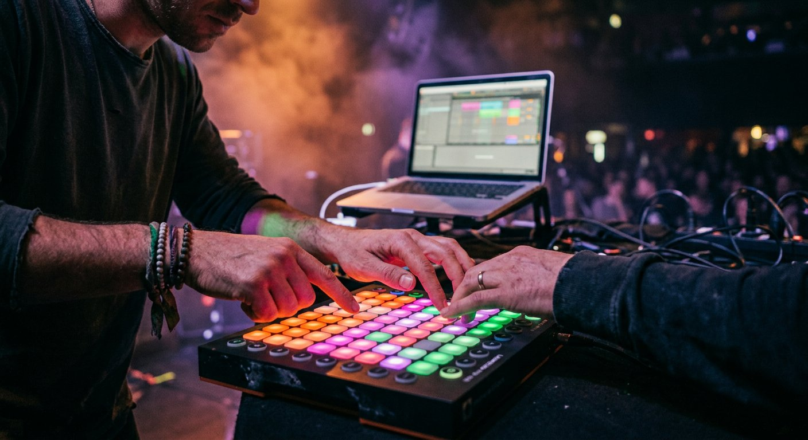

# livelooper

[English](README.md) | **Deutsch**

**livelooper ist ein Instrument, kein Rekorder.** Eine Loop-Station mit fünf oder acht Spuren für deine DAW – ein VST3- und Audio-Unit-Plug-in für alle kompatiblen Hosts (Ableton Live, Bitwig Studio, Cubase, Studio One, Reaper, FL Studio, Logic Pro, GarageBand …), zusätzlich als Standalone-App –, gebaut zum *Spielen*: eine Idee erforschen, schichten, verbiegen und live aufführen – mit den Händen auf einem **Ableton Push**, einem MIDI-Controller oder der Computertastatur und dem Blick beim Publikum statt auf dem Bildschirm.


## Die Idee

- **Live-Performance zuerst.** Jede Funktion reagiert sofort, landet auf dem Schlag und hält die Musik nie an. Beim Spielen braucht nichts ein Menü.
- **Erforschen und spielen.** Halte fest, was du gerade improvisiert hast, leg mit dem XY-Pad einen Effekt darauf, verstimm es, dreh es um, lass es ausklingen wie ein Band – und behalte, was funktioniert.
- **Hände an die Hardware.** Schließ einen Ableton Push an und livelooper übernimmt ihn – ohne Mapping. Jeder andere Controller funktioniert per MIDI Learn, alle 250 Funktionen sind zuweisbar.
- **Deine Loops gehören in deinen Song.** Zieh einen Loop direkt aus livelooper auf eine Spur in deiner DAW, exportiere Stems oder behalte alles im Projekt gespeichert.

## Spielen mit Ableton Push



Push (ab Version 1) anschließen, **User** drücken – und livelooper macht daraus eine eigene Looper-Oberfläche – im Plug-in in jeder DAW und in der Standalone-App, denn livelooper spricht Push direkt über dessen User-Port an:

- **Eine Pad-Spalte pro Spur**: REC / PLAY / DUB und STOP, die Loop-Position läuft als Licht die Spalte hoch, Farben zeigen den Status, Blinken heißt „wartet auf den Takt“
- **Encoder** für Pegel, Panorama, Tonhöhe, Feedback oder Effekte, eine **Master-Sektion** (Gesamtpegel, Tempo) und Swing auf dem Swing-Encoder
- **Szenen** auf den Szenen-Tasten, **Capture**, Undo, Metronom, Tap-Tempo, **DELETE + Pad** löscht eine Spur
- **FX-XY-Pad**: Das 8×8-Raster wird zum Performance-Pad – anfassen, schieben, loslassen, und es springt zurück
- **Display** mit Namen, Werten, Spurstatus und Tempo

Einrichtung und komplette Belegung: **[PUSH.md](docs/de/PUSH.md)**.

## Funktionen

**Performance**
- **5 oder 8 Loop-Spuren**: REC → DUB → PLAY auf einem Pad, STOP (halten = löschen), Undo/Redo, Reverse, One-Shot, Pegel, Panorama
- **Szenen**: 8 Szenen-Knöpfe starten und stoppen Spurgruppen im Takt
- **Capture**: Die zuletzt gespielten 1–8 Takte werden nachträglich zum Loop – ganz ohne Aufnahme-Taste
- **Auto-Aufnahme**: Scharf geschaltete Spuren starten mit dem ersten Ton über einer Schwelle – die Hände bleiben am Instrument
- **Quantisierung** auf Takt oder Schlag; „zu spät“ gedrückt wird bis 15 % nach dem Taktstrich korrigiert; feste Längen 1–16 Takte oder frei
- **Start-/Stopp-Modi**: sofort, Fade-In/-Out, Stopp am Loop-Ende; Overdub oder Replace
- **Geister-Abspielmarke**: Gestoppte Spuren zeigen, wo sie gerade wären – so holst du sie punktgenau zurück
- **Ableton Push**, **MIDI Learn** für jeden Controller (Rechtsklick auf ein Bedienelement) und **Computertastatur** in der Standalone-App

**Klang formen**
- **Input-FX und Track-FX**: je vier Slots mit 12 Effekten – Tiefpass, Hochpass, Bandpass, Phaser, Flanger, Delay (tempo-synchron), Hall, Slicer, Tremolo, Auto-Pan, Lo-Fi, Overdrive
- **Pro Spur**: Feedback (Ausklingen wie ein Band), Sidechain-Ducking, Tonhöhe ±12 Halbtöne, Tempo folgen (Time-Stretch, Signalsmith Stretch), Resample der anderen Spuren
- **Rhythmus**: 4 Kits (Studio, 808, 909, Lo-Fi), 21 Grooves von Rock bis Trap, Dembow, UK Garage und Afro House, Swing und Feel; Metronom mit 4 Klängen

**Arbeiten mit deiner DAW**
- **Synchron zur DAW**: Host-Tempo, Taktart und Transport – oder interne Clock mit Tap-Tempo / eingetipptem Tempo
- **Loops in die DAW ziehen**: Zieh die Wellenform einer Spur auf eine Audiospur oder in den Browser der DAW – eine WAV mit Tempo-Infos (ACID-Metadaten), die die meisten DAWs direkt ins Raster legen
- **Stem-Export** mit Tempo-Metadaten, WAV-Export pro Spur, Audiodateien per Drag & Drop auf eine Spur importieren
- **Direkte Spurausgänge** (Plug-in Multi-Out – jede Spur als eigener Ausgang in deiner DAW – oder Interface-Ausgänge in der Standalone-App), **Cue-Ausgang** für das Metronom
- **Mit dem Projekt gespeichert**: Loops verlustfrei (FLAC, 24 Bit) im DAW-Projekt; komplette **Looper-Sets** als `.llset`-Datei
- **Pegel und Wellenformen**: Stereo-Pegel pro Spur, Master-Pegel, Wellenform mit Abspielposition, Clip-LED
- **Alle 250 Funktionen** sind Host-Parameter für MIDI-Mapping und Automation deiner DAW
- **Deutsche und englische** Oberfläche (*SETUP → Language / Sprache*)

## Welche DAWs?

livelooper läuft in jedem Host, der **VST3**-Plug-ins (Windows und macOS) oder **Audio Units** (macOS) lädt – zum Beispiel Ableton Live, Bitwig Studio, Cubase, Studio One, Reaper, FL Studio (VST3), Logic Pro und GarageBand (AU) – und als **Standalone-App** ganz ohne DAW. Es ist ein Audio-Effekt mit MIDI-Eingang: auf eine Audiospur setzen, und es folgt Tempo und Transport des Hosts.

## Warum ein natives Plug-in?

livelooper ist ein JUCE-Plug-in (C++). Als natives Plug-in läuft es in jedem VST3-/AU-Host, statt an eine DAW oder eine bestimmte Edition gebunden zu sein, die Audio-Engine läuft sample-genau und echtzeitsicher in nativem Code, und es ist automatisiert testbar.

## Schnellstart

1. Plug-in installieren – siehe [Installation](docs/de/INSTALLATION.md)
2. In deiner DAW eine Audiospur mit deinem Mikro/Instrument als Eingang anlegen, das Eingangs-Monitoring einschalten und **livelooper** (VST3 oder AU) auf die Spur setzen – in Ableton Live zum Beispiel: Monitor auf **In**, dann livelooper aus *Plug-ins* auf die Spur ziehen. Oder einfach die Standalone-App starten.
3. Das große REC/PLAY-Pad von Spur 1 klicken: Aufnahme startet auf dem nächsten Takt, nochmal klicken: Loop läuft

Alles Weitere steht in der **[Bedienungsanleitung](docs/de/BEDIENUNGSANLEITUNG.md)**, die MIDI-Steuerung in **[MIDI](docs/de/MIDI.md)**.

## Dokumentation

| Dokument | Inhalt |
|---|---|
| [INSTALLATION.md](docs/de/INSTALLATION.md) | Download, Installation auf macOS und Windows, Einrichtung in deiner DAW (mit Ableton Live als Beispiel) |
| [BEDIENUNGSANLEITUNG.md](docs/de/BEDIENUNGSANLEITUNG.md) | Oberfläche, alle Funktionen, Effekte, Rhythmus, Setup, Sprache |
| [MIDI.md](docs/de/MIDI.md) | MIDI-Learn, MIDI-Mapping deiner DAW, Standard-Belegung, Parameterliste |
| [PUSH.md](docs/de/PUSH.md) | Steuerung mit Ableton Push (in jeder DAW und standalone): Einrichtung, Pad-Belegung, Encoder, FX-XY-Pad |
| [ENTWICKLUNG.md](docs/de/ENTWICKLUNG.md) | Bauen aus dem Quellcode, Architektur, Tests, CI, Übersetzungen |

Englische Dokumentation: [docs/en](docs/en/).

## Selbst bauen

```bash
cmake -S . -B build -DCMAKE_BUILD_TYPE=Release
cmake --build build --config Release
ctest --test-dir build -C Release --output-on-failure
```

JUCE 8 wird beim Konfigurieren automatisch geladen. Details in [ENTWICKLUNG.md](docs/de/ENTWICKLUNG.md).

## Lizenz

Für den livelooper-Quellcode ist noch keine Lizenz festgelegt. livelooper basiert auf dem JUCE-Framework, das unter AGPLv3 oder einer kommerziellen JUCE-Lizenz steht – bei Weitergabe von Binärdateien gelten deren Bedingungen.

Ableton, Push und alle anderen genannten Produktnamen sind Marken ihrer jeweiligen Inhaber; livelooper steht in keiner Verbindung zu ihnen und wird nicht von ihnen unterstützt.

Fremdcode in `third_party/`: [Signalsmith Stretch](https://github.com/Signalsmith-Audio/signalsmith-stretch) und Signalsmith Linear (Time-Stretch / Tonhöhe), beide unter MIT-Lizenz – siehe deren `LICENSE.txt`.
