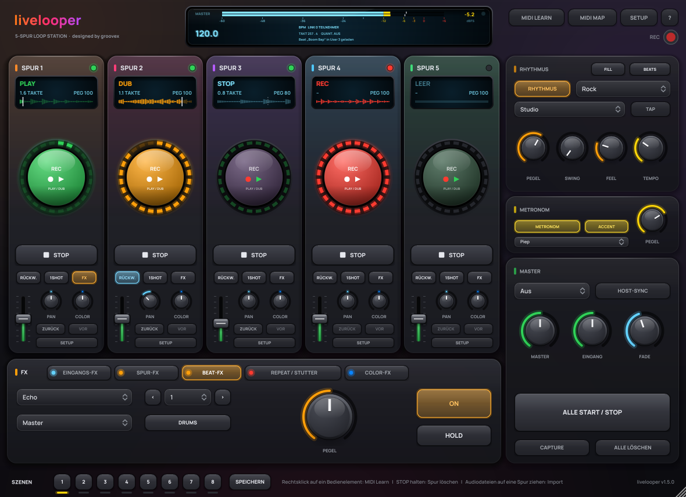
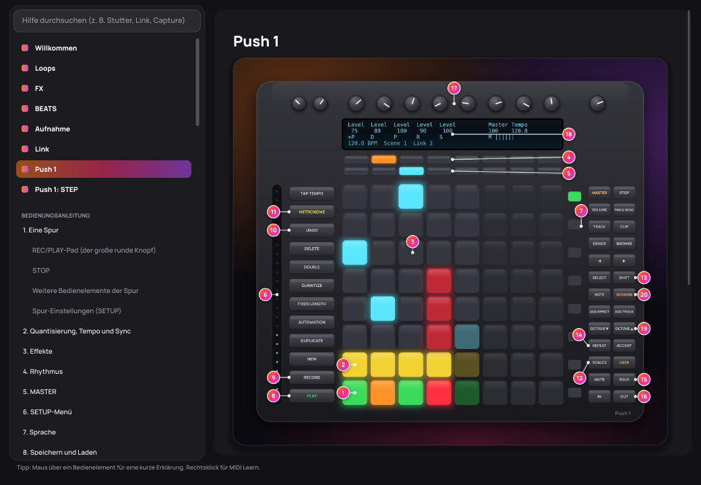
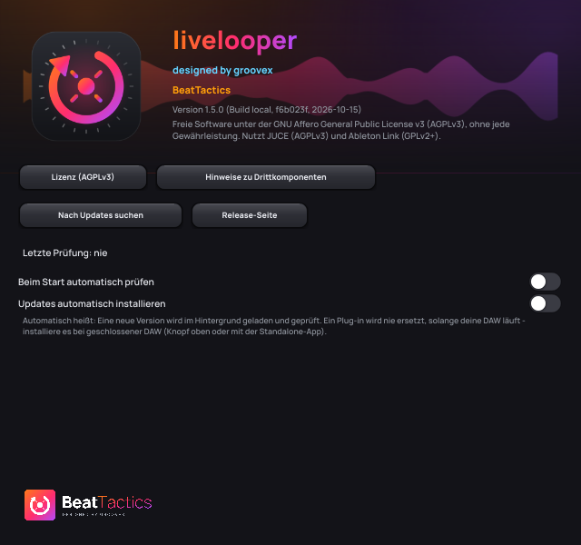

# Bedienungsanleitung

[English](../en/USER-GUIDE.md) | **Deutsch**

livelooper ist als **Instrument zum Erforschen und Live-Spielen** gebaut: Jedes Bedienelement reagiert sofort und landet auf dem Schlag, und alles lässt sich mit einem [Ableton Push](PUSH.md), jedem MIDI-Controller oder der Computertastatur spielen. Tipps fürs Live-Spielen stehen in Abschnitt 23. Wie du das Plug-in in deine DAW einbindest (Looper-Spur, Monitoring, Software-Instrumente loopen, Quellen wechseln), steht in [DAW-EINRICHTUNG.md](DAW-EINRICHTUNG.md).

Die Oberfläche ist wie ein Hardware-Looper aufgebaut. Die Bezeichnungen in dieser Anleitung entsprechen der deutschen Oberfläche; bei englischer Oberfläche steht die englische Bezeichnung in Klammern (siehe auch [Kapitel 7](#7-sprache) und die [Übersicht am Ende](#16-bezeichnungen-deutsch--englisch)).

| Bereich | Inhalt |
|---|---|
| Kopfzeile | Display (Tempo, Takt/Schlag, Quantisierung, Link, Master-VU in dB, Meldungen), **MIDI LEARN**, **MIDI MAP**, **SETUP**, **?** (Hilfe) |
| EINGANGS-FX (links) | vier Effekt-Slots A–D für das Eingangssignal |
| … BEARBEITEN (Mitte) | Effekttyp und Regler des gerade gewählten Slots |
| SPUR-FX (rechts) | vier Effekt-Slots A–D für die Spuren mit eingeschaltetem **FX** |
| Performance-Reihe (seit 1.5) | **BEAT-FX**, **BEAT REPEAT / STUTTER**, **COLOR-FX**, **METRONOM** (Abschnitte 25–28) |
| SPUR 1–5 (oder 1–8) | die Loop-Spuren (SETUP → Spuren) |
| RHYTHMUS | Drumcomputer, Tempo, Tap |
| MASTER | Quantisierung, Host-Sync, Pegel, Fade-Zeit, ALLE START / STOP, CAPTURE, ALLE LÖSCHEN |
| Fußleiste | 8 Szenen-Knöpfe, SPEICHERN |

Das Fenster lässt sich an der rechten unteren Ecke größer und kleiner ziehen; die Oberfläche skaliert mit. Fährt man mit der Maus über ein Element, erscheint ein Hinweis.

---

## 1. Eine Spur

### REC/PLAY-Pad (der große runde Knopf)

| Zustand der Spur | Druck auf REC/PLAY |
|---|---|
| leer | **Aufnahme** startet (mit Quantisierung auf dem nächsten Takt/Schlag) |
| Aufnahme | Aufnahme endet → **Overdub** (Standard „Rec > Dub") bzw. **Play** („Rec > Play") |
| Overdub | → **Play** |
| Play | → **Overdub** |
| gestoppt | → **Play** (quantisiert) |
| wartet (blinkt) | erneuter Druck bricht das Warten ab |

Der LED-Ring zeigt den Zustand und die Position im Loop:

- **rot** Aufnahme · **orange** Overdub · **grün** Play · **grün gedimmt** gestoppt, Loop vorhanden · **aus** leer
- **blinkend**: wartet auf den nächsten Takt (Aufnahme, Start oder Aufnahme-Ende)
- die hellen Segmente laufen im Kreis und zeigen die Wiedergabeposition

### STOP

- kurzer Druck: Spur stoppt (je nach **Stop**-Modus sofort, mit Ausblenden oder am Loop-Ende)
- Druck während der Aufnahme: die Aufnahme wird beendet und die Spur gestoppt
- **1,5 s halten: Spur löschen** (der rote Balken zeigt den Fortschritt)

### Weitere Bedienelemente der Spur

| Element | Funktion |
|---|---|
| Display | Zustand (LEER, REC, DUB, PLAY, STOP, … WARTET), Länge in Takten, Pegel (PEG), Fortschrittsbalken |
| **RÜCKW.** (REV) | Loop rückwärts abspielen (auch beim Overdub) |
| **1SHOT** | Loop einmal abspielen, dann stoppen |
| **FX** | Spur durch die Spur-FX schicken |
| Fader | Pegel 0–200 % (Doppelklick = 100 %), daneben die Pegelanzeige |
| **PAN** | Panorama L50–R50 (Doppelklick = Mitte) |
| **ZURÜCK / VOR** (UNDO / REDO) | letzten Overdub zurücknehmen / wiederherstellen. ZURÜCK direkt nach der ersten Aufnahme leert die Spur, VOR holt sie zurück |
| **SETUP** | Spur-Einstellungen (Bild oben) |

### Spur-Einstellungen (SETUP)

| Einstellung | Werte | Bedeutung |
|---|---|---|
| Eingang (Input) | Stereo · Links · Rechts | welcher Eingangskanal aufgenommen wird (Links/Rechts = mono auf beide Seiten) |
| Start | Sofort · Einblenden | Wiedergabestart sofort oder mit Einblendung (Fade-Zeit im MASTER) |
| Stop | Sofort · Ausblenden · Loop-Ende | Stopp sofort, mit Ausblendung oder am Ende des Loops |
| Dub-Modus (Dub mode) | Overdub · Ersetzen | beim Overdub hinzufügen oder ersetzen |
| Takte (Measures) | Auto · 1 · 2 · 4 · 8 · 16 | Auto = Länge durch zweiten Druck; feste Zahl = Aufnahme endet automatisch nach so vielen Takten |
| LOOP-SYNC | an/aus | Loop bleibt fest am Taktraster: nach dem Spulen in der DAW oder beim Neustart läuft er an der passenden Stelle weiter |
| LÖSCHEN (CLEAR) | | Spur löschen |
| WAV EXPORT | | Loop als 24-Bit-WAV speichern |
| IMPORT | | Audiodatei (WAV, AIFF, FLAC, OGG, MP3) in die Spur laden. Schneller: Datei per Drag & Drop auf die Spur ziehen |

---

## 2. Quantisierung, Tempo und Sync

**Quantisierung** (Auswahlfeld im MASTER, im Display „QUANT."):

- **Takt** (Measure, Standard): Aufnahme-Start, Aufnahme-Ende und Wiedergabestart passieren auf dem nächsten Taktstrich. Loops sind damit immer ganze Takte lang.
- **Schlag** (Beat): dasselbe auf Viertel-Schlägen.
- **Aus** (Off): alles sofort, freie Loop-Länge (auf das Sample genau zwischen den beiden Drücken).

**Rückwirkendes Beenden**: Wer das Ende einer Aufnahme bis zu 15 % eines Rasterschritts *nach* dem Taktstrich drückt, bekommt den Loop trotzdem exakt am Taktstrich beendet – das Gespielte nach dem Taktstrich wird an den Anfang des Loops (in den Overdub) übernommen. Wer zu früh drückt, wartet einfach auf den Taktstrich.

**HOST-SYNC** (Standard an): Tempo, Taktart und Position kommen von deiner DAW. Läuft der Host-Transport nicht, läuft eine interne Clock im aktuellen Host-Tempo weiter, sobald eine Spur aufnimmt oder spielt. Ohne Host-Sync gilt das interne Tempo (Regler **TEMPO**, **TAP** mehrfach im Takt antippen, oder auf das Tempo im Display klicken und eintippen – siehe Abschnitt 11).

**Host-Transport folgen** (SETUP-Menü): Loops starten mit der Play-Taste deiner DAW und stoppen mit ihrer Stop-Taste.

Hinweis: Ändert sich das Tempo, nachdem ein Loop aufgenommen wurde, wird der Loop nicht zeitgedehnt – er spielt in seiner Originalgeschwindigkeit weiter.

---

## 3. Effekte

Es gibt zwei Effektbänke mit je vier Slots:

- **EINGANGS-FX** (INPUT FX) bearbeiten das Eingangssignal – was du hörst, wird so auch aufgenommen.
- **SPUR-FX** (TRACK FX) bearbeiten alle Spuren, bei denen **FX** eingeschaltet ist (gemeinsamer Effektweg), ohne die Aufnahme zu verändern.

Der Knopf **A/B/C/D** schaltet den Slot ein und aus und wählt ihn gleichzeitig zum Bearbeiten aus; ein Klick auf den Effektnamen darunter wählt ihn nur aus. Im Feld **… BEARBEITEN** stellst du Typ, zwei Parameter und Mix ein. Die Slots einer Bank sind in Reihe geschaltet (A → B → C → D).

| Effekt (englisch) | P1 | P2 | Mix |
|---|---|---|---|
| Tiefpass / Hochpass / Bandpass (LPF / HPF / BPF) | Cutoff | Reso(nanz) | Dry/Wet |
| Phaser | Tiefe | Rate (0,05–5 Hz) | Dry/Wet |
| Flanger | Feedback | Rate | Dry/Wet |
| Delay | Feedback | Zeit: 1/16 · 1/8 · 1/8. · 1/4 · 1/4. · 1/2 (tempo-synchron) | Pegel (Echo) |
| Hall (Reverb) | Größe | Dämpfung | Pegel (Hall) |
| Slicer | Tiefe | Muster (8 Rhythmen in 16teln) | Dry/Wet |
| Tremolo | Tiefe | Rate: 1 Takt … 1/32 (tempo-synchron) | Dry/Wet |
| Auto-Pan | Tiefe | Rate (tempo-synchron) | Dry/Wet |
| Lo-Fi | Bits (16 → 3 Bit) | Rate (Sample-Rate-Reduktion) | Dry/Wet |
| Overdrive | Drive | Klang | Dry/Wet |

Ein- und Ausschalten wird ohne Knackser überblendet.

---

## 4. Rhythmus

**RHYTHMUS** schaltet den Drumcomputer ein, daneben wird das Muster gewählt: Metronom, Rock, Pop, Funk, Hip Hop, House, Techno, Breakbeat, Reggae, Bossa, Shuffle, Half Time, Trap, Lo-Fi, Drum & Bass, Afrobeat, Dembow, UK Garage, Neo Soul, Disco, Afro House. Der Rhythmus ist fest mit dem Taktraster verbunden (Host oder interne Clock) und wird nicht mit aufgenommen. Beim Metronom ist die Eins betont.

| Regler | Funktion |
|---|---|
| **Kit** | **Studio** (straffes, modernes akustisches Kit), **808** (tiefe Boom-Kick, knackige Hi-Hats), **909 Style** (druckvoll für House / Techno), **Lo-Fi** (warm, staubig, weiche Höhen) – alle vier spielen aufgenommene Drum-Samples (CC0 / gemeinfrei, siehe [THIRD-PARTY.md](../../THIRD-PARTY.md)) mit mehreren Anschlagstufen und Round Robin |
| **PEGEL** | Lautstärke des Rhythmus |
| **SWING** | verzögert jede zweite Sechzehntel. 50 % = gerade, 54–58 % = leichter Groove, 66 % = Triolen-Shuffle, 75 % = maximal. Tipp: Hip Hop / Lo-Fi 56–60 %, UK Garage 60–64 %, Neo Soul 60–66 % |
| **FEEL** | Humanisierung: kleine Schwankungen im Timing (ein paar ms später, nie früher) und in der Anschlagstärke. 0 % = maschinengenau |
| **TEMPO / TAP** | internes Tempo |

Jedes Muster hat Akzente und Ghost-Notes, Hi-Hat-Rolls (Trap) und Percussion (Rimshot, Shaker, Tom). Snare, Clap und Rimshot klingen in einem kurzen Raum. Das Metronom wird nie geswingt.

Die Kit-Namen beschreiben einen Klangstil; „909 Style“ und „808“ sind nicht die Original-Geräte und bedeuten keine Unterstützung durch einen Hersteller.

**Groove** (*SETUP → Rhythmus-Groove*, seit 1.5): das Gefühl eines Drummers – kleine, feste Timing-Verschiebungen pro Instrument und eine Akzentkurve, zusätzlich zu SWING und FEEL:

| Groove | Gefühl |
|---|---|
| Gerade (Straight) | maschinengenau |
| Natürlich (Natural, Standard) | ein paar ms menschliche Lockerheit, beim Backbeat leicht dahinter |
| Laid Back | Snare und Hi-Hats deutlich hinter dem Schlag – Hip Hop, Neo Soul |
| Treibend (Pushed) | alles leicht vor dem Schlag – drängend, nach vorn |
| Drunk | locker, wackelig, hinter dem Schlag (wie späte Beat-Tapes) |
| Drive | Kick und Hi-Hats auf dem Schlag – Rock, Techno |

**Fills** (*SETUP → Rhythmus-Fills*): *Aus*, *Alle 4 Takte* oder *Alle 8 Takte* – der Drummer spielt im letzten Schlag vor der nächsten Phrase einen kurzen Fill (Snare- / Tom-Lauf).

---

## 5. MASTER

| Element | Funktion |
|---|---|
| Quantisierung | Aus · Schlag · Takt |
| HOST-SYNC | Tempo/Transport vom Host übernehmen |
| MASTER | Gesamtpegel 0–200 % |
| EINGANG (INPUT) | Pegel des direkt durchgeschleiften Eingangs 0–200 % (die Aufnahme ist davon unabhängig) |
| FADE | Fade-Zeit für Ein-/Ausblenden (10 ms – 8 s) |
| ALLE START / STOP | läuft irgendeine Spur: alle stoppen; sonst alle Spuren mit Loop starten (quantisiert) |
| ALLE LÖSCHEN | alle Spuren löschen (mit Rückfrage) |
| CAPTURE | die letzten 1–32 Takte werden ein Loop (Abschnitt 16) |

---

## 6. SETUP-Menü

| Eintrag | Bedeutung |
|---|---|
| Aufnahme-Aktion (Record action) | „Rec > Dub > Play" (Standard) oder „Rec > Play > Dub". Die Beschriftung der REC-Taste („DUB / PLAY" bzw. „PLAY / DUB") und die unterste Displayzeile zeigen den aktiven Modus. |
| Host-Transport folgen | Loops starten/stoppen mit dem Host-Transport |
| Maximale Loop-Länge | 30 · 60 · 120 · 240 · 480 Sekunden pro Spur (bestimmt den Speicherbedarf; vorhandene Loops bleiben erhalten) |
| Loops im Projekt speichern | Loops im DAW-Projekt speichern (Standard an). Aus = kleinere Projekte, die Loops sind nach dem Laden weg |
| Steuerung mit der Computertastatur | nur Standalone-App: Tasten an/aus (Abschnitt 10) |
| Tastaturbelegung … | nur Standalone-App: eigene Tastenbelegung (Abschnitt 10) |
| Tempo eintippen (BPM) … | internes Tempo eintippen (Abschnitt 11) |
| Language / Sprache | Automatisch (Systemsprache) · English · Deutsch |
| Zuletzt verwendete Sets | die letzten 10 gespeicherten oder geladenen Sets, ein Klick lädt (Abschnitt 13) |
| Capture-Länge | 1 · 2 · 4 · 8 · 16 · 32 Takte (Abschnitt 16) |
| Rhythmus-Groove / Rhythmus-Fills | Gefühl und Fills des Drumcomputers (Abschnitt 4) |
| Ableton Link | Link an / aus, Start / Stopp synchronisieren, Anzahl Teilnehmer (Abschnitt 29) |
| Einstellungen beim Start | mit den zuletzt verwendeten oder den Standard-Einstellungen starten, jetzt zurücksetzen (Abschnitt 31) |
| Updates | jetzt prüfen, automatisch prüfen, automatisch installieren (Abschnitt 32) |
| Hilfe … / Über livelooper … | Hilfe in der App und Info-Fenster (Abschnitte 30 und 32) |

---

## 7. Sprache

Die gesamte Oberfläche – Knöpfe, Displays, Menüs, Hinweise, Dialoge und Parameternamen – gibt es auf Deutsch und Englisch.

- **SETUP → Language / Sprache → Automatisch** (Standard): Deutsch, wenn das Betriebssystem auf Deutsch eingestellt ist, sonst Englisch.
- **English** oder **Deutsch** legt die Sprache fest. Die Wahl wird auf diesem Rechner gespeichert und gilt für alle livelooper-Instanzen, in deiner DAW und in der Standalone-App.
- Die Oberfläche wechselt sofort. Die Parameternamen, die deine DAW anzeigt (Gerät, MIDI-Mapping, Automation), liest sie beim Laden des Plug-ins – sie wechseln nach dem Neuladen (z. B. Projekt neu öffnen). Bestehende MIDI-Zuweisungen und Automationen bleiben erhalten.

---

## 8. Speichern und Laden

Mit dem DAW-Projekt werden gespeichert: alle Parameter, die MIDI-Zuweisungen und – wenn eingeschaltet – die Loops (verlustfrei als FLAC, 24 Bit). Beim Laden sind die Spuren gestoppt und starten mit REC/PLAY oder ALLE START. Wechselt die Samplerate des Projekts, werden die Loops automatisch umgerechnet.

## 9. Display

- große Zahl: aktuelles Tempo – anklicken, um die BPM einzutippen
- oberste Reihe: **Master-VU** des Hauptausgangs in dBFS, links und rechts, mit Skala von -60 bis +6 dB und dem Spitzenwert als Zahl – grün bis -12 dB, gelb bis -3 dB, orange bis 0 dB, rot darüber (Abschnitt 12)
- Zeile 1: Tempoquelle (HOST, INTERN, interne Clock) und **Link**-Status: *LINK 2 TEILNEHMER*, solange Link das Tempo vorgibt, *LINK: HOST-SYNC ZUERST*, wenn in einer DAW HOST-SYNC Vorrang hat
- Zeile 2: Takt . Schlag und Quantisierung
- Zeile 3: Meldungen (Export, Import, MIDI Learn) oder der Speicher pro Spur
- Punkt oben rechts: leuchtet gelb bei eingehenden MIDI-Daten

---

## 10. Computertastatur (Standalone-App)

In der Standalone-App spielt die Computertastatur livelooper wie ein Hardware-Gerät – ideal am MacBook ohne Controller. In einer DAW gehört die Tastatur der DAW, deshalb ist das eine Standalone-Funktion (dort gibt es MIDI und die eigenen Tastaturbefehle bzw. Tastaturzuweisung der DAW).

Standardbelegung – eine Tastaturspalte pro Spur:

| Taste | Funktion |
|---|---|
| **1 2 3 4 5** (6 7 8) | REC/PLAY Spur 1–5 (6–8) |
| **Q W E R T** (Y U I) | STOP Spur 1–5 (6–8) |
| **Shift + Q … T** | Spur 1–5 LÖSCHEN – Taste 1,5 s halten, wie die STOP-Taste (kurzes Antippen löscht nicht) |
| **A S D F G** (H J L) | ZURÜCK (Undo) Spur 1–5 (6–8) |
| **Shift + A … G** | VOR (Redo) Spur 1–5 |
| **Leertaste** | ALLE START / STOP |
| **Shift + Rücktaste** | ALLE LÖSCHEN (mit Rückfrage) |
| **Eingabe (Return)** | TAP-Tempo |
| **B** | Tempo eintippen (BPM) |
| **Pfeil hoch / runter** | Tempo +1 / −1 BPM (mit Shift: ±0,1) |
| **M** | RHYTHMUS an/aus |
| **N** | nächstes Rhythmus-Pattern |
| **K** | nächste Quantisierung |

Das Display zeigt kurz, welche Taste was ausgelöst hat (z. B. `TASTE Q > S1 STOP`). Gehaltene Tasten wiederholen nicht – außer Tempo hoch/runter.

**Eigene Belegung:** *SETUP → Tastaturbelegung …* listet alle Funktionen (alle Spurfunktionen inkl. Rückwärts, One-Shot, Loop-Sync und FX, alle globalen Funktionen, FX-Slots A–D, Tempo). Funktion anklicken, neue Taste drücken – Shift, Strg, Option und Cmd zählen mit. Eine bereits belegte Taste wandert zur neuen Funktion. Esc bricht ab, Rechtsklick entfernt eine Taste, **STANDARD** stellt die Tabelle oben wieder her, **ALLE ENTFERNEN** leert sie, **TASTATURSTEUERUNG** schaltet die Tastatursteuerung an/aus (auch *SETUP → Steuerung mit der Computertastatur*). Die Belegung wird mit dem Zustand der App gespeichert.

## 11. Tempo eintippen

Auf die große Tempo-Zahl im Display klicken (oder **B** drücken, oder Rechtsklick auf den TEMPO-Regler → *Tempo eintippen (BPM) …*, oder *SETUP → Tempo eintippen (BPM) …*), BPM eintippen, Eingabe drücken. Nachkommastellen gehen mit Punkt oder Komma (`97.5`, `97,5`); Bereich 40–300 BPM, Esc bricht ab. Der Wert setzt das interne Tempo – solange HOST-SYNC einem laufenden Host folgt, bestimmt weiter das Host-Tempo.

---

## 12. Pegelanzeigen, Wellenform und Clip-LED

- **Spur-Pegel** (Stereo, neben dem Fader): Während eine Spur aufnimmt oder overdubbt, zeigt er den **Eingangspegel** (orange, Beschriftung **IN**), sonst den **Ausgangspegel** der Spur (grün, **OUT**). Gelb ab -12 dB, rot ab -1 dB; der dünne Strich hält die Spitze etwa eine Sekunde.
- **Master-VU** (seit 1.5): Die oberste Zeile im Display (**MASTER**) zeigt den Pegel des Hauptausgangs in dBFS, links und rechts, auf einer Skala von -60 bis +6 dB, rechts den Spitzenwert als Zahl. Grün bis -12 dB, gelb bis -3 dB, orange bis 0 dB, rot darüber – laute Stellen am besten im Gelben halten.
- **Wellenform**: Das Spur-Display zeigt statt eines Fortschrittsbalkens eine Übersicht des Loops. Der schon gespielte Teil ist hell, ein weißer Strich markiert die Abspielposition. Bei der Aufnahme wächst die Wellenform von links nach rechts; Overdubs und Undo sind sofort sichtbar. Bei REVERSE wird sie gespiegelt.
- **Clip-LED** (oben rechts an jeder Spur): aus = leer, grün = Spur enthält einen Loop, rot = erste Aufnahme läuft, rot blinkend = wartet auf den nächsten Takt, um aufzunehmen.

## 13. Looper-Sets

Ein Set speichert den kompletten Looper in einer Datei (`.llset`): alle Loops, Pegel, Pan, Spur-Einstellungen, Effekte, Rhythmus, Tempo und Quantisierung.

- **SETUP → Set speichern ...** schreibt ein Set (ein Set enthält immer seine Loops, auch wenn *Loops mit dem Projekt speichern* aus ist).
- **SETUP → Set laden ...** lädt eins; alternativ eine `.llset`-Datei auf das Fenster ziehen.
- MIDI-Zuweisungen, Tastatur-Belegung und Cue-Routing gehören zur App und bleiben beim Laden eines Sets erhalten.
- **SETUP → Zuletzt verwendete Sets** listet die letzten 10 gespeicherten oder geladenen Sets (nicht mehr vorhandene Dateien fallen weg); *Liste leeren* leert sie.

## 14. Cue-Ausgang (Standalone-App)

Die Standalone-App hat einen zweiten Ausgangsbus für **Rhythmus und Metronom**: Du hörst den Click im Kopfhörer, das Publikum nicht.

1. Unter **Audio-/MIDI-Einstellungen** (oben links im Fenster) die zusätzlichen Ausgänge des Audio-Interfaces aktivieren (Ausgang 3 und höher).
2. **SETUP → Cue-Ausgang (Click / Rhythmus)**: Ausgangspaar wählen (z. B. *Ausgänge 3 / 4*) und festlegen, wo der Rhythmus spielt: **Hauptausgang**, **Nur Cue-Ausgang** oder **Haupt- und Cue-Ausgang**.

Ohne Cue-Paar (und im Plug-in) spielt der Rhythmus immer auf dem Hauptausgang – der Click geht also nie verloren. Die Einstellung wird mit der App gespeichert.

## 15. Metronomklang

**SETUP → Metronomklang** (oder das Klang-Menü im **METRONOM**-Block, Abschnitt 28): **Piep** (klassisch), **Holzblock** (kurzer, hölzerner Schlag), **Klick** (trockener Tick ohne Tonhöhe) oder **Rimshot**.

## Bezeichnungen Deutsch / Englisch

| Deutsch | English |
|---|---|
| SPUR | TRACK |
| EINGANGS-FX / SPUR-FX | INPUT FX / TRACK FX |
| BEARBEITEN | EDIT |
| RHYTHMUS · Muster | RHYTHM · Pattern |
| ALLE START / STOP · ALLE LÖSCHEN | ALL START / STOP · CLEAR ALL |
| HOST-SYNC | HOST SYNC |
| RÜCKW. | REV |
| ZURÜCK / VOR | UNDO / REDO |
| LÖSCHEN · WAV EXPORT | CLEAR · EXPORT WAV |
| Pegel · Eingang | Level · Input |
| Quantisierung: Aus · Schlag · Takt | Quantize: Off · Beat · Measure |
| Sofort · Einblenden · Ausblenden · Loop-Ende | Immediate · Fade In · Fade Out · Loop End |
| Dub-Modus: Overdub · Ersetzen | Dub mode: Overdub · Replace |
| Takte | Measures |
| LEER · STOPPT · WARTET · ENDE · GELÖSCHT | EMPTY · STOPPING · WAIT · END · CLEARED |
| BEAT-FX · Kanal · PEGEL | BEAT FX · Channel · LEVEL |
| COLOR-FX | COLOR FX |
| METRONOM · BETONUNG | METRONOME · ACCENT |
| Einstellungen beim Start | Settings on start |
| Zuletzt verwendete Sets | Last used sets |

## 16. Capture (rückwirkende Aufnahme)

Du hast etwas Gutes gespielt, ohne Aufnahme zu drücken? Drück **CAPTURE** (MASTER-Bereich). Die zuletzt gespielten Takte werden ein Loop auf der ersten leeren Spur und laufen sofort im Takt weiter. Die Länge stellst du unter **SETUP → Capture-Länge** ein (1, 2, 4, 8, 16 oder 32 Takte; am Push: FIXED LENGTH). Wurde weniger gespielt, nimmt livelooper die größte Länge, die passt. Im SETUP jeder Spur gibt es außerdem einen **CAPTURE**-Knopf für genau diese Spur. **UNDO** entfernt einen Capture-Loop wieder.

## 17. Auto-Aufnahme

**SETUP → Auto-Aufnahme**: Scharf geschaltete Spuren (REC gedrückt, Anzeige **AUTO REC**) warten, bis das Eingangssignal die Schwelle überschreitet (-50 bis -12 dB), und starten mit dem ersten Ton. So bleiben die Hände am Instrument. Erneutes Drücken von REC bricht ab.

## 18. Spur-Einstellungen: Feedback, Ducking, Tonhöhe, Tempo folgen, Ausgang

| Einstellung | Bedeutung |
|---|---|
| **FEEDBACK** | wie viel vom Loop bei jedem Overdub-Durchlauf erhalten bleibt. 100 % = alles (klassisches Overdub), kleinere Werte lassen ältere Schichten wie bei einem Bandecho ausklingen |
| **DUCKING** | senkt die Spur ab, während die Ducking-Quelle spielt (**SETUP → Ducking-Quelle**: Kick des Rhythmus oder Spur 1). Ergibt pumpende Sidechain-Grooves |
| **TONHÖHE** | -12 bis +12 Halbtöne, die Länge bleibt gleich |
| **TEMPO FOLGEN** | der Loop folgt Tempoänderungen (Host oder intern), ohne seine Tonhöhe zu ändern (Time-Stretch) |
| **AUSGANG** | Haupt · Direkt · Haupt + Direkt: wo die Spur zu hören ist (Abschnitt 20) |
| **Eingang → Resample** | die Spur nimmt die Summe der anderen Spuren auf (Bounce): Loops auf einer Spur zusammenfassen und die anderen frei machen |

## 19. Szenen

In der Fußleiste gibt es **8 Szenen-Knöpfe**. Ein leerer Szenen-Knopf speichert beim ersten Drücken, welche Spuren gerade spielen. Eine gespeicherte Szene startet ihre Spuren und stoppt die anderen, quantisiert auf den nächsten Takt oder Schlag. **SPEICHERN** + Szenen-Knopf überschreibt eine Szene. Eine schwache LED zeigt eine gespeicherte Szene, eine helle die zuletzt aufgerufene. Szenen werden mit dem Projekt und in Sets gespeichert und lassen sich per MIDI steuern.

## 20. Direkte Spurausgänge

- **Plug-in**: livelooper hat pro Spur einen optionalen Stereo-Ausgang („Track 1“ … „Track 8“). Aktiviere ihn in deiner DAW (jede Spur bekommt dort dann einen eigenen Ausgang), in Ableton Live zum Beispiel über eine zweite Audiospur mit *Audio von: livelooper → Track 1*.
- **Standalone-App**: **SETUP → Direkte Spurausgänge** weist jeder Spur ein Ausgangspaar des Audio-Interfaces zu (ab Ausgang 3/4, nicht das Cue-Paar).
- Im Spur-SETUP legt **AUSGANG** fest: *Haupt*, *Direkt* (nur der direkte Ausgang) oder *Haupt + Direkt*. Ohne aktiven direkten Ausgang spielt die Spur immer auf dem Hauptausgang.
- Weitere Wege, Audio aus livelooper in die DAW zu holen: [DAW-EINRICHTUNG.md, Abschnitt 5](DAW-EINRICHTUNG.md#5-audio-herausholen).

## 21. 8 Spuren, Geister-Abspielmarke, Stem-Export

- **SETUP → Spuren → 8 Spuren** zeigt drei weitere Spuren und macht das Fenster breiter. Ausgeblendete Spuren belegen keinen Speicher. Beim Zurückschalten auf 5 Spuren werden die Spuren 6 bis 8 gelöscht.
- **Geister-Abspielmarke**: Eine gestoppte Spur zeigt mit einer gepunkteten Linie, wo sie gerade spielen würde. So holst du sie punktgenau wieder rein.
- **SETUP → Stems exportieren** schreibt jede Spur mit Loop als 24-Bit-WAV (`livelooper-track1-120bpm.wav`) mit Tempo- und Taktangaben (ACID). Die meisten DAWs legen sie dadurch direkt im Raster ab.

## 22. Loops in die DAW ziehen

Pack die **Wellenform** im Display einer Spur und zieh sie aus livelooper heraus:

- auf eine **Audiospur** in deiner DAW – der Loop wird ein Clip bzw. eine Region (in Ableton Live in der Arrangement- oder Session-Ansicht),
- in den **Browser** deiner DAW oder auf den Schreibtisch / Finder / Explorer.

livelooper schreibt dabei eine neue 24-Bit-WAV mit Tempo- und Taktangaben (ACID-Metadaten, `livelooper-track1-120bpm-<Datum>.wav`). Die meisten DAWs legen sie dadurch in der richtigen Länge ins Raster (Ableton Live etwa warpt sie automatisch). Die Dateien bleiben in *Musik → livelooper → Dragged Loops*, weil das DAW-Projekt sie dort weiter verwendet – mit der Funktion deiner DAW zum Sammeln/Konsolidieren von Dateien kopierst du sie ins Projekt (in Live: *Datei → Alles sammeln und sichern*). Zieht man eine solche Datei zurück auf livelooper, passiert nichts. Über einer ziehbaren Wellenform wird der Mauszeiger zur Hand; leere Spuren oder Spuren, die gerade aufnehmen, lassen sich nicht ziehen.

## 23. Live spielen

livelooper ist zum Spielen gedacht, wie ein Instrument. Ein paar Gewohnheiten, die auf der Bühne helfen:

- **Hände an die Hardware**: Leg die Bedienung auf einen [Ableton Push](PUSH.md) oder einen MIDI-Controller ([MIDI](MIDI.md)) – dann brauchst du nie die Maus.
- **Im Fluss bleiben**: Quantisierung *Takt*, feste Loop-Längen und Auto-Aufnahme – jeder Druck sitzt, auch wenn du gerade spielst.
- **Erst improvisieren, dann aufnehmen**: Spiel einfach – wenn etwas Gutes passiert, drück **CAPTURE**.
- **Einen Bogen bauen**: Strophe, Refrain und Breakdown als **Szenen** speichern und im Takt wechseln.
- **Schichten formen statt stapeln**: Feedback unter 100 % lässt alte Schichten ausklingen, Tonhöhe und Reverse machen aus einer Phrase etwas Neues, das FX-XY-Pad auf dem Push ist für Drops und Steigerungen gemacht.
- **Gute Momente behalten**: Zieh einen Loop auf eine Spur in deiner DAW oder exportiere nach dem Auftritt die Stems.
- **Mehrere Instrumente, ein Looper**: alle in die Looper-Spur routen und durch Spielen, Stummschalten oder Scharfschalten wechseln – siehe [DAW-EINRICHTUNG.md, Abschnitt 4](DAW-EINRICHTUNG.md#4-beim-spielen-zwischen-instrumenten-und-quellen-wechseln).

## 24. Performance-Moves (seit 1.4)

Neue Funktionen fürs Live-Spielen. Sie sind Host-Parameter (MIDI Learn, MIDI-Mapping deiner DAW, Tastatur) und Gesten am [Ableton Push](PUSH.md):

- **Loop-Cutting** (*Slice 1 – 6*): springt zur nächsten 16tel-Note an eine von sechs Positionen eines spielenden Loops (mit Quantisierung *Aus* sofort). Kurz gedrückt bleibt er dort, länger als ¼ s gehalten wiederholt er das Stück (eine ¼-, ⅛- oder 1/16-Note) und springt beim Loslassen dorthin zurück, wo der Loop jetzt wäre – synchron. *Zurück in Sync* beendet einen Schnitt. Sprünge werden übergeblendet und knacken nie.
- **Stumm** / **Solo**: Eine Spur (oder alle anderen) stummschalten, ohne sie zu stoppen – sie läuft im Takt weiter und kommt genau an der richtigen Stelle zurück.
- **Loop verdoppeln**: Der Loop wird verdoppelt (doppelt so lang) – overdubbe eine Variation über die zweite Hälfte. **Loop halbieren** behält die erste Hälfte. Beides geht bei spielenden oder gestoppten Spuren und lässt sich mit UNDO zurücknehmen.
- **Oktave hoch / runter**: Tonhöhe +12 / −12 Halbtöne.
- **In leere Spur kopieren**: kopiert den Loop in die nächste leere Spur (gestoppt; gestartet läuft sie synchron mit dem Original).
- **Aufnahmelänge**: eine feste Länge (1 – 32 Takte) für die nächste oder die laufende erste Aufnahme, ohne die Takte-Einstellung der Spur zu ändern.
- **Tape-Stopp**: Die Loops werden langsamer wie ein anhaltendes Tonband; zurück auf 0 % laufen sie wieder an und spielen synchron weiter – die Zeitachse hält nie an.
- **Performance-Filter**: ein DJ-Filter auf den Loops (links Tiefpass, rechts Hochpass, in der Mitte aus).

## 25. Beat-FX (seit 1.5)

Der **BEAT-FX**-Block funktioniert wie die Beat-FX-Sektion eines DJ-Mixers: ein Effekt, fest am Schlag, den du beim Spielen ein- und auswirfst.

| Element | Funktion |
|---|---|
| Typ (oben links) | der Effekt, siehe Tabelle |
| Kanal (darunter) | wo er wirkt: **Master** (alles), **Loops** (alle Spuren), **Eingang** (was du live spielst) oder **Spur 1 … 8** |
| **<  1/32 … 16  >** | Schlagwert: die Länge des Effekts in Schlägen (1/32, 1/16, 1/8, 1/4, 1/2, 3/4, 1, 2, 4, 8, 16 – 16 Schläge = 4 Takte). Die Pfeile schalten weiter |
| **PEGEL** (LEVEL) | Pegel / Tiefe des Effekts (was er tut, hängt vom Typ ab) |
| **ON** | Effekt an / aus (rastet ein) |
| **HOLD** | Effekt an, solange gehalten – für einen kurzen Einwurf |

| Typ | Was er tut |
|---|---|
| Delay | sauberes Echo im Schlagwert |
| Echo | Echo, das natürlich ausklingt, auch nach dem Ausschalten |
| Ping Pong | Echo, das links / rechts springt |
| Spiral | Echo, das ansteigt und in sich selbst zurückläuft |
| Hall (Reverb) | großer Raum, klingt nach dem Ausschalten aus |
| Trans | rhythmische Schnitte (Lautstärke-Gate) im Schlagwert |
| Filter | Filter, das im Schlagwert wandert |
| Flanger / Phaser | Sweep-Zyklus im Schlagwert |
| Pitch | Tonhöhe verschieben (PEGEL = Tonhöhe) |
| Roll | wiederholt den letzten Schlagwert (wie Beat Repeat) |
| Slip Roll | Roll, der beim Loslassen dorthin zurückkehrt, wo die Musik jetzt ist |
| Reverse Roll | der Roll läuft rückwärts |
| Vinyl Brake | der Klang bremst ab wie ein stoppender Plattenspieler |
| Helix | ein Roll, der mit jeder Wiederholung höher wird |
| Noise | gefilterter Rausch-Sweep für Steigerungen |

Umschalten wird überblendet, Echo- und Hallfahnen klingen aus. Jedes Element ist ein Host-Parameter (MIDI Learn, DAW-Mapping) und liegt auf dem [Ableton Push](PUSH.md#performance-fx-seit-15) (ADD EFFECT, ADD TRACK, LEFT / RIGHT, BROWSE).

## 26. Beat Repeat und Stutter

**BEAT REPEAT / STUTTER** fängt ein Stück der Musik ein und wiederholt es:

- **REPEAT** (halten): Ab der nächsten Rasterlinie des gewählten Timings (**1/2, 1/4, 1/8, 1/16, 1/32** Note) wird das Stück wiederholt, solange du den Knopf hältst.
- **STUTTER** (halten): dasselbe mit einem kurzen Gate bei jeder Wiederholung – ein abgehacktes Maschinengewehr-Stottern. Es hat ein eigenes Timing.
- **LATCH**: hält es ohne Festhalten an; nochmal drücken beendet es.

Es wirkt auf den im BEAT-FX-Block gewählten Kanal. Die Musik läuft darunter weiter – beim Loslassen bist du also genau wieder auf dem Schlag. Am Push: **REPEAT** / **ACCENT**, dabei über den Touchstrip streichen für 1/2 … 1/32.

## 27. Color-FX

Ein Ein-Regler-Effekt pro Spur, wie die Color-FX eines DJ-Mixers: Die sechs Knöpfe im **COLOR-FX**-Block wählen den Effekt, der **COLOR**-Regler jeder Spur stellt ihn ein – **Mitte = aus**, nach links oder rechts für mehr.

| Effekt | Links | Rechts |
|---|---|---|
| Filter | Tiefpass | Hochpass |
| Dub Echo | dunkles punktiertes Achtel-Echo | helles Echo |
| Space | Hall | Hall |
| Crush | Bit-Crush, dunkler | Bit-Crush, dünner |
| Noise | dunkles Rauschen | helles Rauschen |
| Sweep | Gate in Sechzehnteln | Bandpass, der nach oben wandert |

In der Mitte bleibt die Spur unberührt (bit-genau). Der Regler ist pro Spur zuweisbar (*Color 1 … 8*).

## 28. Metronom-Block

Der **METRONOM**-Block spielt einen Klick unabhängig vom RHYTHMUS: **METRONOM** = an / aus, **ACCENT** = lautere Eins, das Menü darunter = Klang (Piep, Holzblock, Klick, Rimshot), **PEGEL** = Lautstärke. In der Standalone-App kann der Klick nur auf den Cue-Ausgang gehen (Abschnitt 14), damit das Publikum ihn nicht hört. Am Push: SHIFT + TAP TEMPO.

## 29. Ableton Link

livelooper kann Tempo und Schlag mit anderen Apps und Geräten im selben Netzwerk teilen (Ableton Live, andere Link-Apps auf Mac, PC, iPhone oder iPad):

1. **SETUP → Ableton Link → Ableton Link (Tempo und Beat mit anderen Apps)** – oder am Push SHIFT + METRONOME.
2. Das Display zeigt *LINK 1 TEILNEHMER*, *LINK 2 TEILNEHMER* … – livelooper folgt Tempo und Schlag der Session; TEMPO oder TAP ändern das Tempo für alle.
3. **Start / Stopp mit Link synchronisieren** (optional): Auch Starten und Stoppen wird geteilt.

Das Beitreten ändert nie das Tempo einer Session – livelooper übernimmt das Tempo der anderen. In der **Standalone-App** gibt Link den Takt von livelooper vor. In einer **DAW** hat HOST-SYNC Vorrang (das Display zeigt *LINK: HOST-SYNC ZUERST*) – schalte HOST-SYNC aus, um Link zu folgen, oder nutze das Link deiner DAW. Link braucht keine Einrichtung am Computer; alle Geräte müssen nur im selben Netzwerk sein.

## 30. Hilfe

Der Knopf **?** (oben rechts) oder **SETUP → Hilfe …** öffnet die Hilfe: diese Bedienungsanleitung, die Push-Anleitung und die MIDI-Anleitung in deiner Sprache, in Abschnitte aufgeteilt, mit Suchfeld (z. B. *Stutter*, *Link*, *Capture*). Fährt man mit der Maus über ein Element, erscheint ein kurzer Hinweis.

## 31. Einstellungen beim Start

Beim ersten Start fragt livelooper einmal, wie es künftig starten soll:

- **Letzte Einstellungen**: Jeder Start – und jedes neue Plug-in ohne gespeichertes Projekt – nutzt die zuletzt verwendeten Einstellungen: Effekte, Rhythmus, Metronom, MIDI- und Tastatur-Zuordnung, Spuren, Push (keine Loops).
- **Standard-Einstellungen**: immer frisch starten.

Jederzeit änderbar unter **SETUP → Einstellungen beim Start**; *Alle Einstellungen jetzt zurücksetzen (Loops bleiben)* setzt die Bedienelemente zurück, ohne die Loops zu löschen. Ein DAW-Projekt lädt immer seinen eigenen gespeicherten Zustand.

## 32. Info und Updates

**SETUP → Über livelooper …** zeigt die Version (mit Build-Nummer, Git-Hash und Datum), die Lizenz (AGPLv3) und die Hinweise zu Drittkomponenten. **Nach Updates suchen** fragt bei GitHub nach einer neueren Version:

- **Standalone-App**: *Herunterladen und installieren* – die neue Version wird geladen, geprüft und ersetzt die App, wenn du livelooper beendest.
- **Plug-in**: Das Update wird geladen und vorbereitet; installiere es bei geschlossener DAW (Knopf *Plug-ins installieren* oder mit der Standalone-App). Ein Plug-in wird nie ersetzt, solange eine DAW es benutzt.

*Beim Start automatisch prüfen* und *Updates automatisch installieren* sind aus, bis du sie einschaltest (auch unter **SETUP → Updates**).

<!-- v1.6 features (branch v1.6-wip) -->
## 33. Demo-Set und geführte Tour (neu in 1.6)

Beim **allerersten Start** lädt livelooper ein **Demo-Set**: einen Drum-Groove (100 BPM) und drei kurze Loops – Bass, Keys und ein Arpeggio – auf den Spuren 1 – 3. Drück **ALLE START / STOP** und du hörst nach Sekunden Musik; probier die Szenen 1 und 2, die Beat-FX und die Loop-Tricks. Die Loops sind eigens für livelooper erzeugt und frei verwendbar (CC0).

- **SETUP → Demo-Set laden** lädt es jederzeit wieder.
- **SETUP → Leeres Set (alles löschen)** führt zurück zum leeren Looper: alle Loops gelöscht, alle Einstellungen auf Standard.
- Ein DAW-Projekt oder ein geladenes Set wird nie durch das Demo ersetzt – es erscheint nur einmal, beim ersten Start.

Direkt nach dem ersten Start zeigt eine **geführte Tour** (etwa 60 Sekunden) die fünf Dinge, die du zuerst ausprobieren solltest: **Aufnehmen → Overdub → Groove → Beat-FX → Szene**. Jeder Schritt hebt das Bedienelement hervor und erklärt es; **WEITER**, **ZURÜCK** oder **TOUR ÜBERSPRINGEN**. Du startest sie jederzeit wieder über die Hilfe-Taste **?** → *Geführte Tour (60 Sekunden)* oder **SETUP → Geführte Tour**.

## 34. Loop-Tricks (neu in 1.6)

Drei Tricks schreiben den Loop einer Spur um – musikalisch auf den nächsten Schlag oder Takt (QUANTISIERUNG), und **ZURÜCK** (Undo) stellt den Loop exakt wieder her:

- **Halbe Geschwindigkeit**: Der Loop läuft halb so schnell, eine Oktave tiefer, und wird doppelt so lang (reicht der Speicher nicht, wird die erste Hälfte auf die alte Länge gedehnt).
- **Doppelte Geschwindigkeit**: doppelt so schnell, eine Oktave höher – zweimal hintereinander, Länge und Taktstruktur bleiben.
- **Loop-Audio umdrehen**: Die Aufnahme selbst wird umgedreht. (Der Schalter RÜCKW. spielt den Loop nur rückwärts ab; dieser Trick dreht die Aufnahme um, du kannst also vorwärts über den umgedrehten Klang overdubben.)
- **Loop verdoppeln / halbieren** (seit 1.4) ergänzen das: Loop × 2 (Kopie) und halbe Länge.

Alle Tricks sind Host-Parameter (*S1 Halbe Geschwindigkeit*, *S1 Doppelte Geschwindigkeit*, *S1 Loop-Audio umdrehen* …) für MIDI Learn und das MIDI-Mapping deiner DAW. Auf **Push 1**: SHIFT + OCTAVE DOWN = halbe Geschwindigkeit, SHIFT + OCTAVE UP = doppelte Geschwindigkeit, SHIFT + SCALES = umdrehen (siehe [PUSH.md](PUSH.md)). Sie wirken auf laufende oder gestoppte Spuren, nicht während eine Spur aufnimmt.

## 35. Performance-Recorder (neu in 1.6)

Die Taste **REC** unter dem livelooper-Logo nimmt **alles auf, was livelooper spielt** – den Master-Mix, genau das, was am Hauptausgang zu hören ist – als WAV-Datei (Stereo, 24 Bit, aktuelle Samplerate). Während der Aufnahme zeigt die Taste die Zeit (*REC 02:13*); erneut klicken stoppt. Die Datei heißt nach Datum und Uhrzeit (`livelooper-2026-10-14_21-30-05.wav`).

- Ordner: **Musik/livelooper/Recordings** – ändern unter **SETUP → Performance-Recorder → Ordner für Aufnahmen wählen …**, öffnen mit *Aufnahme-Ordner zeigen*.
- Funktioniert in der Standalone-App und im Plug-in (in einer DAW nimmt er die Ausgabe des Loopers auf seiner Spur auf; die Aufnahme der DAW brauchst du dafür nicht).
- Host-Parameter **Performance-Recorder** (an / aus) für MIDI Learn – z. B. ein Fußschalter – und Automation. Das Laden eines Projekts schaltet ihn nie ein.
- Die Datei wird im Hintergrund geschrieben; der Audio-Thread wartet nie auf die Festplatte.

## 36. Clip-Export 9:16 (neu in 1.6)

**SETUP → Clip-Export 9:16** macht aus den letzten Momenten deiner Performance ein Hochformat-Video für Reels, TikTok und Shorts:

- *Die letzten 20 Sekunden als 9:16-Video exportieren …* – livelooper hält immer die letzten 30 Sekunden seiner Ausgabe im Speicher, du entscheidest also **nach** einem guten Moment.
- *Die letzte Performance-Aufnahme als 9:16-Video exportieren …* – die letzte REC-Aufnahme (bis zu 90 Sekunden ab ihrem Anfang).

Das Video hat 1080 × 1920 Pixel, 30 Bilder pro Sekunde, H.264 + AAC (.mp4), mit animierter Wellenform, Abspielposition, bewegter Pegelanzeige, Zeit, dem livelooper-Titel und der Marke BeatTactics. Es wird im Hintergrund gerendert und im Aufnahme-Ordner gespeichert, dazu ein Titelbild (`…-cover.png`). Der Host-Parameter **9:16-Clip exportieren** (Trigger) startet den Export vom Controller aus.

So wird das Video kodiert: unter **macOS** mit AVFoundation, unter **Windows** mit Media Foundation (beides Teil des Betriebssystems). Unter **Linux** nutzt livelooper ein auf dem System installiertes **ffmpeg**, falls vorhanden. Ohne Video-Encoder schreibt der Export einen Ordner mit `audio.wav`, den PNG-Einzelbildern, einem Titelbild und `make-video.txt` mit dem ffmpeg-Befehl, der daraus ein Video macht.

## 37. Sets teilen (neu in 1.6)

**SETUP → Set zum Teilen speichern (.livelooper, eine Datei mit allem Audio) …** schreibt den ganzen Looper – Loops, Effekte, Rhythmus, Szenen, Tempo – in **eine Datei** mit der Endung `.livelooper`. Schick sie einem Freund, leg sie in die Cloud oder auf GitHub; sie öffnet sich auf Mac, Windows und Linux.

- **Öffnen**: SETUP → *Set laden …* (zeigt `.livelooper`- und `.llset`-Dateien) oder **die Datei auf das livelooper-Fenster ziehen** (Standalone-App und Plug-in).
- Innen ist es ein normales ZIP-Archiv: `set.xml` (Einstellungen), `audio/track1.flac` … (verlustfreie Loops), `info.json` (Tempo, Version) und ein kurzes README. Dein MIDI-Mapping, Tastatur-Mapping und Audio-Routing bleiben auf deinem Rechner, nicht im Set.
- `.llset`-Dateien (eine XML-Datei, seit 1.0) funktionieren weiter.

**Presets auf GitHub**: Der Ordner [`presets`](../../presets/) im livelooper-Repository enthält das Demo-Set (`demo-set.livelooper`). Eigene Sets teilen: als `.livelooper` speichern, prüfen, dass jeder Klang darin von dir ist oder frei geteilt werden darf, und einen Pull Request öffnen, der es in `presets/` legt (oder es an ein Issue anhängen).

## 38. Controller-Vorlagen (neu in 1.6)

Neben [Push 1](PUSH.md) und MIDI Learn hat livelooper fertige Vorlagen für verbreitete Grid-Controller. Schließ den Controller an, livelooper erkennt ihn am Namen seines MIDI-Ports; **SETUP → Controller-Vorlagen** zeigt den Status und lässt dich selbst eine Vorlage wählen (oder die Vorlagen ausschalten). Unterstützt: **Launchpad Mini MK3, Launchpad X, APC mini mk2** (und das erste APC mini) und die Pads von **Launchkey MK3 / MK4**. Die Vorlagen folgen den öffentlichen Programmer's References der Hersteller – **an der Hardware sind sie noch nicht getestet**; bitte melde, was nicht funktioniert.

8 × 8-Grid (Launchpad, APC mini) – eine Spalte pro Spur, Reihen von oben:

| Reihe | Pad | Mit SHIFT |
|---|---|---|
| 1 | REC / PLAY (Clip starten, aufnehmen, overdubben) | |
| 2 | STOP | LÖSCHEN |
| 3 | ZURÜCK (Undo) | VOR (Redo) |
| 4 | STUMM | |
| 5 | HALBE GESCHWINDIGKEIT | |
| 6 | DOPPELTE GESCHWINDIGKEIT | |
| 7 | LOOP UMDREHEN | |
| 8 | LOOP × 2 | LOOP / 2 |

- **Szenen-Tasten** (Launchpad rechte Spalte, APC-mini-Szenentasten): Szenen 1 – 8; mit SHIFT wird die Szene gespeichert.
- **Funktionstasten** (Launchpad obere Reihe, APC-mini-Track-Tasten von links): ALLE START / STOP, ALLE STOP, CAPTURE, TAP, RHYTHMUS, METRONOM, Performance-Recorder; die achte Launchpad-Taste (und SHIFT am APC mini) ist SHIFT.
- **APC-mini-Fader**: Pegel der Spuren 1 – 8 (Fader oben = 100 %), der neunte Fader ist der Master-Pegel.
- **Launchkey-Pads** (DAW-Modus): obere Reihe REC / PLAY, untere Reihe STOP für die Spuren 1 – 8; die Szenen-Taste (>) = ALLE START / STOP, die Taste darunter = ALLE STOP. Die Tasten (Keys) bleiben bei deiner DAW.
- **LEDs**: grün = läuft, rot pulsierend = Aufnahme, orange = Overdub, gelb blinkend = wartet auf den Takt, gelb gedimmt = gestoppt, dunkel = leer. Szenen: gedimmt = gespeichert, hell = zuletzt gestartet.

livelooper schaltet den Controller in seinen Programmer-/DAW-Modus, solange er ihn nutzt, und beim Loslassen zurück. **Windows**: Ein MIDI-Port kann nur von einem Programm gleichzeitig benutzt werden – schalte den Controller in den MIDI-Einstellungen deiner DAW aus (wie bei Push).
<!-- end v1.6 features -->
