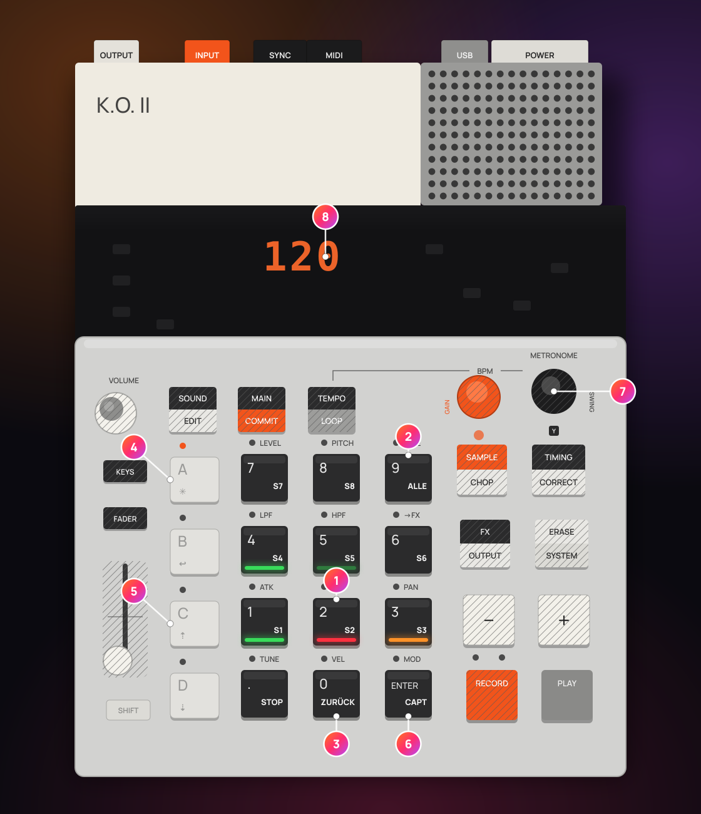
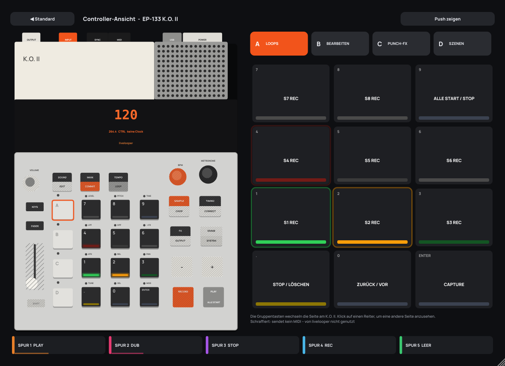

# EP-133 K.O. II steuern (experimentell – bitte testen)

> **Status: experimentell – bitte testen.** Diese Unterstützung wurde nach der öffentlichen Dokumentation von
> teenage engineering (OS 2.5 / 2.5.1) geschrieben und ist **noch nicht an echter Hardware getestet**. Bitte
> geh die Testliste am Ende dieser Seite durch und melde, was du findest. Die Bezeichnung wechselt erst zu
> „getestet mit OS …“, wenn alle MUSS-Tests bestanden sind.

livelooper findet einen **EP-133 K.O. II** am USB von selbst (im Plug-in in jeder DAW und in der
Standalone-App) und macht seine Pads zu Looper-Tasten. Auf Wunsch nimmt die Standalone-App den USB-Ton des
K.O. II in die Loops auf – livelooper ist dabei der Clock-Master.

1 Gruppe A, Pads 1 – 8: REC / PLAY / DUB Spur 1 – 8 · 2 Pad 9: alle Start / Stop – ENTER: Capture ·
3 `.`: Stop (halten: löschen) – `0`: Rückgängig (halten: Wiederholen) · 4 Gruppentasten A – D: die Seiten ·
5 Gruppe C: die 12 Punch-FX – fester anschlagen = stärker · 6 Gruppe D: `.` + ENTER 1 s halten = Nur Controller / K.O. II aufnehmen ·
7 Regler, Fader und Funktionstasten (schraffiert) senden kein MIDI – nur die 12 Pads (auf der mit den Gruppentasten A – D gewählten Seite) und PLAY (Start / Stop) kommen bei livelooper an · 8 das Display zeigt nichts von livelooper – der Bildschirm spiegelt ihn
(dasselbe Bild steht in der Hilfe der App: **?** → *K.O. II*)

## 1. Was geht – und was nicht

Über MIDI sendet der K.O. II nur seine **Pad-Noten** (Gruppen A – D = Noten 36 – 83, mit **Anschlagstärke**,
wenn Pad-Velocity an ist) sowie **Clock / Start / Stop**. Mehr kann livelooper nicht nutzen:

| Geht | Geht nicht (der K.O. II sendet nichts) |
|---|---|
| 48 Pads = 4 Seiten mit je 12 Funktionen (die Gruppentasten wechseln die Seite) | Regler X / Y, Fader (alle Belegungen) |
| Anschlagstärke → Stärke der Punch-FX, **Pad halten = Stärke steigt bis 100 %** (§4) | Pad-Druck / Aftertouch (wird nicht gesendet – weder Poly- noch Kanal-Druck) |
| livelooper sendet Clock, Start auf dem Takt und Stop | FX-Taste, Punch-in-FX, MAIN / SOUND / KEYS / TEMPO / ERASE … |
| seinen USB-Stereoausgang aufnehmen (Standalone; in der DAW als Audio-Eingang) | LEDs und Display (kein Host kann sie ansteuern) |

Die Rückmeldung kommt deshalb vom Bildschirm: der **Kopfzeilen-Chip** und die **Controller-Oberfläche** (§7).

## 2. Anschließen und loslegen

Schließ den K.O. II an. livelooper erkennt ihn grob am Port-Namen („EP-133“, „K.O. II“, „KO II“, „KO2“; ein
Port, der auf „MIDI 1“ endet, wird bevorzugt) und bestätigt ihn mit einer MIDI-Identity-Anfrage. Einmalig
erscheint eine kleine Frage:

**„K.O. II erkannt – wie soll livelooper ihn nutzen?“** – **[Nur Controller]** **[K.O. II aufnehmen]** **[Ignorieren]** · *Einstellungen …*

- **Nur Controller**: die Pads steuern livelooper, an der Audio-Einstellung ändert sich nichts.
- **K.O. II aufnehmen**: die Standalone-App schaltet den Audio-**Eingang** auf das USB-Stereopaar des
  K.O. II; der **Ausgang bleibt am Computer** (Lautsprecher, Kopfhörer oder Interface), damit Metronom und
  Loops nicht noch einmal mit aufgenommen werden (§6). Die vorigen Geräte werden gemerkt und kommen beim
  Abziehen oder Zurückschalten wieder. Standardmäßig
  steuert nur **Gruppe D** livelooper – die Gruppen A – C bleiben Instrumente des K.O. II.
- **Ignorieren**: livelooper lässt den K.O. II in Ruhe.

Die Wahl wird gemerkt (*SETUP → Controller → K.O. II → Beim Verbinden wieder fragen* fragt erneut). Ohne
Antwort verschwindet die Frage nach 12 s und livelooper nutzt den K.O. II für diese Sitzung als Controller.

Solange ein K.O. II verbunden ist, zeigt die Kopfzeile einen **Chip** `● K.O. II | Controller ▾` (grüner Punkt
= bestätigt, gelb = nur Namensübereinstimmung). Klick darauf: Rolle, *K.O.-Pattern resamplen*,
*Clock an K.O. II senden*, *Controller-Oberfläche*, *Einstellungen …*.

Die Rolle wechseln:
- im Chip oder unter **SETUP → Controller → K.O. II**,
- mit dem Host-Parameter **Controller-Audio** (`ctl_audio_mode`, MIDI-zuweisbar wie jede Funktion),
- am K.O. II selbst: **`.` + ENTER der Gruppe D zusammen 1 s halten**.

## 3. Den K.O. II einmal einrichten

| Einstellung am K.O. II (SHIFT + ERASE, Zahl, ENTER) | Warum |
|---|---|
| **101** Clock-Eingang | livelooper ist der Master: der K.O. II folgt seinem Tempo und startet auf dem Takt |
| **301** (hoch) oder **302** (niedrig) Pad-Velocity | Anschlagstärke = Stärke der Punch-FX (mit 300 sendet jeder Schlag denselben Wert) |
| optional **127** + ein MIDI-Kanal pro Steuer-Pad | dann erreichen nur diese Pads livelooper; *K.O.-II-MIDI-Kanal* im SETUP setzen |
| **510** nur Sampler (Standard) / **511** Sampler + Live-Mithören | mit 511 hörst du livelooper über den K.O. II – siehe §6 |

**Steuer-Projekt (2 Minuten):** leg im K.O. II ein Projekt an, in dem die Pads, die du als livelooper-Tasten
nutzt, auf Sound **000** stehen (leer – „hält MIDI, ohne Stimmen zu belegen“). Sonst spielt ein Steuer-Pad
zusätzlich seinen Sound – und bei *K.O. II aufnehmen* landet dieser Sound im Loop.

## 4. Seiten

Pad-Positionen auf jeder Seite (wie aufgedruckt): `7 8 9` / `4 5 6` / `1 2 3` / `. 0 ENTER`.

**A – LOOPS** (Nur Controller)

| Pad | Funktion |
|---|---|
| 1 – 8 | REC / PLAY / DUB Spur 1 – 8 (eine leere Spur nimmt auf) |
| 9 | ALLE START / STOP |
| `.` | STOP der zuletzt benutzten Spur · 1 s halten = LÖSCHEN (rückgängig machbar) |
| `0` | RÜCKGÄNGIG (letzte Spur) · 1 s halten = WIEDERHOLEN |
| ENTER | CAPTURE (die letzten Takte) |

**B – SPUR BEARBEITEN**

| Pad | Funktion |
|---|---|
| 1 – 8 | STOP Spur 1 – 8 · 1 s halten = LÖSCHEN · doppelt tippen = MUTE an / aus |
| 9 | ALLE STOP |
| `.` | SHIFT: gehalten sind die Pads 1 – 8 = RÜCKGÄNGIG Spur n |
| `0` | TAP-Tempo |
| ENTER | Metronom an / aus |

**C – PUNCH-FX** (dieselben Positionen wie die Punch-in-Pads des K.O. II): Pad *n* hält **Punch-FX *n***,
solange es gedrückt ist – Anschlagstärke = Stärke (auch leise Schläge wirken: Stärke = 0,25 + 0,75 ·
Velocity / 127). Mehrere Pads zugleich kombinieren sich (Tiefpass + Hochpass = Bandpass). Die Effekte
beschreibt die Bedienungsanleitung (*Punch-FX*).

**Halten = stärker.** Der K.O. II sendet **keinen Pad-Druck** – seine MIDI-Implementierung kennt weder
Poly-Aftertouch noch Kanal-Druck, nur Note-on + Anschlagstärke –, festeres Drücken eines gehaltenen Pads
ändert also von sich aus nichts. Darum lässt livelooper die Stärke ansteigen, solange du ein Punch-Pad hältst:
sie **beginnt bei der Anschlagstärke und steigt bis 100 %** innerhalb der **Rampenzeit** und geht beim
Loslassen auf die Anschlagstärke zurück. Ein neuer Schlag auf ein gehaltenes Pad setzt eine neue Startstärke.
Rampenzeit: *SETUP → Controller → K.O. II → Punch-Pads: halten = stärker* – **Aus / 1 Schlag / 2 Schläge
(Standard) / 1 Takt** (folgt dem Tempo), auch als Host-Parameter **Punch-FX Halte-Rampe** (`pfx_hold_ramp`,
per MIDI zuweisbar). Die aktuelle Stärke zeigen das PUNCH-FX-Feld (*HALTEN 83 %* mit Balken, der
STÄRKE-Regler bewegt sich mit) und das Display der Controller-Oberfläche. Sollte eine künftige
K.O.-II-Firmware Poly-Aftertouch (`An`) oder Kanal-Druck (`Dn`) senden, nutzt livelooper ihn statt der Rampe
(nie unter der Anschlagstärke).

| `.` | `0` | ENTER | 1 | 2 | 3 | 4 | 5 | 6 | 7 | 8 | 9 |
|---|---|---|---|---|---|---|---|---|---|---|---|
| Tonhöhen-Zufall | Slice-Tausch | Granular | Beat-Repeat | Bandstopp | Filter-Wobble | Tiefpass | Hochpass | Send-Wurf | Tremolo | Oktave runter | Dezimierer |

**D – SZENEN & SETUP** (Nur Controller)

| Pad | Funktion |
|---|---|
| 1 – 8 | Szene 1 – 8 · 1 s halten = speichern |
| 9 | RHYTHMUS an / aus |
| `0` | FILL, solange gehalten |
| ENTER | Set-Aufnahme (Performance-Rekorder) an / aus |
| `.` + ENTER (1 s) | Rolle wechseln |

**D – KOMPAKT-LOOPER** (K.O. II aufnehmen, standardmäßig die einzige Steuer-Gruppe)

| Pad | Funktion |
|---|---|
| 1 – 8 | REC / PLAY / DUB Spur 1 – 8 |
| 9 | ALLE START / STOP |
| `0` | RÜCKGÄNGIG · halten = WIEDERHOLEN |
| `.` | STOP letzte Spur · halten = LÖSCHEN |
| ENTER | **K.O.-Pattern resamplen** (§6) |
| `.` + ENTER (1 s) | Rolle wechseln |

*SETUP → Controller → K.O. II → Steuer-Gruppe A – D* legt fest, welche Gruppen livelooper steuern (die
anderen bleiben Instrumente des K.O. II). Noten außerhalb 36 – 83 (KEYS-Modus) werden ignoriert; livelooper
weist einmal darauf hin. Sendet PLAY am K.O. II Start / Stop und livelooper sendet **keine** Clock, gilt:
Start = alle Start, Stop = alle Stop.

## 5. Clock

livelooper ist der Clock-Master: es sendet MIDI-Clock (24 pro Viertel), **Songposition 0 + Start auf dem
nächsten Taktanfang**, wenn seine Zeitleiste startet, und Stop, wenn sie stoppt. Standalone: standardmäßig an;
im Plug-in: standardmäßig aus (die DAW sendet vielleicht schon Clock) – *SETUP → Controller → K.O. II →
Clock an K.O. II senden*. livelooper bestimmt das Tempo (erster Loop, TAP, Link); mit Link folgt der K.O. II
livelooper, und livelooper folgt Link.

## 6. K.O. II aufnehmen

- **Standalone:** der **Eingang** wechselt zum K.O. II (48 kHz, wenn angeboten, Puffer 256), alle Spuren
  nehmen sein Stereopaar auf (Eingang *Stereo*, kein Resampling), livelooper's **Eingangs-Mithören geht auf
  0** – du hörst den K.O. II direkt über seinen eigenen Lautsprecher / seine Buchse. Der **Ausgang bleibt am
  Computer** – der vorher benutzte Ausgang (Laptop-Lautsprecher, Kopfhörer, Interface), sonst der
  Systemstandard –, **Metronom und Loops kommen also aus dem Computer**. Ein- und Ausgang dürfen zwei Geräte
  sein (macOS CoreAudio kombiniert sie, WASAPI, DirectSound und ALSA öffnen sie nebeneinander). Nie während
  eine Spur von ihm aufnimmt: der Wechsel wartet. Abziehen stellt den vorigen Eingang **und** Ausgang (oder
  den Systemstandard) wieder her und zeigt *K.O. II: zurück zu …*.
- **Warum nicht der K.O. II als Ausgang?** Der USB-Stereoausgang des K.O. II enthält, was er über USB
  bekommt: Geht livelooper's Ausgabe (Metronom, Loops) in den K.O. II, kommt sie sofort über seinen
  USB-Eingang zurück und wird **noch einmal aufgenommen** – jeder neue Loop enthielte den Klick und alle
  früheren Loops. *SETUP → Controller → K.O. II → K.O.-II-Audioausgang*: **Computer (Standard)** /
  **K.O. II** – *K.O. II* nur wählen, wenn du genau das willst (Metronom aus, nichts läuft); die
  Einstellungsseite warnt davor. Das Metronom selbst wird nie in eine Aufnahme geschrieben – es gelangt nur
  über so einen Rückweg hinein.
- **livelooper über den K.O. II hören** braucht Einstellung **511** am K.O. II plus *K.O.-II-Audioausgang:
  K.O. II* – mit demselben Rückkopplungsrisiko (Test T9). Bei Rückkopplung oder Klick in den Loops zurück auf
  **510** und *Computer*.
- **Latenz:** USB-Audio kommt verspätet an. Endet im Modus *K.O. II aufnehmen* eine erste Aufnahme, schiebt
  livelooper den Loop um den **Latenz-Ausgleich** nach vorn (*SETUP → Controller → K.O. II →
  Latenz-Ausgleich*: automatisch = gemeldete Latenz des Geräts + ein Block, oder 0 – 200 ms). Eine
  automatische Mess-Taste gibt es noch nicht.
- **K.O.-Pattern resamplen** (Gruppe D ENTER im Aufnahme-Modus, der Chip, SETUP oder der Host-Parameter
  *Controller-Pattern resamplen* `ko2_resample`): nimmt **Capture-Länge Takte** (SETUP → Looper →
  Capture-Länge, Standard 4) vom K.O. II in die **erste leere Spur** auf, beginnend auf dem nächsten Takt (mit
  Quantisierung = Takt, dem Standard). Steht der K.O. II, startet ihn livelooper's Clock auf dem Takt. Keine
  freie Spur → *Keine freie Spur*.
- **Plug-in:** die DAW verwaltet das Audio. So einrichten, dass nichts doppelt aufgenommen wird:
  1. **Eingang:** in der DAW „EP-133 …“ als Audio-Eingangsgerät wählen (Live: Einstellungen → Audio →
     Audio-Eingangsgerät) und seine Eingänge 1/2 als **Eingang der Spur** nutzen, auf der livelooper liegt;
     Spur-Eingang in livelooper = *Stereo*.
  2. **Ausgang:** die Ausgabe der DAW bleibt auf Computer / Interface – **nicht** auf dem K.O. II (macOS: ein
     Aggregatgerät aus K.O. II + Interface im Audio-MIDI-Setup, mit dem Interface als Ausgang).
  3. **Eingangs-Monitoring aus** auf dieser Spur (Live: Monitor *Aus*), sonst spielt die DAW den K.O. II ein
     zweites Mal durch livelooper; das Metronom der DAW und von livelooper bleibt aus der Aufnahme draußen.
  Windows: für den K.O. II gibt es keinen ASIO-Treiber – WASAPI / MME der DAW oder einen generischen
  ASIO-Treiber nutzen. Dieselben Schritte stehen in der Hilfe der App (**?** → *K.O. II*).

## 7. Controller-Oberfläche

*SETUP → Controller → Oberfläche: Standard / Controller* (nur angeboten, solange ein K.O. II oder ein Push 1
verbunden ist). **Controller** ersetzt die Standard-Oberfläche durch eine Zeichnung des K.O. II: das Display
spiegelt Takt, Tempo, Rolle, die letzte Aktion und den Clock-Zustand; die 12 Pads zeigen Funktion und
Live-Zustand der Seite (leer dunkel, Aufnahme rot im Takt blinkend, Overdub orange, spielt grün, gestoppt
dunkelgrün, wartet gelb, Punch-FX cyan während gehalten); die Reiter A – D zeigen die Seiten (die zuletzt am
Gerät benutzte Seite ist umrandet, ein Klick zeigt eine andere Seite – die Seite am Gerät lässt sich nicht
fernsteuern). **Klick auf ein gezeichnetes Pad drückt es.** Regler und Fader sind grau („sendet kein MIDI –
nicht belegt“). *◀ Standard* führt zurück; beim Abziehen springt livelooper automatisch zur
Standard-Oberfläche (die Einstellung bleibt und kommt mit dem Controller zurück).

## 8. Plug-in und Windows

livelooper öffnet den MIDI-Port des K.O. II direkt – die Steuerung funktioniert in jeder DAW. **Windows:**
einen MIDI-Port kann nur ein Programm öffnen – schalte den MIDI-Eingang des K.O. II in den MIDI-Einstellungen
deiner DAW **aus** (sonst kann livelooper ihn nicht öffnen). livelooper's Standard-MIDI-Map nutzt Kanal 1,
Noten 36 – 67 – genau die Gruppen A – C des K.O. II; der K.O. II braucht sie nicht.

## 9. Probleme lösen

| Problem | Lösung |
|---|---|
| Kein Chip erscheint | USB-Kabel prüfen (Daten, nicht nur Laden); Windows: den K.O. II in den MIDI-Einstellungen der DAW ausschalten |
| Gelber Punkt | das Gerät hat nicht auf die Identity-Anfrage geantwortet – die Steuerung geht trotzdem; bitte Port-Namen melden |
| Pads spielen Sounds in den Loop | Steuer-Pads auf Sound 000 setzen (§3) oder nur Gruppe D nutzen |
| „K.O. II im KEYS-Modus“ | am K.O. II KEYS drücken, um den Keys-Modus zu verlassen |
| Der K.O. II folgt dem Tempo nicht | 101 (Clock-Eingang) einstellen; *Clock an K.O. II senden* prüfen |
| Rückkopplung im Aufnahme-Modus | K.O.-II-Einstellung 510 statt 511; *K.O.-II-Audioausgang: Computer* |
| Metronom / frühere Loops sind in der neuen Aufnahme | *SETUP → Controller → K.O. II → K.O.-II-Audioausgang: Computer*; Plug-in: DAW-Ausgang nicht auf dem K.O. II, Eingangs-Monitoring aus |
| Punch-FX-Stärke ändert sich nur bei einem neuen Schlag | der K.O. II sendet keinen Pad-Druck – Pad halten: *Punch-Pads: halten = stärker* (nicht *Aus*) |

## 10. Hardware-Testliste (bitte durchgehen und melden, OS 2.5.1)

MUSS = nötig für die Bezeichnung „getestet“.

| # | Test | Notieren | MUSS |
|---|---|---|---|
| T1 | macOS: Namen in Audio-MIDI-Setup (Audio + MIDI-Port) | genaue Texte | ✔ |
| T2 | Windows: Namen in den Sound-Einstellungen und in einem MIDI-Monitor | genaue Texte | ✔ |
| T3 | Bytes der Antwort auf die Identity-Anfrage | `F0 7E .. 06 02 00 20 76 …` | ✔ |
| T4 | Pad-Velocity 300 vs. 301 / 302 | fester Wert mit 300, Bereich mit 301 | ✔ |
| T5 | Senden die Gruppentasten etwas? Wechseln die Seiten die Notenbereiche? | nichts / A – D | ✔ |
| T6 | FX + Pad halten: sendet das Pad noch seine Note? | ja / nein | ✔ |
| T7 | PLAY / RECORD mit Clock 100 / 101 / 102: Start / Stop / Songposition gesendet? | je Einstellung | ✔ |
| T8 | USB-Ausgang = ganze Summe? vor / nach dem Lautstärkeregler? | | ✔ |
| T9 | Mit 511: ist der USB-Eingang im USB-Ausgang zu hören? | **Rückkopplungsgefahr** | ✔ |
| T10 | Roundtrip-Latenz (CoreAudio, WASAPI geteilt / exklusiv) bei 128 / 256 / 512 | ms | ✔ |
| T11 | Note-on an ein leeres (000) Pad: leuchtet seine LED? | ja / nein | |
| T12 | Erreichen sequenzierte Noten auf Steuer-Pads livelooper? | ja (erwartet) | |
| T13 | Punch-in-FX pro Pad nach Gehör vs. Liste in §4 | Namen | |
| T14 | Clock-Eingang (101): folgt Tempowechseln, startet auf dem Takt, Songposition | eng / driftet | ✔ |
| T15 | Ab- und Anstecken während Wiedergabe und Aufnahme (Aufnahme-Modus) | Rückfall klappt, kein Absturz | ✔ |
| T16 | Rollenwechsel-Akkord D `.` + ENTER 1 s | wechselt, keine Fehlauslösung | ✔ |
| T17 | 4 Takte resamplen: Loop mit Latenz-Ausgleich auf dem Takt | < 5 ms Fehler | ✔ |
| T18 | Plug-in in Live (macOS + Windows): MIDI-Port öffnet; Windows-Exklusiv-Hinweis | | ✔ |
| T19 | Push 1 + K.O. II gleichzeitig; Controller-Oberfläche umschalten | | |
| T20 | Nur Controller: normaler Eingang unverändert, Pads steuern nur | | ✔ |
| T21 | K.O. II aufnehmen (Standalone): Ausgang bleibt am Laptop, ein neuer Loop enthält nur den K.O. II (kein Klick, keine früheren Loops) | | ✔ |
| T22 | Gruppe C gehalten: Stärke steigt vom Anschlag bis 100 % (2 Schläge), beim Loslassen zurück; sendet eine Firmware `An` / `Dn`? | | ✔ |

---

EP-133 K.O. II ist eine Marke von teenage engineering; livelooper steht in keiner Verbindung dazu.
