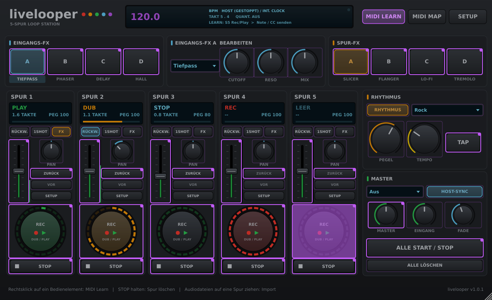

# MIDI-Steuerung

[English](../en/MIDI.md) | **Deutsch**

Jede Funktion von livelooper ist frei per MIDI steuerbar – jeder Knopf, jeder Regler, jede Auswahl, jeder Effekt-Slot. Es gibt zwei Wege, die sich beliebig kombinieren lassen.

## Weg 1: MIDI-Learn im Plug-in

Vorbereitung (einmalig): das MIDI deines Controllers an livelooper schicken. Wie, hängt von der DAW ab – über den MIDI-Eingang der Spur, auf der livelooper sitzt, oder über eine MIDI-Spur, die auf das Plug-in geroutet ist. In der Standalone-App den Controller unter **Audio-/MIDI-Einstellungen** (oben links im Fenster) einschalten. Beispiel Ableton Live:

1. MIDI-Spur anlegen.
2. *MIDI From*: dein Controller / Fußschalter, *Monitor*: **In**.
3. *MIDI To*: die Audiospur mit livelooper, darunter **livelooper** wählen.

Zuweisen:

- **Rechtsklick** auf ein Bedienelement → **MIDI Learn** → Taste/Pad/Fußschalter drücken oder Regler bewegen. Fertig.
- Oder **MIDI LEARN** in der Kopfzeile einschalten: alle zuweisbaren Elemente werden lila umrandet (bereits zugewiesene mit Punkt). Element anklicken, Controller bewegen, nächstes Element anklicken … zum Beenden **MIDI LEARN** erneut klicken.
- Entfernen: Rechtsklick → **MIDI-Zuweisung entfernen**, oder im Menü **MIDI MAP** auf den Eintrag klicken.

Auch die Elemente im Spur-**SETUP** (Eingang, Start, Stop, Dub-Modus, Takte, Loop-Sync, Löschen) lassen sich per Rechtsklick zuweisen.

Die Zuweisungen werden mit dem DAW-Projekt gespeichert.

### Wie MIDI-Nachrichten wirken

| Art der Funktion | Beispiele | Note | CC |
|---|---|---|---|
| Taster | REC/PLAY, STOP, LÖSCHEN, ZURÜCK (Undo), VOR (Redo), ALLE START/STOP, ALLE LÖSCHEN, TAP | Note-On löst aus | Wert steigt über 63 → löst aus (Loslassen löst nichts aus) |
| Schalter | RÜCKW., 1SHOT, FX, Loop-Sync, Effekt A–D an/aus, RHYTHMUS, HOST-SYNC | Note-On schaltet um | steigende Flanke schaltet um |
| Auswahl | Effekttyp, Quantisierung, Muster, Start-/Stopp-/Dub-Modus | Note-On → nächster Wert | CC wählt direkt (0–127 über alle Werte) |
| Regler | Pegel, Pan, Effekt-Parameter, Tempo, Fade, Tape-Stopp, Performance-Filter | Anschlagstärke setzt den Wert | CC setzt den Wert |
| Gehalten (seit 1.4) | Slice 1–6 (Loop-Cutting); seit 1.5 Beat-FX halten, Beat Repeat halten, Stutter halten; seit 1.6 Fill (halten) | an, solange die Note gehalten wird, aus mit Note-Off | an, solange der CC ≥ 64 ist |

Die Slice-Funktionen verhalten sich wie die Positions-Pads am Push: kurz drücken springt (zur nächsten 16tel-Note) in dieses Sechstel des Loops und bleibt dort, länger als ¼ s halten stottert und springt beim Loslassen synchron zurück. *Stumm* und *Solo* sind für MIDI Schalter (drücken = an, nochmal = aus); das Stummschalten / Solo nur solange gehalten ist eine Push-Geste.

Damit funktionieren sowohl Fußschalter, die beim Drücken 127 und beim Loslassen 0 senden, als auch Pads mit Noten.

### Standard-Belegung

**MIDI MAP → Standard-Map laden** lädt eine fertige Belegung auf MIDI-Kanal 1:

| Note / CC | Funktion |
|---|---|
| C1–E1 (36–40) | REC/PLAY Spur 1–5 |
| F1–A1 (41–45) | STOP Spur 1–5 |
| A#1 (46) | ALLE START/STOP |
| B1 (47) | TAP |
| C2–E2 (48–52) | ZURÜCK (Undo) Spur 1–5 |
| C3–D#3 (60–63) | Eingangs-FX A–D an/aus |
| E3–G3 (64–67) | Spur-FX A–D an/aus |
| CC 20–24 | Pegel Spur 1–5 |
| CC 25 | Master |

## Weg 2: MIDI-Mapping deiner DAW

Alle Funktionen sind als Plug-in-Parameter sichtbar und automatisierbar – du kannst sie also auch mit dem eigenen MIDI-Mapping deiner DAW (MIDI-Learn, Controller-Zuweisung …) zuweisen und automatisieren. Beispiel Ableton Live:

1. Im Gerätetitel von livelooper auf **Konfigurieren** klicken und die gewünschten Elemente im Plug-in-Fenster anklicken bzw. bewegen – sie erscheinen als Regler im Gerät. (Bei weniger als 128 Parametern zeigt Live sie auch direkt an.)
2. **MIDI** (Cmd+M / Strg+M) einschalten, Parameter anklicken, Controller bewegen.

Taster-Parameter (z. B. „S1 Rec/Play") springen nach dem Auslösen selbst wieder auf „aus". Dadurch löst jede Betätigung genau einmal aus – egal ob deine DAW die Taste als Umschalter oder als Momentschalter zuordnet.

Auch Automation ist möglich (in Live z. B. in der Arrangement-Ansicht), etwa um eine Aufnahme exakt an einem Taktstrich zu starten.

## Parameterliste

497 Parameter. Mit deutscher Oberfläche zeigt deine DAW die deutschen Namen, mit englischer die englischen (in Klammern). Die internen IDs und gespeicherte Zuweisungen bleiben in beiden Sprachen gleich – ein Sprachwechsel zerstört also keine MIDI-Map und keine Automation.

**Pro Spur (S1 … S5 / T1 … T5)** – je 16:
`Rec/Play`, `Stop`, `Löschen` (Clear), `Rückgängig` (Undo), `Wiederherstellen` (Redo) – Taster · `Pegel` (Level), `Panorama` (Pan) · `Rückwärts` (Reverse), `One Shot`, `Loop-Sync` (Loop Sync), `Spur-FX` (Track FX) – Schalter · `Eingang` (Input), `Startmodus` (Start Mode), `Stoppmodus` (Stop Mode), `Dub-Modus` (Dub Mode), `Takte` (Measures) – Auswahl

**Global** – 16:
`Alle Start/Stop` (All Start/Stop), `Alle Start` (All Start), `Alle Stop` (All Stop), `Alle löschen` (Clear All), `Tap Tempo` – Taster · `Master-Pegel` (Master Level), `Eingangsmonitor` (Input Monitor), `Internes Tempo` (Internal Tempo), `Fade-Zeit` (Fade Time) · `Quantisierung` (Quantize), `Aufnahme-Aktion` (Rec Action), `Rhythmus-Muster` (Rhythm Pattern), `Drum-Kit` (Drum Kit), `Metronomklang` (Metronome Sound) – Auswahl · `Host-Sync` (Sync to Host), `Transport folgen` (Follow Transport), `Rhythmus an` (Rhythm On) – Schalter · `Rhythmus-Pegel` (Rhythm Level), `Swing` (Swing), `Humanisierung` (Humanize)

**Effekte** – je Slot 5 (`Ein-FX A … D` / `In FX A … D`, `Sp-FX A … D` / `Trk FX A … D`):
`An` (On), `Typ` (Type), `Parameter 1` (Param 1), `Parameter 2` (Param 2), `Mix`

**Seit 1.3** – pro Spur: `Capture` (Taster), `Feedback`, `Ducking`, `Tonhöhe` (Pitch), `Ausgang` (Output, Auswahl), `Tempo folgen` (Follow Tempo, Schalter); global: `Capture` (Taster), `Capture-Takte` (Capture Bars), `Auto-Aufnahme` (Auto Record), Schwelle, Ducking-Quelle, `Szene 1 … 8` (Taster), Szene speichern. Spuren S1 … S8.

**Seit 1.4 (Performance)** – pro Spur 15 weitere: `Slice 1 … 6` (gehalten), `Zurück in Sync` (Back in Sync), `Loop verdoppeln` (Double Loop), `Loop halbieren` (Halve Loop), `Oktave hoch` (Octave Up), `Oktave runter` (Octave Down), `In leere Spur kopieren` (Copy to Empty Track) – Taster · `Stumm` (Mute), `Solo` – Schalter · `Aufnahmelänge` (Rec Length, Auswahl, die einmal auslöst: `1 Takt` … `32 Takte` für die nächste oder laufende erste Aufnahme, danach wieder `-`); global: `Tape-Stopp` (Tape Stop: 0 % = läuft, 100 % = das Band steht; zurück auf 0 % = läuft synchron wieder an), `Performance-Filter` (−100 = Tiefpass zu, 0 = aus, +100 = Hochpass offen).

**Seit 1.5 (Live-Performance-FX, Metronom, Link)** – 28 weitere, alle angehängt (bestehende IDs, MIDI-Maps und Automation bleiben unverändert):
- global: `Beat-FX an` (Beat FX On, Schalter), `Beat-FX halten` (Beat FX Hold, gehalten), `Beat-FX-Typ` (Beat FX Type, 16 Typen), `Beat-FX-Schlag` (Beat FX Beat, 1/32 … 16), `Beat-FX Pegel/Tiefe` (Beat FX Level/Depth), `Beat-FX-Kanal` (Beat FX Channel: Master, Loops, Eingang, Spur 1 … 8) · `Color-FX-Typ` (Color FX Type: Filter, Dub Echo, Space, Crush, Noise, Sweep) · `Beat Repeat halten` (Beat Repeat Hold, gehalten), `Beat Repeat Latch` (Schalter), `Beat-Repeat-Timing` (Beat Repeat Timing, 1/2 … 1/32) · `Stutter halten` (Stutter Hold, gehalten), `Stutter Latch` (Schalter), `Stutter-Timing` (Stutter Timing, 1/2 … 1/32) · `Metronom an` (Metronome On), `Metronom-Betonung` (Metronome Accent) – Schalter, `Metronom-Pegel` (Metronome Level) · `Link`, `Link Start/Stopp-Sync` (Link Start/Stop Sync) – Schalter · `Groove` (Gerade, Natürlich, Laid Back, Treibend, Drunk, Drive), `Fills` (Aus, Alle 4 Takte, Alle 8 Takte)
- pro Spur (S1 … S8): `Color-FX` (Color FX, −100 … +100, 0 = aus)
- `Capture-Takte` (Capture Bars) reicht jetzt bis 16 und 32 Takte.

<!-- v1.6 features -->
**Seit 1.6 (Loop-Tricks, Performance-Recorder, Clip-Export)** – 26 weitere, alle angehängt (bestehende IDs, MIDI-Maps und Automation bleiben unverändert):
- pro Spur (S1 … S8): `Halbe Geschwindigkeit` (Half Speed), `Doppelte Geschwindigkeit` (Double Speed), `Loop-Audio umdrehen` (Reverse Loop Audio) (Tasten; quantisiert auf den nächsten Schlag / Takt, rückgängig machbar) – IDs `t1_halfspeed`, `t1_dblspeed`, `t1_revloop` …
- global: `Performance-Recorder` (Performance Recorder; Schalter: nimmt den Master-Mix als WAV auf, solange an, ID `perf_rec`), `9:16-Clip exportieren` (Export 9:16 Clip; Taste: Hochformat-Video der letzten 20 Sekunden, ID `clip_export`)
<!-- end v1.6 features -->

Die internen Parameter-IDs (für Entwickler und gespeicherte Zuweisungen) lauten z. B. `t1_recplay`, `t3_level`, `allstartstop`, `inB_type`, `trD_mix`, `bfx_type`, `brep_hold`, `t2_color`, `link_on`.

**Seit 1.6 (Rhythmus: Kits, BEATS, Fill, Drum-FX-Routing)** – 37 weitere, alle angehängt:
- `Drum-Variation` (0 – 100 %), `Fill (halten)` (gehalten: Note an / aus), `Pattern-Wechsel` (Sofort, Nächster Schlag, Nächster Takt) · `Drums durch Beat FX`, `Drums durch Repeat/Stutter` (Schalter)
- BEATS-Zeilen 1 – 8 (= Kit-Instrumente Kick … Tom): `Beat Zeile N stumm`, `Beat Zeile N solo` (Schalter), `Beat Zeile N Pegel` (0 – 150 %), `Beat Zeile N Tonhöhe` (±12 Halbtöne)
- `Drum-Kit` hat 8 weitere Kits (House … Afro Latin) und die Plätze `Pack-Kit 1 … 8`; `Rhythmus-Pattern` hat 18 weitere Grooves und die User-Plätze `User 1 … 16` (BEATS) – neue Einträge stehen am Ende dieser Listen
- IDs: `rhythm_variation`, `rhythm_fill`, `beat_switch`, `drums_bfx`, `drums_repeat`, `beat_mute1` … `beat_mute8`, `beat_solo1` …, `beat_vol1` …, `beat_pitch1` …

**Seit 1.6 (Beat-Bibliothek)** – 2 weitere, nach den Rhythmus-Parametern angehängt: `Nächster Bibliotheks-Beat` (Next Library Beat), `Vorheriger Bibliotheks-Beat` (Previous Library Beat) (Tasten: blättern durch die mit BEATS → SPEICHERN gesicherten Beats; IDs `beat_lib_next`, `beat_lib_prev`).

**Seit 1.6 (Punch-FX, Send-FX, Controller)** – 23 weitere, angehängt (Parameter 466 – 488): `Send-FX-Typ`, `Send-FX X`, `Send-FX Y`, `Send-FX-Anteil` (IDs `sfx_type`, `sfx_x`, `sfx_y`, `sfx_level`), `Punch-FX 1 … 12 (halten)` (`pfx_hold1` … `pfx_hold12`, Momentan: Note an / aus), `Punch-FX-Stärke`, `Punch-FX X`, `Punch-FX Y`, `Punch-FX-Ziel`, `Punch-FX halten` (`pfx_amount`, `pfx_x`, `pfx_y`, `pfx_target`, `pfx_latch`), `Controller-Audio` (`ctl_audio_mode`: nur Controller / Controller-Audio aufnehmen) und `Controller-Pattern resamplen` (`ko2_resample`, Taste). Die Namen sind allgemein; zum K.O. II siehe KO2.md. Hinweis: die Standard-MIDI-Map (Kanal 1, Noten 36 – 67) überschneidet sich mit dem Notenbereich des K.O. II – der K.O. II braucht sie nicht (livelooper öffnet seinen Port direkt).

**Seit 1.6 (Punch-FX Halte-Rampe)** – 1 weiterer, angehängt (Parameter 489): `Punch-FX Halte-Rampe` (`pfx_hold_ramp`: aus / 1 Schlag / 2 Schläge (Standard) / 1 Takt) – für Pads ohne Druck (K.O. II): ein gehaltenes Punch-Pad hebt die Stärke in dieser Zeit vom Anschlag bis 100 %. Wie jeder Parameter per MIDI zuweisbar.

**Seit 1.7 (Latenz, Anschlagkurven, MIDI-Feedback, Push-1-Display)** – 8 weitere, angehängt (Parameter 490 – 497): `Latenzausgleich` (Latency Compensation, `lat_comp`, Schalter, an), `Latenz-Versatz` (Latency Offset, `lat_offset`, −50 … +50 ms), `Latenz messen` (Measure Latency, `lat_measure`, Taster), `Push-1-Anschlagkurve`, `Sampler-Pad-Anschlagkurve` (die K.O.-II-Kurve; Hosts sehen keine Gerätenamen), `MIDI-Anschlagkurve` (`vel_push`, `vel_ko2`, `vel_midi`: Weich / Normal (Standard) / Hart / Fest), `MIDI-Feedback (experimentell)` (`midi_fb`, Schalter, aus) und `Push 1 Loop-Fortschrittsbalken` (`push_progress`, Schalter, an). `Transport folgen` (`follow`) ist seit 1.7 standardmäßig **an** (die ID bleibt; gespeicherte Projekte behalten ihren Wert).

### Anschlagkurve und LED-Feedback für gelernte Bedienelemente (1.7)

- Eine auf einen stufenlosen Parameter gelernte Note setzt ihn auf ihre Anschlagstärke – über die **MIDI-Anschlagkurve** (*SETUP → Controller → Anschlagkurven → MIDI (gelernte Noten)*): Weich, Normal, Hart, Fest.
- **MIDI-Feedback (experimentell)**: *SETUP → Controller → MIDI-Feedback* sendet den Zustand jedes gelernten Bedienelements an einen gewählten MIDI-Ausgang zurück (gleicher Kanal und gleiche Noten-/CC-Nummer; Werte für an / aus / blinken wählbar, standardmäßig blinkt es im Takt). REC / PLAY einer Spur blinkt bei Aufnahme, leuchtet beim Abspielen; Schalter leuchten, wenn sie an sind; auf einen CC gelernte Regler bekommen ihren Wert. Siehe [Bedienungsanleitung, Abschnitt 42](BEDIENUNGSANLEITUNG.md#42-anschlagkurven-und-midi-feedback-neu-in-17).
