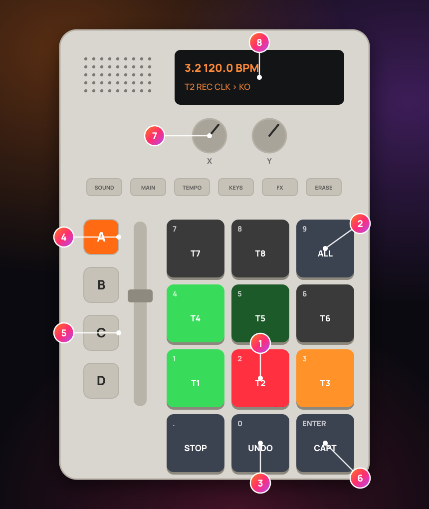
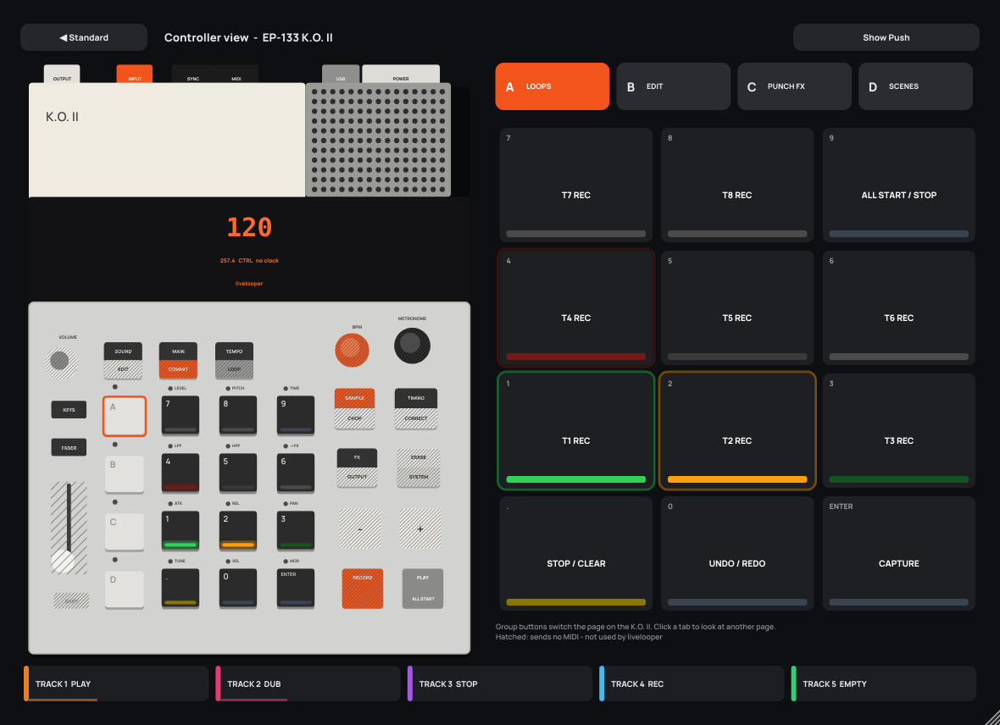

# EP-133 K.O. II control (experimental – please test)

> **Status: experimental – please test.** This support was written from teenage engineering's public
> documentation (OS 2.5 / 2.5.1) and has **not been tested on hardware yet**. Please run the test list at
> the end of this page and report what you find. The label changes to "tested with OS …" only after
> every MUST test has passed.

livelooper finds an **EP-133 K.O. II** on USB by itself (in the plug-in in any DAW and in the standalone
app) and turns its pads into looper controls. Optionally the standalone app records the K.O. II's USB audio
into the loops, with livelooper as the clock master.

1 group A pads 1 – 8: REC / PLAY / DUB track 1 – 8 · 2 pad 9: all start / stop – ENTER: capture ·
3 `.`: stop (hold: clear) – `0`: undo (hold: redo) · 4 group buttons A – D: the pages ·
5 group C: the 12 punch FX – hit harder for more · 6 group D: `.` + ENTER held 1 s = Controller only / Record K.O. II ·
7 knobs, fader and the function buttons (hatched) send no MIDI – only the 12 pads (on the page chosen with the group buttons A – D) and PLAY (start / stop) reach livelooper · 8 the display shows nothing from livelooper – the screen mirrors it
(the same picture is in the in-app help: **?** → *K.O. II*)

## 1. What works – and what doesn't

Over MIDI the K.O. II sends only its **pad notes** (groups A – D = notes 36 – 83, with **velocity** when pad
velocity is on) plus **clock / start / stop**. That is all livelooper can use:

| Works | Does not work (the K.O. II sends nothing) |
|---|---|
| 48 pads = 4 pages of 12 functions (the group buttons switch the page) | knobs X / Y, the fader (all its assignments) |
| velocity → punch FX amount | pad pressure / aftertouch (not transmitted) |
| livelooper sends clock, start on the bar and stop to it | FX button, punch-in FX, MAIN / SOUND / KEYS / TEMPO / ERASE … |
| record its USB stereo out (standalone; in a DAW: as audio input) | LEDs and display (no host can light them) |

The feedback is therefore on the screen: the **header chip** and the **Controller GUI** (§7).

## 2. Plug and play

Plug the K.O. II in. livelooper matches its port name loosely ("EP-133", "K.O. II", "KO II", "KO2"; the
first port ending in "MIDI 1" is preferred) and confirms it with a MIDI identity request. A small question
appears once:

**"K.O. II connected – how should livelooper use it?"** – **[Controller only]** **[Record K.O. II]** **[Ignore]** · *Settings …*

- **Controller only**: the pads control livelooper, the audio setup is not touched.
- **Record K.O. II**: the standalone app switches audio in and out to the K.O. II's USB stereo pair (the
  previous device is remembered and comes back when you unplug it or switch back). Only **group D** controls
  livelooper by default, so groups A – C stay the K.O. II's own instruments.
- **Ignore**: livelooper leaves the K.O. II alone.

The choice is remembered (*SETUP → Controllers → K.O. II → Ask again when connected* asks again). Without an
answer the question disappears after 12 s and livelooper uses the K.O. II as a controller for this session.

While a K.O. II is connected the header shows a **chip** `● K.O. II | Controller ▾` (green dot = confirmed,
yellow = name match only). Click it for: role, *Resample K.O. pattern*, *Send clock to K.O. II*,
*Controller GUI*, *Settings …*.

Switch the role:
- in the chip or in **SETUP → Controllers → K.O. II**,
- with the host parameter **Controller Audio** (`ctl_audio_mode`, MIDI-mappable like every function),
- on the K.O. II itself: hold **`.` + ENTER of group D together for 1 s**.

## 3. Set the K.O. II up once

| Setting on the K.O. II (SHIFT + ERASE, number, ENTER) | Why |
|---|---|
| **101** clock in | livelooper is the master: the K.O. II follows its tempo and starts on the bar |
| **301** (hi) or **302** (lo) pad velocity | velocity = punch FX amount (with 300 every hit sends the same value) |
| optional **127** + a MIDI channel per control pad | then only those pads reach livelooper; set *K.O. II MIDI channel* in SETUP |
| **510** sampler only (default) / **511** sampler + live monitoring | 511 lets you hear livelooper through the K.O. II – see §6 |

**Control project (2 minutes):** make one K.O. II project in which the pads you use as livelooper controls are
set to sound **000** (empty – "holds MIDI without stealing voices"). Otherwise a control pad also plays its
sound – and in *Record K.O. II* that sound ends up in your loop.

## 4. Pages

Pad positions on every page (as printed): `7 8 9` / `4 5 6` / `1 2 3` / `. 0 ENTER`.

**A – LOOPS** (Controller only)

| Pad | Function |
|---|---|
| 1 – 8 | REC / PLAY / DUB track 1 – 8 (an empty track records) |
| 9 | ALL START / STOP |
| `.` | STOP the last used track · hold 1 s = CLEAR it (undoable) |
| `0` | UNDO (last track) · hold 1 s = REDO |
| ENTER | CAPTURE (the last bars) |

**B – TRACK EDIT**

| Pad | Function |
|---|---|
| 1 – 8 | STOP track 1 – 8 · hold 1 s = CLEAR · double tap = MUTE on / off |
| 9 | ALL STOP |
| `.` | SHIFT: held, pads 1 – 8 = UNDO track n |
| `0` | TAP tempo |
| ENTER | metronome on / off |

**C – PUNCH FX** (same positions as the K.O. II's own punch-in pads): pad *n* holds **punch FX *n*** while
pressed – velocity = amount (soft hits still do something: amount = 0.25 + 0.75 · velocity / 127).
Several pads at once combine (low-pass + high-pass = band-pass). The effects are described in the user guide
(*Punch FX*).

| `.` | `0` | ENTER | 1 | 2 | 3 | 4 | 5 | 6 | 7 | 8 | 9 |
|---|---|---|---|---|---|---|---|---|---|---|---|
| Pitch Scatter | Slice Swap | Grains | Beat Repeat | Tape Stop | Filter Wobble | Low-Pass | High-Pass | Send Throw | Tremolo | Octave Drop | Decimator |

**D – SCENES & SETUP** (Controller only)

| Pad | Function |
|---|---|
| 1 – 8 | scene 1 – 8 · hold 1 s = store |
| 9 | RHYTHM on / off |
| `0` | FILL while held |
| ENTER | set (performance) recording on / off |
| `.` + ENTER (1 s) | role switch |

**D – COMPACT LOOPER** (Record K.O. II, the only control group by default)

| Pad | Function |
|---|---|
| 1 – 8 | REC / PLAY / DUB track 1 – 8 |
| 9 | ALL START / STOP |
| `0` | UNDO · hold = REDO |
| `.` | STOP last track · hold = CLEAR |
| ENTER | **Resample K.O. pattern** (§6) |
| `.` + ENTER (1 s) | role switch |

*SETUP → Controllers → K.O. II → Control group A – D* decides which groups are livelooper controls (the
others stay K.O. II instruments). Notes outside 36 – 83 (KEYS mode) are ignored; livelooper says once that
the K.O. II is in KEYS mode. If the K.O. II's PLAY sends start / stop and livelooper is **not** sending clock,
start = all start, stop = all stop.

## 5. Clock

livelooper is the clock master: it sends MIDI clock (24 per quarter note), **song position 0 + start on the
next bar line** when its timeline starts, and stop when it stops. Standalone: on by default; in a plug-in:
off by default (your DAW may already send clock) – *SETUP → Controllers → K.O. II → Send clock to K.O. II*.
livelooper's tempo (first loop, TAP, Link) drives it; with Link, the K.O. II follows livelooper which follows
Link.

## 6. Record K.O. II

- **Standalone:** input and output switch to the K.O. II (48 kHz if offered, buffer 256), all tracks record
  its stereo pair, livelooper's **input monitor goes to 0** – you hear the K.O. II directly on its own jack.
  Never while a track records into it: the switch waits. Unplugging restores the previous device (or the
  system default) and shows *K.O. II: back to …*.
- **Hearing livelooper through the K.O. II** needs setting **511** on the K.O. II. Careful: if the K.O. II also
  sends that monitored input back out over USB (test T9), livelooper would record itself. If you hear
  feedback, go back to **510** and use your interface for the output.
- **Latency:** USB audio arrives late. When a first recording ends in *Record K.O. II*, livelooper moves the
  loop earlier by the **latency offset** (*SETUP → Controllers → K.O. II → Latency offset*: automatic = the
  latency the device reports + one block, or 0 – 200 ms). An automatic measuring button is not there yet.
- **Resample K.O. pattern** (group D ENTER in Record mode, the chip, SETUP or the host parameter *Resample
  Controller Pattern* `ko2_resample`): records **capture-length bars** (SETUP → Looper → Capture length,
  default 4) of the K.O. II into the **first empty track**, starting on the next bar (with quantize =
  measure, the default). If the K.O. II is stopped, livelooper's clock starts it on the bar. No free track
  → *No free track*.
- **Plug-in:** the DAW owns the audio. Choose "EP-133 …" as audio input in your DAW's audio settings
  (Live: Settings → Audio → Audio Input Device) and set livelooper's track input. Windows: there is no ASIO
  driver – use your DAW's WASAPI / MME option or a generic ASIO driver. macOS: combine it with your interface
  in an aggregate device (Audio MIDI Setup).

## 7. Controller GUI

*SETUP → Controllers → GUI: Standard / Controller* (offered only while a K.O. II or a Push 1 is connected).
**Controller** replaces the standard surface with a drawing of the K.O. II: the display mirrors bar, tempo,
role, the last action and the clock state; the 12 pads show the function and the live state of the page
(empty dark, recording red blinking in time, overdub orange, playing green, stopped dim green, waiting
yellow, punch FX cyan while held); the tabs A – D show the pages (the page last used on the device is
outlined, a click shows another page – the device's page cannot be set remotely). **Click a drawn pad to
press it.** Knobs and fader are grey ("sends no MIDI – not used"). *◀ Standard* goes back; unplugging falls
back to the standard GUI automatically (the setting stays and comes back with the controller).

## 8. Plug-in and Windows notes

livelooper opens the K.O. II's MIDI port directly, so the control works in any DAW. **Windows:** a MIDI port
can only be opened by one program – switch the K.O. II's MIDI input **off** in your DAW's MIDI settings (or
livelooper cannot open it). The default MIDI map of livelooper uses channel 1 notes 36 – 67, the same as the
K.O. II's groups A – C – the K.O. II does not need it.

## 9. Troubleshooting

| Problem | Fix |
|---|---|
| No chip appears | check the USB cable (data, not charge only); Windows: switch the K.O. II off in the DAW's MIDI settings |
| Yellow dot | the device did not answer the identity request – control still works; please report the port name |
| Pads play sounds into the loop | set the control pads to sound 000 (§3) or use only group D |
| "K.O. II in KEYS mode" | press KEYS on the K.O. II to leave the keys mode |
| The K.O. II does not follow the tempo | set 101 (clock in); check *Send clock to K.O. II* |
| Feedback in Record mode | K.O. II setting 510 instead of 511 |

## 10. Hardware test list (please run and report, OS 2.5.1)

MUST = needed before the "tested" label.

| # | Test | Note | MUST |
|---|---|---|---|
| T1 | macOS: names in Audio MIDI Setup (audio + MIDI port) | exact strings | ✔ |
| T2 | Windows: names in Sound settings and in a MIDI monitor | exact strings | ✔ |
| T3 | Identity request reply bytes | `F0 7E .. 06 02 00 20 76 …` | ✔ |
| T4 | Pad velocity 300 vs 301 / 302 | fixed value with 300, range with 301 | ✔ |
| T5 | Do the group buttons send anything? Do pages switch the note ranges? | none / A – D | ✔ |
| T6 | Holding FX + pad: does the pad still send its note? | yes / no | ✔ |
| T7 | PLAY / RECORD with clock 100 / 101 / 102: start / stop / song position sent? | per setting | ✔ |
| T8 | USB out = full mix? before / after the volume knob? | | ✔ |
| T9 | With 511: is the USB input audible in the USB output? | **feedback risk** | ✔ |
| T10 | Round-trip latency (CoreAudio, WASAPI shared / exclusive) at 128 / 256 / 512 | ms | ✔ |
| T11 | Note-on to an empty (000) pad: does its LED light? | yes / no | |
| T12 | Sequenced notes on control pads reach livelooper? | yes (expected) | |
| T13 | Punch-in FX per pad by ear vs. the list in §4 | names | |
| T14 | Clock in (101): follows tempo changes, starts on the bar, song position | tight / drift | ✔ |
| T15 | Hot-plug during playback and during recording (Record mode) | fallback works, no crash | ✔ |
| T16 | Role switch chord D `.` + ENTER 1 s | toggles, no stray actions | ✔ |
| T17 | Resample 4 bars: loop on the bar with the latency offset | < 5 ms error | ✔ |
| T18 | Plug-in in Live (macOS + Windows): MIDI port opens; Windows exclusivity hint | | ✔ |
| T19 | Push 1 + K.O. II at the same time; Controller GUI switching | | |
| T20 | Controller only: normal input unchanged, pads control only | | ✔ |

---

EP-133 K.O. II is a trademark of teenage engineering; livelooper is not affiliated.
