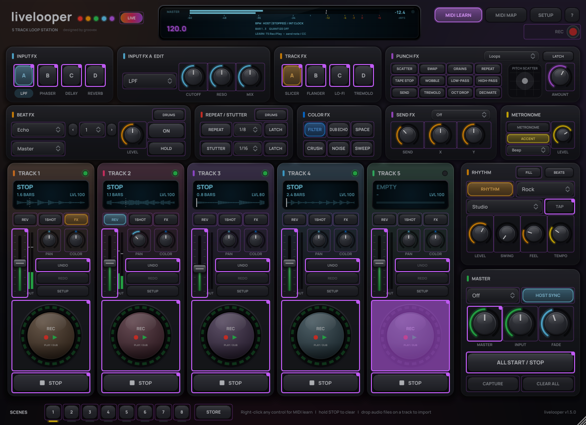

# MIDI control

**English** | [Deutsch](../de/MIDI.md)

Every function of livelooper can be controlled freely via MIDI – every button, every knob, every selector, every effect slot. There are two ways, and you can combine them as you like.

## Way 1: MIDI learn inside the plug-in

Preparation (once): send your controller's MIDI to livelooper. How depends on the DAW – through the MIDI input of the track livelooper sits on, or a MIDI track routed to the plug-in. In the standalone app, enable your controller under **Audio/MIDI Settings** (top left of the window). Example Ableton Live:

1. Create a MIDI track.
2. *MIDI From*: your controller / foot switch, *Monitor*: **In**.
3. *MIDI To*: the audio track with livelooper, below that choose **livelooper**.

Assigning:

- **Right-click** a control → **MIDI Learn** → press a key/pad/foot switch or move a knob. Done.
- Or switch on **MIDI LEARN** in the header: all assignable controls get a purple outline (already assigned ones show a dot). Click a control, move the controller, click the next control … click **MIDI LEARN** again to finish.
- Removing: right-click → **Remove MIDI mapping**, or click the entry in the **MIDI MAP** menu.

The controls in the track **SETUP** (Input, Start, Stop, Dub mode, Measures, Loop Sync, Clear) can be assigned by right-click as well.

Assignments are saved with your DAW project.

### How MIDI messages act

| Kind of function | Examples | Note | CC |
|---|---|---|---|
| Button | REC/PLAY, STOP, CLEAR, UNDO, REDO, ALL START/STOP, CLEAR ALL, TAP | note-on triggers | value rising above 63 → triggers (releasing does nothing) |
| Switch | REV, 1SHOT, FX, Loop Sync, effect A–D on/off, RHYTHM, HOST SYNC | note-on toggles | rising edge toggles |
| Selector | effect type, Quantize, pattern, start/stop/dub mode | note-on → next value | CC selects directly (0–127 across all values) |
| Continuous | level, pan, effect parameters, tempo, fade, tape stop, performance filter | velocity sets the value | CC sets the value |
| Held (since 1.4) | Slice 1–6 (loop cutting); since 1.5 Beat FX Hold, Beat Repeat Hold, Stutter Hold; since 1.6 Fill (hold) | on while the note is held, off with note-off | on while the CC is ≥ 64 |

The slice functions behave like the Push position pads: a short press jumps to that sixth of the loop (at the next 16th note) and stays there, a press held longer than ¼ s stutters and returns in sync on release. *Mute* and *Solo* are switches for MIDI (press = on, press again = off); the momentary mute / solo is a Push gesture.

This works with foot switches that send 127 on press and 0 on release as well as with pads that send notes.

### Default mapping

**MIDI MAP → Load default map** loads a ready-made mapping on MIDI channel 1:

| Note / CC | Function |
|---|---|
| C1–E1 (36–40) | REC/PLAY track 1–5 |
| F1–A1 (41–45) | STOP track 1–5 |
| A#1 (46) | ALL START/STOP |
| B1 (47) | TAP |
| C2–E2 (48–52) | UNDO track 1–5 |
| C3–D#3 (60–63) | Input FX A–D on/off |
| E3–G3 (64–67) | Track FX A–D on/off |
| CC 20–24 | Level track 1–5 |
| CC 25 | Master |

## Way 2: your DAW's MIDI mapping

All functions are visible and automatable as plug-in parameters, so you can also map them with your DAW's own MIDI mapping (MIDI learn, controller assignment …) and automate them. Example Ableton Live:

1. Click **Configure** in livelooper's device title bar and click or move the controls you want in the plug-in window – they appear as controls in the device. (With fewer than 128 parameters Live also shows them directly.)
2. Switch on **MIDI** (Cmd+M / Ctrl+M), click a parameter, move your controller.

Button parameters (e.g. "T1 Rec/Play") jump back to "off" by themselves after triggering. That way every press triggers exactly once – whether your DAW maps the button as toggle or momentary.

Automation works too (in Live, e.g., in Arrangement view), for example to start a recording exactly at a bar line.

## Parameter list

501 parameters, names as shown in your DAW with the English interface (with the German interface they are localised, e.g. "S1 Pegel" instead of "T1 Level"; the internal IDs and your saved assignments stay the same):

**Per track (T1 … T5)** – 16 each:
`Rec/Play`, `Stop`, `Clear`, `Undo`, `Redo` (buttons) · `Level`, `Pan` · `Reverse`, `One Shot`, `Loop Sync`, `Track FX` (switches) · `Input`, `Start Mode`, `Stop Mode`, `Dub Mode`, `Measures` (selectors)

**Global** – 16:
`All Start/Stop`, `All Start`, `All Stop`, `Clear All`, `Tap Tempo` (buttons) · `Master Level`, `Input Monitor`, `Internal Tempo`, `Fade Time` · `Quantize`, `Rec Action`, `Rhythm Pattern`, `Drum Kit`, `Metronome Sound` (selectors) · `Sync to Host`, `Follow Transport`, `Rhythm On` (switches) · `Rhythm Level`, `Swing`, `Humanize`

**Effects** – 5 per slot (`In FX A … D`, `Trk FX A … D`):
`On`, `Type`, `Param 1`, `Param 2`, `Mix`

**Since 1.3** – per track: `Capture` (button), `Feedback`, `Ducking`, `Pitch`, `Output` (selector), `Follow Tempo` (switch); global: `Capture` (button), `Capture Bars`, `Auto Record`, `Auto Record Threshold`, `Ducking Source`, `Scene 1 … 8` (buttons), `Store Scene`. Tracks T1 … T8.

**Since 1.4 (performance)** – per track, 15 more: `Slice 1 … 6` (held), `Back in Sync`, `Double Loop`, `Halve Loop`, `Octave Up`, `Octave Down`, `Copy to Empty Track` (buttons), `Mute`, `Solo` (switches), `Rec Length` (selector that fires once: `1 Bar` … `32 Bars` for the next or running first recording, then it goes back to `-`); global: `Tape Stop` (0 % = running, 100 % = the tape stands still; back to 0 % = spins up in sync), `Performance Filter` (−100 = low-pass closed, 0 = off, +100 = high-pass open).

**Since 1.5 (live performance FX, metronome, Link)** – 28 more, all appended (existing IDs, MIDI maps and automation are unchanged):
- global: `Beat FX On` (switch), `Beat FX Hold` (held), `Beat FX Type` (16 types), `Beat FX Beat` (1/32 … 16), `Beat FX Level/Depth`, `Beat FX Channel` (Master, Loops, Input, Track 1 … 8) · `Color FX Type` (Filter, Dub Echo, Space, Crush, Noise, Sweep) · `Beat Repeat Hold` (held), `Beat Repeat Latch` (switch), `Beat Repeat Timing` (1/2 … 1/32) · `Stutter Hold` (held), `Stutter Latch` (switch), `Stutter Timing` (1/2 … 1/32) · `Metronome On`, `Metronome Accent` (switches), `Metronome Level` · `Link`, `Link Start/Stop Sync` (switches) · `Groove` (Straight, Natural, Laid Back, Pushed, Drunk, Drive), `Fills` (Off, Every 4 Bars, Every 8 Bars)
- per track (T1 … T8): `Color FX` (−100 … +100, 0 = off)
- `Capture Bars` now goes up to 16 and 32 bars.

<!-- v1.6 features -->
**Since 1.6 (loop tricks, performance recorder, clip export)** – 26 more, all appended (existing IDs, MIDI maps and automation are unchanged):
- per track (T1 … T8): `Half Speed`, `Double Speed`, `Reverse Loop Audio` (buttons; quantized to the next beat / bar, undoable) – IDs `t1_halfspeed`, `t1_dblspeed`, `t1_revloop` …
- global: `Performance Recorder` (switch: records the master mix as WAV while on, ID `perf_rec`), `Export 9:16 Clip` (button: vertical video of the last 20 seconds, ID `clip_export`)
<!-- end v1.6 features -->

**Since 1.6 (rhythm: kits, BEATS, fill, drum FX routing)** – 37 more, all appended:
- `Drum Variation` (0 – 100 %), `Fill (hold)` (held: note on / off), `Pattern Switch` (Immediately, Next Beat, Next Bar) · `Drums through Beat FX`, `Drums through Repeat/Stutter` (switches)
- BEATS rows 1 – 8 (= kit voices kick … tom): `Beat Row N Mute`, `Beat Row N Solo` (switches), `Beat Row N Level` (0 – 150 %), `Beat Row N Pitch` (±12 semitones)
- `Drum Kit` has 8 more kits (House … Afro Latin) and the slots `Pack Kit 1 … 8`; `Rhythm Pattern` has 18 more grooves and the user slots `User 1 … 16` (BEATS) – new entries are appended at the end of these lists
- IDs: `rhythm_variation`, `rhythm_fill`, `beat_switch`, `drums_bfx`, `drums_repeat`, `beat_mute1` … `beat_mute8`, `beat_solo1` …, `beat_vol1` …, `beat_pitch1` …

**Since 1.6 (beat library)** – 2 more, appended after the rhythm parameters: `Next Library Beat`, `Previous Library Beat` (buttons: step through the beats saved with BEATS → SAVE; IDs `beat_lib_next`, `beat_lib_prev`).

**Since 1.6 (punch FX, send FX, controller)** – 23 more, appended (parameters 466 – 488): `Send FX Type`, `Send FX X`, `Send FX Y`, `Send FX Amount` (IDs `sfx_type`, `sfx_x`, `sfx_y`, `sfx_level`), `Punch FX 1 … 12 (Hold)` (`pfx_hold1` … `pfx_hold12`, momentary: note on / off), `Punch FX Amount`, `Punch FX X`, `Punch FX Y`, `Punch FX Target`, `Punch FX Latch` (`pfx_amount`, `pfx_x`, `pfx_y`, `pfx_target`, `pfx_latch`), `Controller Audio` (`ctl_audio_mode`: controller only / record controller audio) and `Resample Controller Pattern` (`ko2_resample`, button). The names are generic; see KO2.md for the K.O. II. Note: the default MIDI map (channel 1, notes 36 – 67) overlaps the K.O. II's note range – the K.O. II does not need it (livelooper opens its port directly).

**Since 1.6 (punch FX hold ramp)** – 1 more, appended (parameter 489): `Punch FX Hold Ramp` (`pfx_hold_ramp`: off / 1 beat / 2 beats (default) / 1 bar) – for pads that send no pressure (K.O. II): holding a punch pad raises the amount from the hit to 100 % over that time. MIDI-mappable like every parameter.

**Since 1.7 (latency, velocity curves, MIDI feedback, Push 1 display)** – 8 more, appended (parameters 490 – 497): `Latency Compensation` (`lat_comp`, switch, on), `Latency Offset` (`lat_offset`, −50 … +50 ms), `Measure Latency` (`lat_measure`, button), `Push 1 Velocity Curve`, `Sampler Pad Velocity Curve` (the K.O. II curve; hosts see no device names), `MIDI Velocity Curve` (`vel_push`, `vel_ko2`, `vel_midi`: Soft / Normal (default) / Hard / Fixed), `MIDI Feedback (experimental)` (`midi_fb`, switch, off) and `Push 1 Loop Progress Bars` (`push_progress`, switch, on). The default of `Follow Transport` (`follow`) is **on** since 1.7 (the ID is unchanged; saved projects keep their value).

**Since 1.7 (display)** – 4 more, appended (parameters 498 – 501): `Live View` (`live_view`, switch, off – the Live view with large track cards), `Stage Mode` (`stage_mode`, switch, off – high contrast, larger text), `Colour Theme` (`ui_theme`, Dark (default) / Light) and `Show Waveforms` (`waveforms`, switch, off – large waveforms in the track displays). Theme, stage mode and waveforms are also remembered on the computer (*SETUP → Display*).

### Velocity curve and LED feedback for learned controls (1.7)

- A note learned on a continuous parameter sets it to the note's velocity – through the **MIDI velocity curve** (*SETUP → Controllers → Velocity curves → MIDI (learned notes)*): Soft, Normal, Hard, Fixed.
- **MIDI feedback (experimental)**: *SETUP → Controllers → MIDI feedback* sends the state of every learned control back to a chosen MIDI output (same channel and note / CC number; values for on / off / blink selectable, blink in time by default). Track REC / PLAY blinks while recording, lights while playing; switches light when on; knobs learned on a CC get their value. See the [user guide, section 42](USER-GUIDE.md#42-velocity-curves-and-midi-feedback-new-in-17).

The internal parameter IDs (for developers and saved assignments) are e.g. `t1_recplay`, `t3_level`, `allstartstop`, `inB_type`, `trD_mix`, `bfx_type`, `brep_hold`, `t2_color`, `link_on`.

Tip: the host identifies parameters by their internal ID, not by their name, so switching the language does not break existing MIDI maps or automation.
