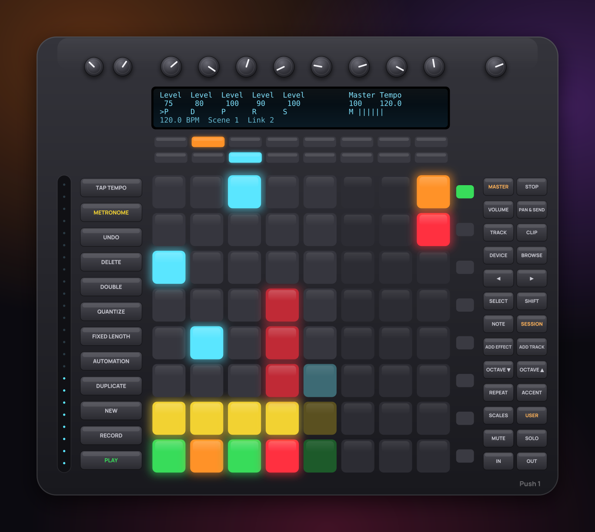
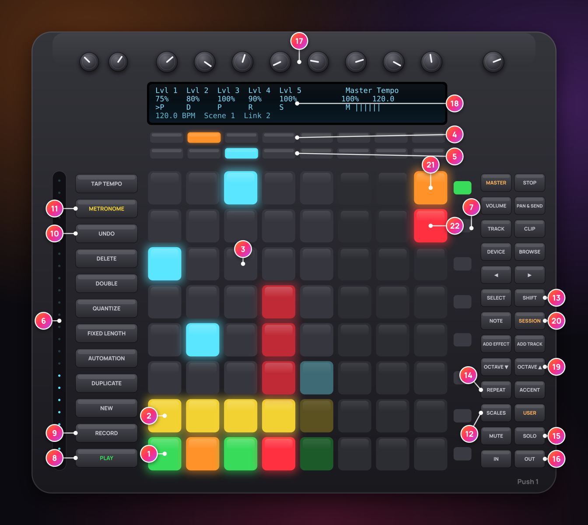
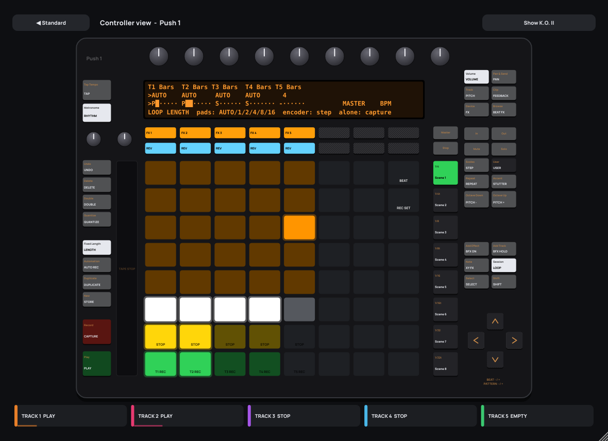
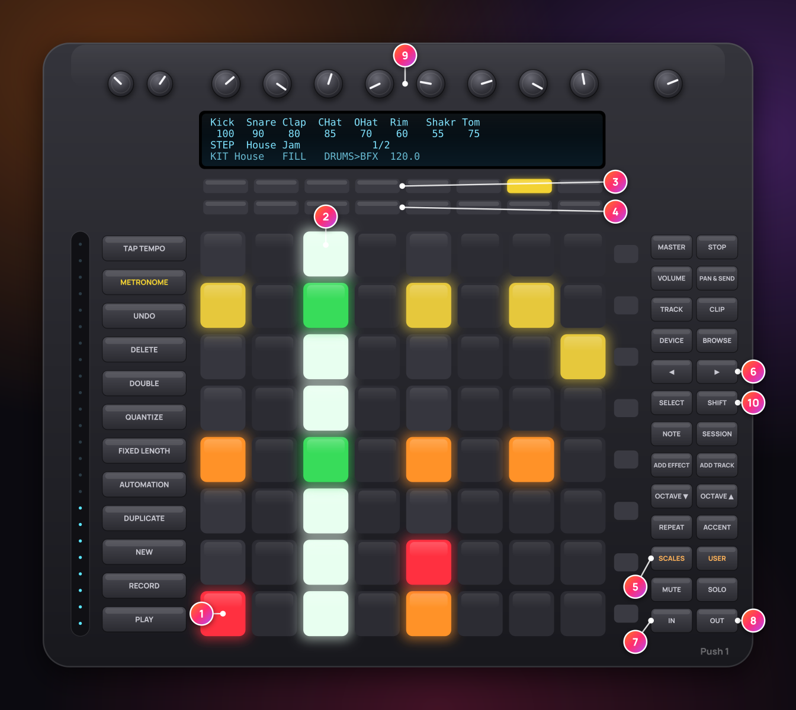

# Ableton Push control

livelooper talks **directly** to an Ableton Push (1) through its **User port**, both in the plug-in (VST3 / AU, in any DAW) and in the standalone app. Because livelooper drives Push itself, it does not depend on your DAW supporting Push. Pads light up with each track's state and loop position, the display shows names, values and tempo.

With a Push, livelooper becomes a self-contained instrument: no mouse, no screen, just pads and encoders – the way it is meant to be played live.

Push 2 and Push 3 send the same pad and button messages, so the controls should work on them too (not tested yet). LED colours may differ there, and their display is not used. The touch strip, footswitch and display features are made for Push 1.

## Setup

**In any DAW:** connect Push, load livelooper and press **USER** on Push – Push switches to livelooper. **SETUP → Ableton Push** shows "Connected". On Windows, a MIDI port can only be used by one program at a time: if your DAW has Push's User port ("MIDIIN2 / MIDIOUT2 (Ableton Push)") enabled, switch it off in the DAW's MIDI settings so livelooper can open it.

**In Ableton Live**
1. Leave Push set up as usual (control surface "Push" in Live's MIDI preferences).
2. Load livelooper. **SETUP → Ableton Push** shows "Connected".
3. Press **USER** on Push: Push switches to livelooper. Press **USER** again to return to Live.

**Windows (Live):** In Live's MIDI preferences, leave the input and output **"MIDIIN2 (Ableton Push)" / "MIDIOUT2 (Ableton Push)"** switched off (Track, Sync and Remote off). Otherwise livelooper cannot open the port. On macOS this is not needed.

**Standalone app:** connect Push and start livelooper. The app switches Push to User mode on its own.

Only one livelooper instance controls Push at a time. **SETUP → Ableton Push** switches the control on or off.

## Layout

### Layout at a glance

| # | Control | # | Control |
|---|---|---|---|
| 1 | bottom pad row: REC / PLAY / DUB | 11 | METRONOME: rhythm on / off · SHIFT: Link |
| 2 | second pad row: STOP | 12 | SCALES: STEP sequencer |
| 3 | pads 3 – 8: loop position – tap to jump, hold to stutter | 13 | SHIFT: second function of a button |
| 4 | top button row: track FX on / off | 14 | REPEAT / ACCENT: beat repeat / stutter while held |
| 5 | second button row: reverse · SHIFT: reverse the loop audio | 15 | MUTE / SOLO + pad: mute or solo while held |
| 6 | touch strip: tape stop · SHIFT: filter | 16 | IN: fill · OUT: drums through the beat FX |
| 7 | scene buttons: scenes 1 – 8 · SHIFT: store | 17 | encoders: level, pan, pitch, FX (mode buttons) |
| 8 | PLAY: all start / stop | 18 | display: names, values, tempo and meters |
| 9 | RECORD: capture the last bars as a loop | 19 | OCTAVE: pitch · SHIFT: half / double speed |
| 10 | UNDO · SHIFT: redo | 20 | SESSION: LOOP mode · NOTE: XY FX pad |

The same picture with the legend is in the in-app help (**?** → *Push 1*).

### LOOP mode (SESSION button)

Each of the 8 pad columns is one track (with 5 tracks, columns 6 to 8 stay dark).

| Pad row | Function | LED |
|---|---|---|
| 1 (bottom) | REC / PLAY / DUB | red = recording, orange = overdub, green = playing, dim green = stopped, blinking = waiting for the bar |
| 2 | STOP | yellow = playing, dim = stopped |
| 3 – 8 | loop position, **loop cutting** (see below) | the play head walks up the column (cyan = cut, dark red = muted); stopped tracks show the ghost play head |

#### Loop cutting on the position pads

The six position pads of a column are the six sixths of that track's loop.

| Gesture | Playing track | Stopped / empty track |
|---|---|---|
| **tap** a position pad | playback **jumps** to that sixth at the next 16th note and plays on from there | selects the track |
| **hold** a position pad (> ¼ s) | the slice **stutters** (repeats a ¼, ⅛ or 1/16 note); **releasing** returns to where the loop would be now – back in sync, as if it never jumped | selects the track |
| **SHIFT** + position pad | back in sync (ends a cut) | – |
| **SELECT** + any pad | selects the track, nothing else | selects the track |
| hold the **REC pad** of an empty / recording track + position pad 1 – 6 | – | fixed length for this recording: **1, 2, 4, 8, 16, 32 bars** (bottom to top); while it records, the column fills up as a progress bar |

The slice starts are snapped to 16th notes of the loop, so a cut keeps the groove on the grid. Every jump and return is crossfaded (3 ms) – no clicks. With quantize *Off* the jump happens at once. A stopped and restarted track always starts in sync again.

| Button | Function |
|---|---|
| top row 1 – 8 | track FX on / off |
| second row 1 – 8 | reverse on / off |
| scene buttons (right) | scenes 1 – 8 (top = 1). **SHIFT** + scene = store |
| PLAY | all start / stop |
| STOP | stop all |
| RECORD | capture (the last bars become a loop) |
| METRONOME | rhythm on / off · **SHIFT** + METRONOME = **Ableton Link** on / off |
| TAP TEMPO | tap tempo · **SHIFT** + TAP TEMPO = metronome click on / off |
| UNDO | undo of the selected track (**SHIFT** = redo) |
| DELETE + pad | clear the track |
| MUTE + pad | **tap**: stop the track (as before) · **hold** (> ¼ s): the track is **muted only while the pad is held** (it keeps running: a drop) |
| SOLO + pad | the track is **soloed while the pad is held** (the others are muted, instantly, no quantize) |
| DUPLICATE + pad + pad | copies the loop of the first track into the second (empty) track. DUPLICATE + one pad (or DUPLICATE alone: the selected track) copies to the next empty track. The copy is stopped and starts in sync |
| DOUBLE | **loop × 2** of the selected track (the loop is duplicated, e.g. to overdub a variation over the second half). **SHIFT** + DOUBLE = half the loop |
| OCTAVE UP / DOWN | pitch of the selected track +12 / −12 semitones |
| SHIFT + OCTAVE DOWN / UP | *(new in 1.6)* loop trick of the selected track: **half speed** (twice as long, an octave lower) / **double speed** (played twice, an octave higher) – on the next beat or bar, UNDO restores the loop |
| SHIFT + second row 1 – 8 | *(new in 1.6)* **reverse the loop audio** of that track (quantized, UNDO restores it). SCALES (with or without SHIFT) opens the STEP mode |
| MASTER | level meters on / off (display line 3) · *(new in 1.7)* **SHIFT + MASTER** = **Live view** on / off on the computer (large track cards for the stage, see the user guide, section 43) |
| SELECT + pad | select a track without doing anything else |
| SHIFT + row 1 / row 2 | undo / redo of that track |
| AUTOMATION | auto record on / off |
| NEW | store mode for scenes |
| QUANTIZE | next quantize value |
| FIXED LENGTH (press and release on its own) | **capture length**: 1 → 2 → 4 → 8 → 16 → 32 bars and around (**SHIFT** = shorter); RECORD captures |
| FIXED LENGTH **held** + pad / encoder | *(new in 1.7)* **loop length** of a track, see [below](#loop-length-new-in-17) |
| ADD EFFECT · ADD TRACK · LEFT / RIGHT · BROWSE · REPEAT · ACCENT | performance FX, see [below](#performance-fx-since-15) |

### Touch strip

| Gesture | Function |
|---|---|
| touch the strip, slide down | **tape stop**: the loops slow down like a stopping tape machine (top = normal speed, bottom = standing still). **Let go** and the tape spins back up and lands exactly where the music would be now – the timeline never stops |
| **SHIFT** + touch, slide | **performance filter** on the loops: lower half = low-pass closing, middle = off, upper half = high-pass opening. Letting go switches it off |
| hold **REPEAT** + touch, slide | **beat repeat** with the timing under your finger: bottom = 1/2, then 1/4, 1/8, 1/16, top = 1/32. It repeats while your finger is on the strip (or REPEAT is held) |
| hold **ACCENT** + touch, slide | the same for **stutter** |

Both work on the loop mix (tracks and track FX); the input monitor and the metronome are not affected. Both are host parameters (*Tape Stop*, *Performance Filter*), so an expression pedal or a ribbon can play them too.

### Footswitches

Push 1 has two footswitch jacks on the back (momentary footswitches).

| Footswitch | Function |
|---|---|
| **2** (CC 69) | **tap** = REC / PLAY / DUB of the selected track · **double tap** = STOP · **hold 1 s** = clear the track |
| **1** (CC 64) | next track (selects tracks 1, 2, 3 … in turn) |

Like on a looper pedal, the first tap of a double tap already acts (REC / PLAY / DUB), the second one stops. If a footswitch works the wrong way round, plug it in while pressing it or use its polarity switch.

### New in 1.6: pressure, more XY FX, set recording, encoder pages, track colours

livelooper switches Push 1 to **polyphonic aftertouch** (every pad reports its own pressure) when it connects.

| What | How |
|---|---|
| **Chop a loop by pressure** (LOOP mode) | press any pad of a playing track **harder**: that track's loop is chopped (beat repeat on that track) – more pressure = faster, **1/4 → 1/8 → 1/16 → 1/32**. Let go (or ease off) = normal playback. With channel pressure instead of poly aftertouch it acts on the last pad pressed. |
| **Pressure on the XY pad** (FX PAD mode) | pad pressure = FX amount (poly aftertouch and channel pressure). |
| **More FX on the XY pad** | in FX PAD mode **SHIFT + top button 1 – 8**: 1 beat FX (X = beat, Y = level) · 2 colour FX (X = knob of all tracks, Y = type) · 3 beat repeat (X = timing) · 4 stutter (X = timing) · 5 – 8 **punch FX** pages of three (press again = next of the page; X / Y = the effect's X / Y, pressure = amount). The display shows the selection (*XY: Punch 5 Tape Stop*). Top buttons without SHIFT = the FX slots again. |
| **Beat flash + set recording pads** (any mode with free columns, e.g. 5 tracks) | the **top-right pad** flashes orange on every beat; the **pad below it** switches the **set (performance) recording** on / off – red, blinking in time while it records. |
| **SHIFT + RECORD** (every track mode, made for 8 tracks) | set recording on / off; RECORD alone stays CAPTURE. RECORD blinks in time while the set recording runs. |
| **PLAY** | blinks in time while loops run – in every track mode. (Before 1.6 it was simply lit; no mode had a beat blink.) |
| **Encoder double touch** | touch any track encoder twice quickly (Push 1 encoders are touch-sensitive): the page cycles **Volume → Pan → Pitch → Feedback → Track colour → Volume**; the display shows the page. |
| **Track colour page** | each encoder picks its track's colour from the palette (auto, red, orange, yellow, lime, green, mint, cyan, sky, blue, violet, magenta, pink). The colour tints the track in the GUI and the loop position pads; it is saved with the project and sets. |
| **Controller GUI** | *SETUP → Controllers → GUI: Controller* (while Push is connected) shows a drawing of Push with the live pads, buttons and display – clickable. Unplug = back to the standard GUI. |

| # | Control (legend, continued) |
|---|---|
| 21 | top-right pad (5 tracks): flashes on every beat |
| 22 | pad below it: set recording on / off – blinks while recording |

### FX PAD mode (NOTE button)

The 8 × 8 pads become an **XY pad** for one effect: X (left to right) = parameter 1, Y (bottom to top) = parameter 2, **pad pressure** = more effect (from the effect's own mix up to 100 % wet). Touching switches the effect on. Releasing the pads **snaps back** to the previous settings. Hold **SHIFT** while releasing to keep the effect as it is. The top buttons 1 – 4 choose input FX A – D, buttons 5 – 8 choose track FX A – D. **SESSION** returns to LOOP mode.

### Encoders

| Mode button | Encoders 1 – 8 |
|---|---|
| VOLUME | level of tracks 1 – 8 |
| PAN & SEND | pan |
| TRACK | pitch (semitones) |
| CLIP | feedback |
| DEVICE | parameter 1 of input FX A – D (1 – 4) and track FX A – D (5 – 8). **SHIFT** = mix |
| BROWSE | performance FX: 1 beat FX type · 2 beat · 3 level / depth · 4 channel · 5 colour FX type · 6 repeat timing · 7 stutter timing · 8 metronome level (line 3 shows ON / off) |

Master encoder = master level · tempo encoder = tempo (1 BPM, **SHIFT** 0.1 BPM). **SHIFT** turns finely.

**Master section**: with up to 6 visible tracks the two rightmost encoders are a master section: **encoder 7 = master level**, **encoder 8 = tempo** (BPM, **SHIFT** 0.1 BPM); the display shows *Master* and *Tempo* above them. With 8 tracks (and in DEVICE and BROWSE mode) all eight encoders control tracks / effects; then use the master encoder (top right) and the tempo encoder (top left), and line 4 shows the master level. With **HOST SYNC** on, the host (your DAW) sets the tempo (the display shows *Host*): the internal tempo applies only without host sync.

Swing encoder = rhythm **swing**, **SHIFT** + swing encoder = rhythm level.

### Display

Line 1: what the encoders control · line 2: their values · line 3: track states (`>` = selected track) – **since 1.7 a loop progress bar per track** (state letter as in the table below, then the loop position in bar characters; *SETUP → Controllers → Push 1 display*, host parameter `push_progress`, on by default; off = the state words) · line 4: tempo, last scene, auto record, Link (with the number of peers), XY effect. Short messages (loop length, copy, octave …) appear on line 4 for a moment.

**Level meters** (MASTER button): line 3 shows a level bar under every track, made of the display's own bar characters (like Live's Push script), 0 to −48 dB, refreshed 25 times per second. In front of each bar: `>` for the selected track and a state letter:

| Letter | State |
|---|---|
| `P` | playing |
| `R` | recording |
| `D` | overdub |
| `S` | stopped |
| `-` | empty |
| `r` / `p` | waits for the bar to record / play |
| `s` | stops (fade / loop end) |
| `M` | muted (MUTE, or another track is soloed) |

A solid block at the end of a bar = the track reached 0 dBFS. With up to 6 tracks the master meter sits in the master section (*M*), with 8 tracks at the start of line 4 (*Out*).

**Amount bar (1.7):** while a punch FX is held (pad, K.O. II, MIDI) or the XY pad is played, line 4 shows its name and the amount as a 20-cell bar with the percentage (e.g. `TAPE STOP ▮▮▮▮▮▮▮▮▮▮▮▮------- 62%`).

**Velocity curve (1.7):** *SETUP → Controllers → Velocity curves → Push 1* (host parameter `vel_push`): Soft / Normal / Hard / Fixed for the pads (punch FX amount, step velocity).

### Performance FX (since 1.5)

The beat FX, beat repeat / stutter, colour FX and metronome of the performance row (user guide, sections 25–28) are on Push without any mapping:

| Button | Function |
|---|---|
| ADD EFFECT | **beat FX** on / off |
| ADD TRACK | beat FX **while held** (a quick throw) |
| LEFT / RIGHT (arrows) | beat fraction shorter / longer (1/32 … 16 beats) |
| BROWSE | encoders for the performance FX (see *Encoders*) |
| REPEAT | **beat repeat while held** with the repeat timing · **SHIFT** + REPEAT = latch on / off |
| ACCENT | **stutter while held** with the stutter timing · **SHIFT** + ACCENT = latch on / off |
| REPEAT / ACCENT held + touch strip | choose the timing with your finger: 1/2 (bottom) … 1/32 (top) |
| FIXED LENGTH | capture length 1 – 32 bars (**SHIFT** = shorter) – on release, when nothing else was pressed while holding it (1.7: held = loop length) |
| SHIFT + METRONOME | Ableton Link on / off (line 4 shows *Link* and the peers) |
| SHIFT + TAP TEMPO | metronome click on / off |

The buttons light up while their function is on. Everything starts on the grid of the chosen timing and returns in sync when you let go.

### Loop length (new in 1.7)

The loop length of a track (AUTO or 1 – 16 bars: the first recording ends by itself after that many bars – the pill on the track strips, host parameter *Loop Length* `t1_measure` …) is one button away, in **every** pad mode (LOOP, FX PAD, STEP):

| Gesture | Function |
|---|---|
| hold **FIXED LENGTH** | the display shows the length of every track (line 1 `T1 Bars` …, line 2 `AUTO` / `4` …, `>` = selected track), the pads show the choices: rows 3 – 8 from the bottom = **AUTO, 1, 2, 4, 8, 16 bars** (white / orange = current, grey / dim orange = the others) |
| FIXED LENGTH held + pad in rows 3 – 8 | sets that track's loop length and selects the track (line 4: `T3 loop length: 4 BARS`). Rows 1 – 2 only select the track (no recording starts) |
| FIXED LENGTH held + track encoder 1 – 8 | steps that track's length (three ticks per step) |
| FIXED LENGTH pressed and released alone | capture length as before (**SHIFT** = shorter) |
| LED of FIXED LENGTH | lit while held and when the **selected** track has a length other than AUTO, dim otherwise |

The length counts for the first recording; on a track that holds a loop it applies to the next new recording (after DELETE). **REC pad held + position pad** still sets a length for *this* recording only (1 – 32 bars, host parameter *Loop Length Once*), without changing the setting. Other MIDI controllers: map *Loop Length* (selector) or *Loop Length Once* (see [MIDI](MIDI.md)). The K.O. II has no free button combination for it – use the GUI or a MIDI mapping.

### MIDI and host parameters

Every Push gesture uses functions that are also host parameters, so any MIDI controller can play them (see [MIDI](MIDI.md)): *Slice 1 – 6* (per track; held = note on, released = note off), *Back in Sync*, *Mute*, *Solo*, *Double Loop*, *Halve Loop*, *Octave Up / Down*, *Copy to Empty Track*, *Loop Length Once* (*Rec Length* before 1.7), *Loop Length* (1.7, FIXED LENGTH held), *Tape Stop* and *Performance Filter* – and since 1.5 *Beat FX On / Hold / Type / Beat / Level/Depth / Channel*, *Color FX Type*, *Color 1 – 8*, *Beat Repeat Hold / Latch / Timing*, *Stutter Hold / Latch / Timing*, *Metronome On / Level / Accent*, *Link*, *Capture Bars*.

### STEP mode and FILL (1.6)

**SCALES** switches to the **STEP mode**: the pads become a step sequencer for the drums (press SCALES again, SESSION or NOTE to leave it).

1 pad rows = drum voices (kick at the bottom, tom on top) · 2 the green / white column plays now · 3 top buttons: row mute · 4 lower buttons: row solo · 5 SCALES: STEP mode on / off · 6 LEFT / RIGHT: previous / next 8 steps · 7 IN: fill while held · 8 OUT: drums through the beat FX · 9 encoders: row level (SHIFT: pitch) · 10 SHIFT + pad: accent

| | STEP mode |
|---|---|
| Pad rows | the eight voices of the kit, **bottom row = kick**, then snare, clap, closed hat, open hat, rim, shaker, **top row = tom** (Afro Latin / packs: their instruments) |
| Pad columns | 8 steps; the pad velocity becomes the step velocity |
| Pad | step on / off · **SHIFT** + pad = accent on / off |
| LEFT / RIGHT | previous / next 8 steps (16 steps per bar = 2 pages, up to 4 bars × 32 steps) |
| UP / DOWN | next / previous pattern (built-in grooves and User 1 … 16; switches as set in PATTERN SWITCH) |
| DELETE + pad | clear the whole row |
| MUTE + pad, top buttons 1 – 8 | row mute on / off |
| SOLO + pad, lower buttons 1 – 8 | row solo on / off |
| Encoders 1 – 8 | row level · **SHIFT**: row pitch (±12 semitones) |

Pad colours: grey = empty step on the 1st / 3rd beat (orientation), yellow = ghost, orange = normal, red = accent, green / white = the step that plays now, dim yellow = muted row. When a built-in groove plays, the first pad press copies it into a free user slot (User 1 … 16) which then plays – the built-in grooves are never changed. Display: line 1 voice names, line 2 level (SHIFT: pitch) or MUTE / SOLO, line 3 pattern and shown steps, line 4 kit, FILL, DRUMS routing and messages.

In **every mode**:

| Button | Function |
|---|---|
| IN | **FILL** while held – the groove comes back on the next downbeat after you let go |
| OUT | drums through the **beat FX** on / off |
| SHIFT + OUT | drums through **beat repeat / stutter** on / off |

The IN and OUT buttons light up while the fill plays / a DRUMS routing is on. New host parameters for other controllers: *Fill (hold)*, *Drums through Beat FX*, *Drums through Repeat/Stutter*, *Pattern Switch*, *Drum Variation*, *Beat Row 1 … 8 Mute / Solo / Level / Pitch*.
