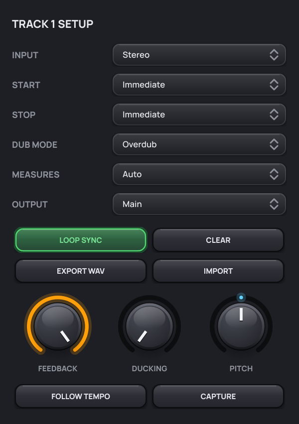
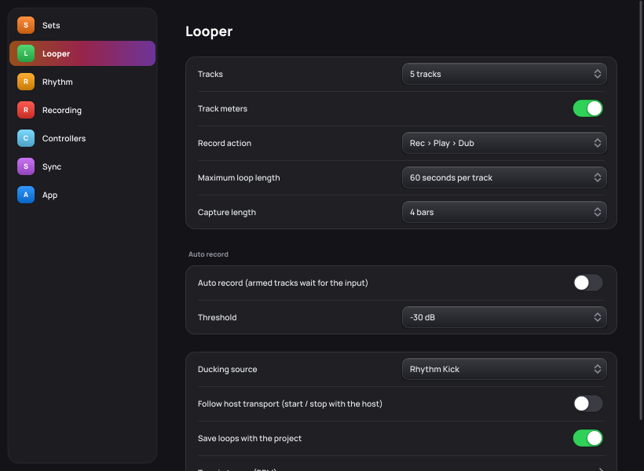
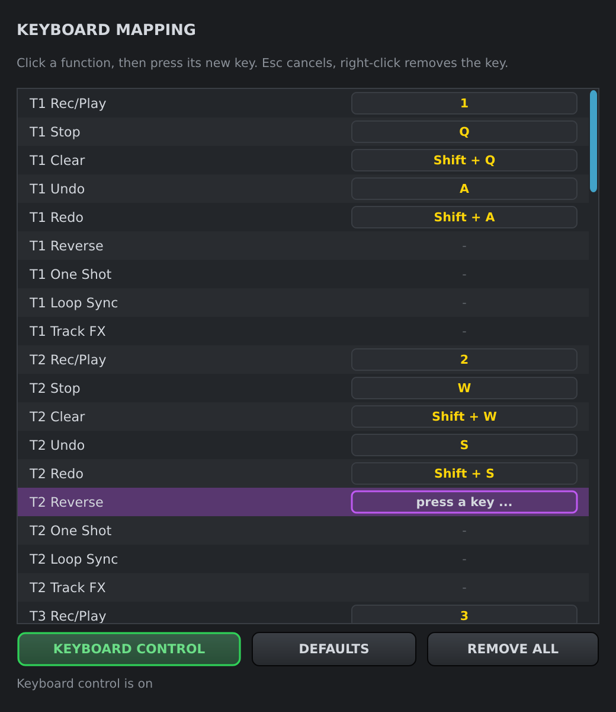
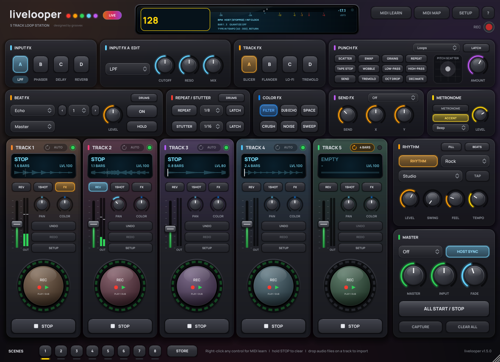
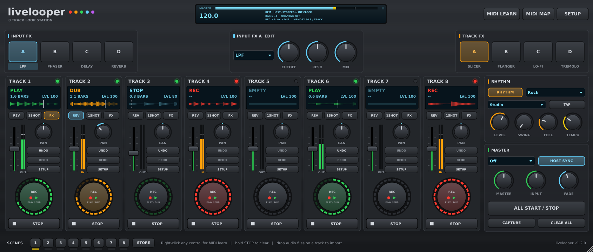
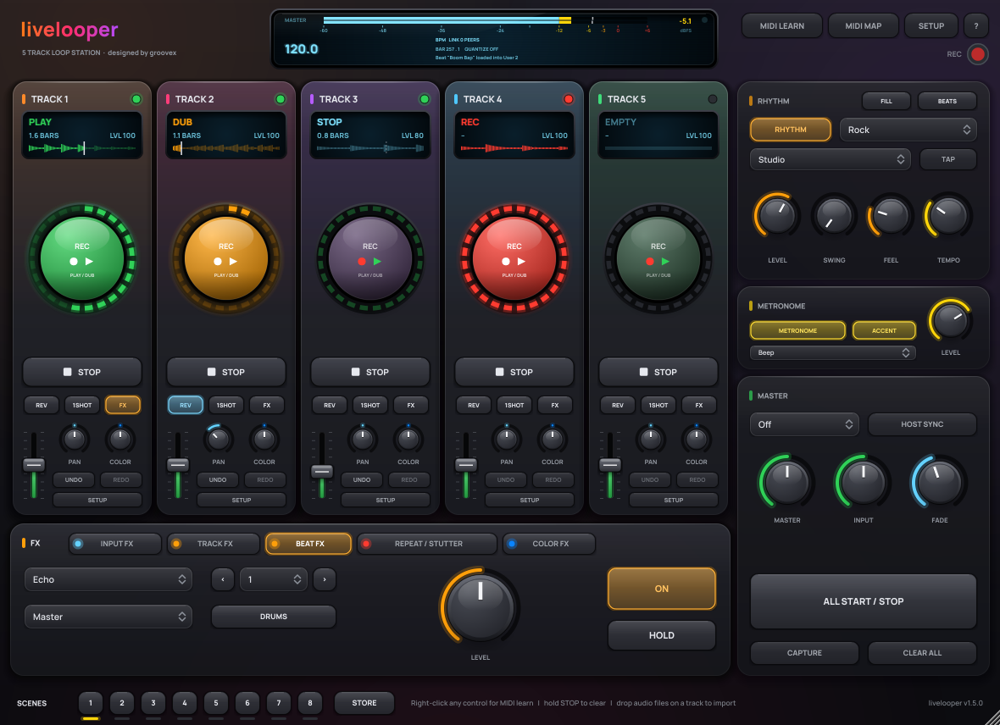
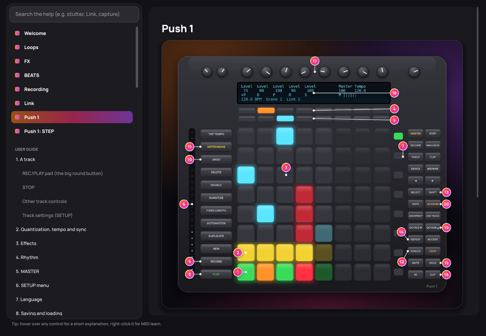
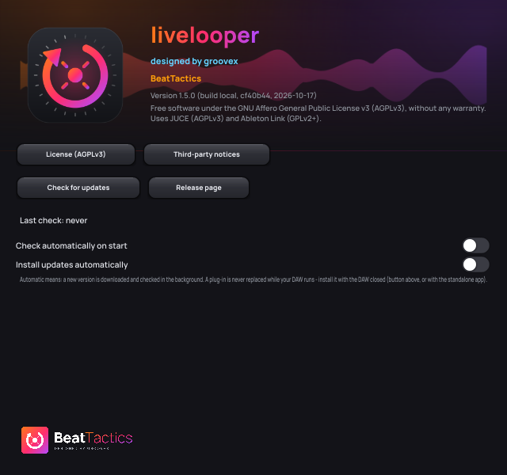
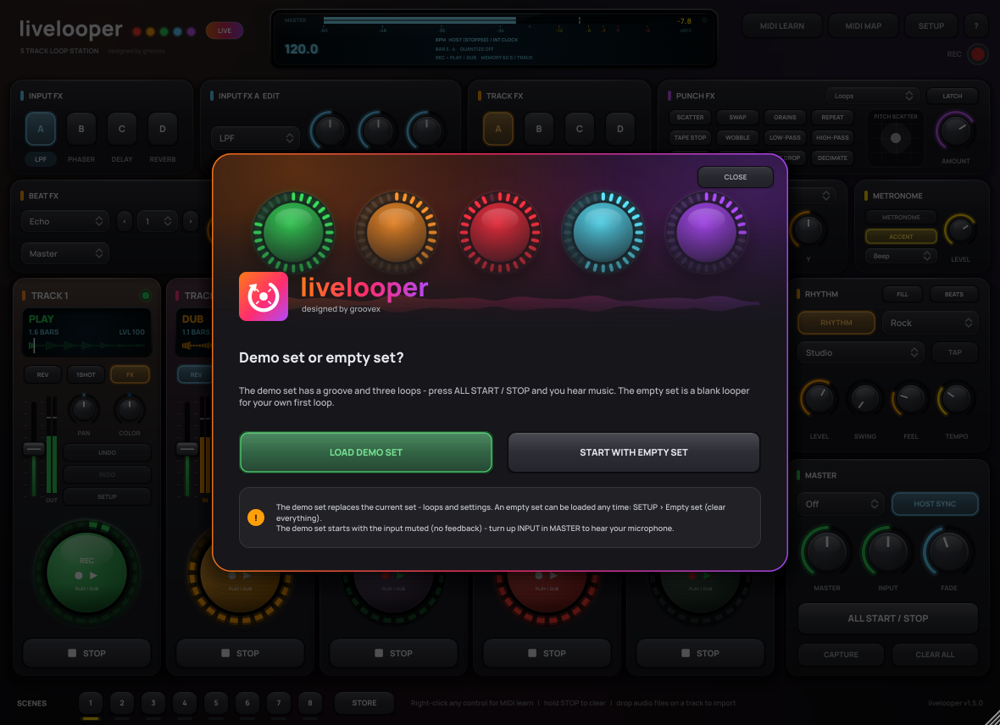

# User Guide

**English** | [Deutsch](../de/BEDIENUNGSANLEITUNG.md)

livelooper is built as an **instrument for exploring and playing live**: every control reacts instantly and lands on the beat, and everything can be played from an [Ableton Push](PUSH.md), any MIDI controller or the computer keyboard. Section 23 has tips for playing live. How to wire the plug-in into your DAW (looper track, monitoring, looping software instruments, switching sources) is explained in [DAW-SETUP.md](DAW-SETUP.md).

The interface puts the loops first (since 1.6): the track strips are the largest and brightest part, each with its own colour and a big pad that invites you to play. The effects come second, everything else stays quiet around them:

| Area | Contents |
|---|---|
| Header | display (tempo, bar/beat, quantization, Link, master VU in dB, messages), **MIDI LEARN**, **MIDI MAP**, **SETUP**, **?** (help), the round **REC** button (performance recorder) |
| TRACK 1–5 (or 1–8) | the loop tracks (SETUP → Looper → Tracks): display with waveform, the big REC/PLAY pad, STOP, REV / 1SHOT / FX and a small mixer row |
| FX (below the tracks) | one group at a time – **INPUT FX**, **TRACK FX**, **BEAT FX**, **REPEAT / STUTTER**, **COLOR FX**. A small light on a tab shows that something in that group is on (sections 3, 25–27) |
| RHYTHM | drum machine, tempo, tap, FILL, BEATS |
| METRONOME | click on / off, accent, sound, level (section 28) |
| MASTER | quantization, host sync, levels, fade time, ALL START/STOP, CAPTURE, CLEAR ALL |
| Footer | 8 scene buttons, STORE |

Drag the bottom right corner to resize the window; the interface scales with it. Hover over any control to see a tooltip.

---

## 1. A track

### REC/PLAY pad (the big round button)

| Track state | Pressing REC/PLAY |
|---|---|
| empty | **recording** starts (quantized: on the next bar/beat) |
| recording | recording ends → **overdub** (default "Rec > Dub") or **play** ("Rec > Play") |
| overdub | → **play** |
| play | → **overdub** |
| stopped | → **play** (quantized) |
| waiting (blinking) | pressing again cancels the wait |

The LED ring shows the state and the position in the loop:

- **red** recording · **orange** overdub · **green** play · **dim green** stopped, loop present · **off** empty
- **blinking**: waiting for the next bar (recording, start or end of recording)
- the bright segments run around the ring and show the playback position

### STOP

- short press: the track stops (depending on the **Stop** mode immediately, with fade out or at the loop end)
- press while recording: the recording ends and the track stops
- **hold for 1.5 s: clear the track** (the red bar shows the progress)

### Other track controls

| Control | Function |
|---|---|
| Display | state, length in bars, level, progress bar |
| **REV** | play the loop backwards (also while overdubbing) |
| **1SHOT** | play the loop once, then stop |
| **FX** | send the track through the track FX |
| Fader | level 0–200 % (double-click = 100 %), level meter next to it |
| **PAN** | panorama L50–R50 (double-click = centre) |
| **UNDO / REDO** | take back / restore the last overdub. Undo right after the first recording empties the track, redo brings it back |
| **SETUP** | track settings (picture above) |

### Track settings (SETUP)

| Setting | Values | Meaning |
|---|---|---|
| Input | Stereo · Left · Right | which input channel is recorded (Left/Right = mono on both sides) |
| Start | Immediate · Fade In | playback starts immediately or fades in (fade time in MASTER) |
| Stop | Immediate · Fade Out · Loop End | stop immediately, fade out, or stop at the end of the loop |
| Dub mode | Overdub · Replace | add to or replace the loop while overdubbing |
| Measures | Auto · 1 · 2 · 4 · 8 · 16 | Auto = length set by the second press; a fixed number = recording ends automatically after that many bars |
| LOOP SYNC | on/off | the loop stays locked to the bar grid: after jumping in the DAW's timeline or restarting it continues at the right spot |
| CLEAR | | clear the track |
| EXPORT WAV | | save the loop as a 24-bit WAV |
| IMPORT | | load an audio file (WAV, AIFF, FLAC, OGG, MP3) into the track. Faster: drag & drop the file onto the track |

---

## 2. Quantization, tempo and sync

**QUANTIZE** (MASTER):

- **Measure** (default): start of recording, end of recording and start of playback happen on the next bar line. Loops are therefore always whole bars long.
- **Beat**: the same on quarter-note beats.
- **Off**: everything immediately, free loop length (sample-accurate between the two presses).

**Retroactive ending**: if you press to end a recording up to 15 % of a grid step *after* the bar line, the loop still ends exactly on the bar line – whatever you played after the bar line is moved to the start of the loop (into the overdub). If you press too early, the looper simply waits for the bar line.

**HOST SYNC** (on by default): tempo, time signature and position come from your DAW. When the host transport is stopped, an internal clock continues at the current host tempo as soon as a track records or plays. Without host sync the internal tempo applies (knob **TEMPO**, tap **TAP** several times in time, or click the tempo on the display and type it in – see section 11).

**Follow host transport** (SETUP menu): loops start with your DAW's play button and stop with its stop button.

Note: if the tempo changes after a loop was recorded, the loop is not time-stretched – it keeps playing at its original speed.

---

## 3. Effects

There are two effect banks with four slots each:

- **INPUT FX** process the input signal – what you hear is also what gets recorded.
- **TRACK FX** process all tracks that have **FX** switched on (a shared effect bus), without changing the recording.

Both banks are tabs of the **FX** panel below the tracks (**INPUT FX** / **TRACK FX**). The **A/B/C/D** pad switches the slot on and off and selects it for editing at the same time; clicking the effect name below it only selects it. Right next to the pads (**… EDIT**) you set the type, two parameters and the mix. The slots of a bank are connected in series (A → B → C → D).

| Effect | P1 | P2 | Mix |
|---|---|---|---|
| LPF / HPF / BPF | cutoff | resonance | dry/wet |
| Phaser | depth | rate (0.05–5 Hz) | dry/wet |
| Flanger | feedback | rate | dry/wet |
| Delay | feedback | time: 1/16 · 1/8 · 1/8. · 1/4 · 1/4. · 1/2 (tempo-synced) | echo level |
| Reverb | room size | damping | reverb level |
| Slicer | depth | pattern (8 rhythms in 16ths) | dry/wet |
| Tremolo | depth | rate: 1 bar … 1/32 (tempo-synced) | dry/wet |
| Auto Pan | depth | rate (tempo-synced) | dry/wet |
| Lo-Fi | bit depth (16 → 3 bit) | sample rate reduction | dry/wet |
| Overdrive | drive | tone | dry/wet |

Switching on and off is crossfaded without clicks.

---

## 4. Rhythm

**RHYTHM** switches the drum machine on; choose the pattern next to it: Metronome, Rock, Pop, Funk, Hip Hop, House, Techno, Breakbeat, Reggae, Bossa, Shuffle, Half Time, Trap, Lo-Fi, Drum & Bass, Afrobeat, Dembow, UK Garage, Neo Soul, Disco, Afro House. The rhythm is locked to the bar grid (host or internal clock) and is not recorded. The metronome accents the downbeat.

| Control | Function |
|---|---|
| **Kit** | **Studio** (tight, modern acoustic kit), **808** (deep boom kick, crisp hats), **909 Style** (punchy house / techno), **Lo-Fi** (warm, dusty, soft top end) – all four play recorded drum samples (CC0 / public domain, see [THIRD-PARTY.md](../../THIRD-PARTY.md)) with several velocity layers and round robin |
| **LEVEL** | volume of the rhythm |
| **SWING** | delays every second 16th note. 50 % = straight, 54–58 % = a light groove, 66 % = triplet shuffle, 75 % = maximum. Tip: Hip Hop / Lo-Fi 56–60 %, UK Garage 60–64 %, Neo Soul 60–66 % |
| **FEEL** | humanize: small variations in timing (a few ms late, never early) and velocity. 0 % = machine-exact |
| **TEMPO / TAP** | internal tempo |

Every pattern has accents and ghost notes, hi-hat rolls (Trap) and percussion (rimshot, shaker, tom). Snare, clap and rimshot sit in a short room. The metronome is never swung.

The kit names describe a sound style; "909 Style" and "808" are not the original machines and imply no endorsement by any manufacturer.

**Groove** (*SETUP → Rhythm groove*, since 1.5): the feel of a drummer – small, fixed timing offsets per instrument and an accent curve, on top of SWING and FEEL:

| Groove | Feel |
|---|---|
| Straight | machine-exact |
| Natural (default) | a few ms of human looseness, slightly behind on the backbeat |
| Laid Back | snare and hats clearly behind the beat – hip hop, neo soul |
| Pushed | everything slightly ahead – urgent, driving |
| Drunk | loose, wobbly, behind the beat (think late-night beat tapes) |
| Drive | kick and hats on top of the beat – rock, techno |

**Fills** (*SETUP → Rhythm fills*): *Off*, *Every 4 Bars* or *Every 8 Bars* – the drummer plays a short fill (snare / tom run) in the last beat before the next phrase.

**Since 1.6:** 8 more style kits with matching grooves and fills, more lively kicks (VARIATION), the **BEATS** step sequencer for your own patterns, **FILL** on demand, the drums through beat FX / repeat if you like, and sound packs – see [Drums, BEATS and sound packs](#drums-beats-and-sound-packs-16).

---

## 5. MASTER

| Control | Function |
|---|---|
| QUANTIZE | Off · Beat · Measure |
| HOST SYNC | follow the host's tempo/transport |
| MASTER | overall level 0–200 % |
| INPUT | level of the input passed straight through, 0–200 % (recording is independent of it) |
| FADE | fade time for fade in/fade out (10 ms – 8 s) |
| ALL START / STOP | if any track is playing: stop all; otherwise start all tracks that have a loop (quantized) |
| CLEAR ALL | clear all tracks (asks first) |
| CAPTURE | the last 1–32 bars become a loop (section 16) |

---

## 6. SETUP menu

Since 1.6 **SETUP** opens a settings window in the style of the macOS System Settings: the pages on the left (**Sets**, **Looper**, **Rhythm**, **Recording**, **Audio**, **Controllers**, **Sync**, **App**), grouped rows on the right – switches, pop-up menus and actions, with short notes underneath. Every entry below is on one of these pages.

| Entry | Meaning |
|---|---|
| Record action | "Rec > Dub > Play" (default) or "Rec > Play > Dub". The REC button legend ("DUB / PLAY" or "PLAY / DUB") and the bottom display line show the active mode. |
| Follow host transport | loops start/stop with the host transport |
| Maximum loop length | 30 · 60 · 120 · 240 · 480 seconds per track (determines memory use; existing loops are kept) |
| Save loops with the project | store loops in the DAW project (on by default). Off = smaller projects, loops are gone after loading |
| Computer keyboard control | standalone app only: keys on/off (section 10) |
| Keyboard mapping … | standalone app only: own key mapping (section 10) |
| Type in tempo (BPM) … | type the internal tempo (section 11) |
| Language / Sprache | Automatic (system language) · English · Deutsch |
| Last used sets | the last 10 sets you saved or loaded, one click to load (section 13) |
| Capture length | 1 · 2 · 4 · 8 · 16 · 32 bars (section 16) |
| Rhythm groove / Rhythm fills | feel and fills of the drum machine (section 4) |
| Ableton Link | Link on / off, sync start / stop, number of peers (section 29) |
| Settings on start | start with the last used or the default settings, reset now (section 31) |
| Updates | check now, check automatically, install automatically (section 32) |
| Help … / About livelooper … | in-app help and the about window (sections 30 and 32) |

---

## 7. Language

The whole interface – buttons, displays, menus, tooltips, dialogs and parameter names – is available in English and German.

- **SETUP → Language / Sprache → Automatic** (default) uses German if your operating system is set to German, otherwise English.
- **English** or **Deutsch** fixes the language. The choice is saved on this computer and applies to all livelooper instances, in your DAW and in the standalone app.
- The interface switches immediately. The parameter names your DAW shows (device, MIDI mapping, automation) are read when the plug-in is loaded, so they switch after reloading the plug-in (e.g. reopening the project). Existing MIDI maps and automation are not affected.

---

## 8. Saving and loading

Your DAW project stores all parameters, the MIDI assignments and – if switched on – the loops (lossless FLAC, 24 bit). After loading, the tracks are stopped and start with REC/PLAY or ALL START. If the project's sample rate changes, the loops are converted automatically.

## 9. Display

- big number: current tempo – click it to type in the BPM
- top row: **master VU** of the main output in dBFS, left and right, with a scale from -60 to +6 dB and the peak value in numbers – green up to -12 dB, yellow up to -3 dB, orange up to 0 dB, red above (section 12)
- line 1: tempo source (HOST, INTERNAL, internal clock) and **Link** status: *LINK 2 PEERS* while Link drives the tempo, *LINK (HOST SYNC HAS PRIORITY)* when HOST SYNC wins in a DAW
- line 2: bar . beat and quantization
- line 3: messages (export, import, MIDI learn) or the memory per track
- dot at top right: lights up yellow on incoming MIDI

---

## 10. Computer keyboard (standalone app)

In the standalone app the computer keyboard plays livelooper like a hardware unit – handy on a MacBook without a controller. In a DAW the keyboard belongs to the DAW, so this is a standalone feature (there, use MIDI or your DAW's own key commands / key mapping instead).

Default mapping – one keyboard column per track:

| Key | Function |
|---|---|
| **1 2 3 4 5** (6 7 8) | REC/PLAY of track 1–5 (6–8) |
| **Q W E R T** (Y U I) | STOP track 1–5 (6–8) |
| **Shift + Q … T** | CLEAR track 1–5 – hold the key for 1.5 s, like the STOP button (a short tap does nothing) |
| **A S D F G** (H J L) | UNDO track 1–5 (6–8) |
| **Shift + A … G** | REDO track 1–5 |
| **Space** | ALL START / STOP |
| **Shift + Backspace** | CLEAR ALL (asks first) |
| **Return** | TAP tempo |
| **B** | type in the tempo (BPM) |
| **Arrow Up / Down** | tempo +1 / −1 BPM (Shift: ±0.1) |
| **M** | RHYTHM on/off |
| **N** | next rhythm pattern |
| **K** | next quantize setting |

The display briefly shows which key did what (e.g. `KEY Q > T1 STOP`). Holding a key does not repeat it – except tempo up/down.

**Own key mapping:** *SETUP → Keyboard mapping …* lists every function (all track functions incl. reverse, one shot, loop sync and FX, all global functions, FX slots A–D, tempo). Click a function and press its new key – modifiers (Shift, Ctrl, Option, Cmd) count. A key that was already used moves to the new function. Esc cancels, right-click removes a key, **DEFAULTS** restores the table above, **REMOVE ALL** empties it, **KEYBOARD CONTROL** switches keyboard control on/off (also *SETUP → Computer keyboard control*). The mapping is saved together with the app's state.

## 11. Typing in the tempo

Click the big tempo number on the display (or press **B**, or right-click the TEMPO knob → *Type in tempo (BPM) …*, or *SETUP → Type in tempo (BPM) …*), type the BPM and press Return. Decimals work with a point or a comma (`97.5`, `97,5`); the range is 40–300 BPM, Esc cancels. The value sets the internal tempo – while HOST SYNC follows a running host, the host tempo stays in charge.

## 12. Meters, waveform and clip LED

- **Track meter** (stereo, next to the level fader; off by default since 1.6 – switch it on with **SETUP → Looper → Track meters**): while a track records or overdubs it shows the **input** level (orange, caption **IN**), otherwise the track's **output** level (green, **OUT**). Yellow from -12 dB, red from -1 dB; the thin line holds the peak for about a second.
- **Master VU** (since 1.5): the top row of the display (**MASTER**) shows the level of the main output in dBFS, left and right, on a scale from -60 to +6 dB, with the peak as a number on the right. Green up to -12 dB, yellow up to -3 dB, orange up to 0 dB, red above – keep the loud parts in the yellow.
- **Waveform**: the track display shows an overview of the loop instead of a plain progress bar. The part already played is bright, a white line marks the play position. While recording, the waveform grows from left to right; overdubs and undo show up right away. Reversed tracks show the waveform mirrored.
- **Clip LED** (top right of every track): off = empty, green = the track holds a loop, red = first recording, blinking red = waiting for the next bar to start recording.

## 13. Looper sets

A set stores the whole looper in one file (`.llset`): all loops, levels, pan, track settings, effects, rhythm, tempo and quantize settings.

- **SETUP → Save set ...** writes a set (a set always contains its loops, even if *Save loops with the project* is off).
- **SETUP → Load set ...** loads one; you can also drop a `.llset` file onto the window.
- Your MIDI mapping, keyboard mapping and cue routing belong to the app and stay as they are when you load a set.
- **SETUP → Last used sets** lists the last 10 sets you saved or loaded (files that no longer exist are left out); *Clear list* empties it.

## 14. Cue output (standalone app)

The standalone app has a second output bus for the **rhythm and metronome**, so you can hear the click on headphones without it reaching the audience.

1. Open **Options → Audio/MIDI Settings** and enable the extra outputs of your audio interface (outputs 3 and up).
2. **SETUP → Cue output (click / rhythm)**: choose the output pair (e.g. *Outputs 3 / 4*) and where the rhythm plays: **Main output**, **Cue output only** or **Main and cue output**.

Without a cue pair (or in a plug-in) the rhythm always plays on the main output, so the click is never lost. The setting is saved with the app.

## 15. Metronome sound

**SETUP → Metronome sound** (or the sound menu in the **METRONOME** block, section 28): **Beep** (classic), **Woodblock** (short, wooden knock), **Click** (dry tick without pitch) or **Rimshot**.

## 16. Capture (retrospective recording)

You played something great without pressing record? Press **CAPTURE** (MASTER panel). The last bars you played become a loop on the first empty track and play on at once, in time. The length is set in **SETUP → Capture length** (1, 2, 4, 8, 16 or 32 bars; on Push: FIXED LENGTH). If less was played, livelooper takes the largest length that fits. Every track's SETUP also has a **CAPTURE** button for that track. **UNDO** removes a captured loop.

## 17. Auto record

**SETUP → Auto record**: armed tracks (REC pressed, display **AUTO REC**) wait until the input passes the threshold (-50 to -12 dB) and start recording with the first note. Hands stay on the instrument. Pressing REC again cancels.

## 18. Track settings: feedback, ducking, pitch, follow tempo, output

| Setting | Meaning |
|---|---|
| **FEEDBACK** | how much of the loop remains with every overdub pass. 100 % = all (classic overdub); lower values let older layers fade away like tape echo |
| **DUCKING** | lowers the track while the ducking source plays (**SETUP → Ducking source**: the rhythm's kick or track 1). Gives pumping, sidechain-style grooves |
| **PITCH** | -12 to +12 semitones, the length stays the same |
| **FOLLOW TEMPO** | the loop follows tempo changes (host or internal) without changing pitch (time-stretch) |
| **OUTPUT** | Main · Direct · Main + Direct: where the track is heard (section 20) |
| **Input → Resample** | the track records the mix of the other tracks (bounce): combine loops on one track and free the others |

## 19. Scenes

The footer has **8 scene buttons**. Pressing an empty scene stores which tracks are playing. Pressing a stored scene starts its tracks and stops the others, quantized to the next bar or beat. **STORE** + scene button overwrites a scene. A dim LED shows that a scene is stored, a bright one shows the last scene you called up. Scenes are saved with the project and in sets, and they are MIDI-mappable.

## 20. Direct track outputs

- **Plug-in**: livelooper has an optional stereo output per track ("Track 1" … "Track 8"). Enable it in your DAW (each track then gets its own output there), for example in Ableton Live through a second audio track with *Audio From: livelooper → Track 1*.
- **Standalone app**: **SETUP → Direct track outputs** assigns each track an output pair of the audio interface (outputs 3/4 and up, not the cue pair).
- In the track SETUP, **OUTPUT** decides between *Main*, *Direct* (only the direct output) and *Main + Direct*. Without an active direct output the track always plays on the main output.
- More ways to get audio out of livelooper in your DAW: [DAW-SETUP.md, section 5](DAW-SETUP.md#5-getting-the-audio-out).

## 21. 8 tracks, ghost play head, stem export

- **SETUP → Tracks → 8 tracks** shows three more tracks and makes the window wider. Hidden tracks use no memory. Switching back to 5 tracks clears tracks 6 to 8.
- **Ghost play head**: a stopped track shows a dotted line where it would be playing now, so you can bring it back in on cue.
- **SETUP → Export stems** writes every track with a loop as a 24-bit WAV (`livelooper-track1-120bpm.wav`) with tempo and beat metadata (ACID), so most DAWs place it straight on the grid.

## 22. Drag loops into your DAW

Grab the **waveform** in a track's display and drag it out of livelooper:

- onto an **audio track** in your DAW – the loop becomes a clip / region (in Ableton Live in Arrangement or Session view),
- into your DAW's **browser** or onto the desktop / Finder / Explorer.

livelooper writes a new 24-bit WAV with tempo and beat information (ACID metadata, `livelooper-track1-120bpm-<date>.wav`), so most DAWs place it on the grid at the right length (Ableton Live, for example, warps it automatically). The files are kept in *Music → livelooper → Dragged Loops* because the DAW project keeps referencing them there – use your DAW's function for collecting/consolidating files to copy them into your project (in Live: *File → Collect All and Save*). Dropping such a file back onto livelooper does nothing. The cursor turns into a hand over a waveform that can be dragged; tracks that are empty or still recording cannot be dragged.

## 23. Playing live

livelooper is meant to be played like an instrument. A few habits that help on stage:

- **Hands on hardware**: put the transport on an [Ableton Push](PUSH.md) or a MIDI controller ([MIDI](MIDI.md)) so you never need the mouse.
- **Keep it moving**: use quantize *Bar*, fixed loop lengths and auto record – every press lands on time, even when you're busy playing.
- **Improvise first, record later**: just play – when something good happens, press **CAPTURE**.
- **Build an arc**: store verse, chorus and breakdown as **scenes** and switch between them on the bar.
- **Shape layers instead of stacking them**: feedback below 100 % lets old layers fade, pitch and reverse turn a phrase into something new, the FX XY pad on Push is made for drops and builds.
- **Keep the good moments**: drag a loop onto a track in your DAW or export stems after the show.
- **Several instruments, one looper**: route them all into the looper track and switch by playing, muting or arming – see [DAW-SETUP.md, section 4](DAW-SETUP.md#4-switching-between-instruments-and-sources-while-playing).

## 24. Performance moves (since 1.4)

New functions for playing live. They are host parameters (MIDI learn, your DAW's MIDI mapping, keyboard) and gestures on [Ableton Push](PUSH.md):

- **Loop cutting** (*Slice 1 – 6*): jumps to one of six positions of a playing loop at the next 16th note (with quantize *Off* at once). A short press stays there, a press held longer than ¼ s repeats the slice (a ¼, ⅛ or 1/16 note) and returns on release to where the loop would be now – in sync. *Back in Sync* ends a cut. Jumps are crossfaded, so they never click.
- **Mute** / **Solo**: silence a track (or all others) without stopping it – it keeps running in time and comes back exactly in place.
- **Double Loop**: the loop is duplicated (twice as long) – overdub a variation over the second half. **Halve Loop** keeps the first half. Both work on playing or stopped tracks and can be undone with UNDO.
- **Octave Up / Down**: pitch +12 / −12 semitones.
- **Copy to Empty Track**: copies the loop into the next empty track (stopped; when started it plays in sync with the original).
- **Rec Length**: a fixed length (1 – 32 bars) for the next or the running first recording, without changing the track's Measures setting.
- **Tape Stop**: the loops slow down like a stopping tape machine; back at 0 % they spin up and continue in sync – the timeline never stops.
- **Performance Filter**: a DJ-style filter on the loops (low-pass to the left, high-pass to the right, off in the middle).

## 25. Beat FX (since 1.5)

The **BEAT FX** block (since 1.6 the **BEAT FX** tab of the FX panel; **REPEAT / STUTTER** and **COLOR FX** are the tabs next to it) works like the beat FX section of a DJ mixer: one effect, locked to the beat, that you throw on and off while you play.

| Control | Function |
|---|---|
| Type (top left) | the effect, see the table |
| Channel (below) | where it works: **Master** (everything), **Loops** (all tracks), **Input** (what you play live) or **Track 1 … 8** |
| **<  1/32 … 16  >** | beat fraction: the length of the effect in beats (1/32, 1/16, 1/8, 1/4, 1/2, 3/4, 1, 2, 4, 8, 16 – 16 beats = 4 bars). The arrows step through it |
| **LEVEL** | level / depth of the effect (what it does depends on the type) |
| **ON** | effect on / off (latched) |
| **HOLD** | effect on while held – for a quick throw |

| Type | What it does |
|---|---|
| Delay | clean echo of the beat fraction |
| Echo | echo that fades out naturally, also after the effect is switched off |
| Ping Pong | echo bouncing left / right |
| Spiral | echo that rises and feeds back into itself |
| Reverb | big room, tails out after switching off |
| Trans | rhythmic cuts (volume gate) on the beat fraction |
| Filter | filter that sweeps in the beat fraction |
| Flanger / Phaser | sweep cycle of the beat fraction |
| Pitch | pitch shift (LEVEL = pitch) |
| Roll | repeats the last beat fraction (like beat repeat) |
| Slip Roll | roll that returns to where the music is now when released |
| Reverse Roll | the roll plays backwards |
| Vinyl Brake | the sound slows down like a stopping turntable |
| Helix | a roll that rises in pitch with every repeat |
| Noise | filtered noise sweep for builds |

Switching is crossfaded, echo and reverb tails ring out. Every control is a host parameter (MIDI learn, DAW mapping) and is on [Ableton Push](PUSH.md#performance-fx-since-15) (ADD EFFECT, ADD TRACK, LEFT / RIGHT, BROWSE).

## 26. Beat repeat and stutter

**BEAT REPEAT / STUTTER** catches a slice of the music and repeats it:

- **REPEAT** (hold): from the next grid line of the chosen timing (**1/2, 1/4, 1/8, 1/16, 1/32** note) the slice is repeated as long as you hold the button.
- **STUTTER** (hold): the same with a short gate on every repeat – a choppy, machine-gun stutter. It has its own timing.
- **LATCH**: keeps it on without holding; press again to stop.

It works on the channel chosen in the BEAT FX block. The music keeps running underneath, so when you let go you are exactly on the beat again. On Push: **REPEAT** / **ACCENT**, hold them and slide on the touch strip for 1/2 … 1/32.

## 27. Color FX

A one-knob effect per track, like the colour FX of a DJ mixer: the six buttons in the **COLOR FX** block choose the effect, the **COLOR** knob of each track sets it – **centre = off**, turn left or right for more.

| Effect | Left | Right |
|---|---|---|
| Filter | low-pass | high-pass |
| Dub Echo | dark dotted-8th echo | bright echo |
| Space | reverb | reverb |
| Crush | bit crush, darker | bit crush, thinner |
| Noise | dark noise | bright noise |
| Sweep | 16th-note gate | band-pass sweeping up |

In the centre the track is untouched (bit-exact). The knob is mappable per track (*Color 1 … 8*).

## 28. Metronome block

The **METRONOME** block plays a click independent of the RHYTHM: **METRONOME** = on / off, **ACCENT** = louder downbeat, the menu below = sound (Beep, Woodblock, Click, Rimshot), **LEVEL** = volume. In the standalone app the click can go to the cue output only (section 14), so the audience does not hear it. On Push: SHIFT + TAP TEMPO.

## 29. Ableton Link

livelooper can share tempo and beat with other apps and devices on the same network (Ableton Live, other Link apps on Mac, PC, iPhone or iPad):

1. **SETUP → Ableton Link → Ableton Link (tempo and beat with other apps)** – or SHIFT + METRONOME on Push.
2. The display shows *LINK 1 PEER*, *LINK 2 PEERS* … – livelooper follows the session tempo and beat; turning TEMPO or TAP changes the tempo for everyone.
3. **Sync start / stop with Link** (optional): starting and stopping is shared too.

Joining a session never changes its tempo – livelooper takes over the tempo of the others. In the **standalone app** Link drives livelooper's clock. In a **DAW**, HOST SYNC has priority (the display shows *LINK (HOST SYNC HAS PRIORITY)*) – switch HOST SYNC off to follow Link, or use your DAW's own Link. Link needs no setup on the computer; all devices just have to be in the same network.

## 30. Help

The **?** button (top right) or **SETUP → App → Help …** opens the help. It starts with illustrated pages (since 1.6): **Welcome**, **Loops**, **FX**, **BEATS**, **Recording**, **Link**, **Push 1** (the whole controller with numbered buttons and what they do) and **Push 1: STEP**. Below them follow this user guide, the Push guide and the MIDI guide in your language, split into sections, with a search field (e.g. *stutter*, *Link*, *capture*). Hover over any control for a short tooltip.

## 31. Settings on start

On the first start livelooper asks once how it should start from then on:

- **Last settings**: every start – and every new plug-in without a saved project – uses the settings you used last: effects, rhythm, metronome, MIDI and keyboard mapping, tracks, Push (no loops).
- **Default settings**: always start fresh.

Change it any time under **SETUP → Settings on start**; *Reset all settings to the defaults now* resets the controls without clearing the loops. A DAW project always loads its own saved state.

## 32. About and updates

**SETUP → About livelooper …** shows the version (with build number, git hash and date), the license (AGPLv3) and the third-party notices. **Check for updates** asks GitHub for a newer release:

- **Standalone app**: *Download and install* – the new version is downloaded, checked and replaces the app when you quit livelooper.
- **Plug-in**: the update is downloaded and prepared; install it with your DAW closed (button *Install plug-ins* or with the standalone app). A plug-in is never replaced while a DAW uses it.

*Check automatically on start* and *Install updates automatically* are off until you switch them on (also under **SETUP → Updates**).

<!-- v1.6 features (branch v1.6-wip) -->
## 33. Demo set and guided tour (new in 1.6)

On the **very first start** livelooper shows its **welcome screen** and lets you choose how to start:

- **LOAD DEMO SET** – a drum groove (100 BPM) and three short loops – bass, keys and an arpeggio – on tracks 1 – 3. Press **ALL START / STOP** and you hear music within seconds; try the scenes 1 and 2, the beat FX, the loop tricks. The loops are self-made for livelooper and free to use (CC0).
- **START WITH EMPTY SET** – a blank looper for your own first loop.

The note on the screen says it: **the demo set replaces the current set** (loops and settings), and an empty set can be loaded any time with **SETUP → Empty set (clear everything)**. After your choice the guided tour starts.

The demo plays through your speakers, so it **starts with the input muted** (the **INPUT** knob in MASTER at 0) – no feedback from an open microphone. Recording still works; turn **INPUT** up to hear what you play.

- **SETUP → Welcome / demo set …** shows the same screen any time (without the tour). **SETUP → Load demo set** loads the demo directly.
- When the current set holds loops, livelooper **asks before** the demo set (or the empty set) replaces it.
- A DAW project or a set you load is never replaced without your choice.

Right after the first start a **guided tour** (about 60 seconds) shows the five things to try first: **Record → Overdub → Groove → Beat FX → Scene**. Each step highlights the control and explains it; **NEXT**, **BACK** or **SKIP TOUR**. Start it again any time from the help button **?** → *Guided tour (60 seconds)* or **SETUP → Guided tour**.

## 34. Loop tricks (new in 1.6)

Three tricks rewrite a track's loop – musically, on the next beat or bar (QUANTIZE), and **UNDO** brings the loop back exactly as it was:

- **Half Speed**: the loop plays at half speed, an octave lower, and becomes twice as long (when the memory is too short, the first half is stretched over the old length).
- **Double Speed**: twice as fast, an octave higher – played twice, so the length and the bar structure stay.
- **Reverse Loop Audio**: the recorded audio itself is reversed. (The REV switch only plays the loop backwards; this trick turns the recording around, so you can overdub forwards over the reversed sound.)
- **Double Loop / Halve Loop** (since 1.4) complete the set: loop × 2 (copy) and half length.

All tricks are host parameters (*T1 Half Speed*, *T1 Double Speed*, *T1 Reverse Loop Audio* …) for MIDI learn and your DAW's MIDI mapping. On **Push 1**: SHIFT + OCTAVE DOWN = half speed, SHIFT + OCTAVE UP = double speed, SHIFT + the button of a track in the second row above the pads = reverse that track (see [PUSH.md](PUSH.md)). They work on playing or stopped tracks, not while a track records.

## 35. Performance recorder (new in 1.6)

The round red **record button** at the top right, directly below MIDI LEARN / MIDI MAP / SETUP / ?, records **everything livelooper plays** – the master mix, exactly what you hear on the main output – as a WAV file (stereo, 24 bit, the current sample rate). While it records, the red light **blinks in time with the beat** and the elapsed time shows next to it (*REC 02:13*); click again to stop. Right-click it for MIDI learn (parameter *Performance Recorder*). The file is named after date and time (`livelooper-2026-10-14_21-30-05.wav`).

- Folder: **Music/livelooper/Recordings** – change it under **SETUP → Performance recorder → Choose recordings folder …**, open it with *Show recordings folder*.
- Works in the standalone app and in the plug-in (in a DAW it records the looper's output on its track; the DAW's own recording is not needed).
- Host parameter **Performance Recorder** (on / off) for MIDI learn – e.g. a footswitch – and automation. It is never switched on by loading a project.
- The file is written in the background; nothing on the audio thread waits for the disk.

## 36. Clip export 9:16 (new in 1.6)

**SETUP → Clip export 9:16** turns the last moments of your performance into a vertical video for Reels, TikTok and Shorts:

- *Export the last 20 seconds as 9:16 video …* – livelooper always keeps the last 30 seconds of its output in memory, so you can decide **after** a good moment.
- *Export the last performance recording as 9:16 video …* – the last REC recording (up to 90 seconds from its start).

The video is 1080 × 1920 pixels, 30 frames per second, H.264 + AAC (.mp4), with an animated waveform, play head, a moving level view, the time, the livelooper title and the BeatTactics brand. It is rendered in the background and saved in the recordings folder, plus a cover image (`…-cover.png`). Host parameter **Export 9:16 Clip** (a trigger) starts the export from a controller.

How the video is encoded: on **macOS** with AVFoundation, on **Windows** with Media Foundation (both part of the operating system). On **Linux** livelooper uses an **ffmpeg** program installed on the system, if there is one. Without a video encoder the export writes a folder with `audio.wav`, the PNG frames, a cover image and `make-video.txt` with the ffmpeg command that turns them into a video.

## 37. Sharing sets (new in 1.6)

**SETUP → Save set to share (.livelooper, one file with all audio) …** writes the whole looper – loops, effects, rhythm, scenes, tempo – into **one file** with the extension `.livelooper`. Send it to a friend, put it in the cloud or on GitHub; it opens on Mac, Windows and Linux.

- **Open**: SETUP → *Load set …* (shows `.livelooper` and `.llset` files) or **drag the file onto the livelooper window** (standalone app and plug-in).
- Inside it is a normal ZIP archive: `set.xml` (settings), `audio/track1.flac` … (lossless loops), `info.json` (tempo, version) and a short README. Your MIDI mapping, keyboard mapping and audio routing stay with your computer, not with the set.
- `.llset` files (one XML file, since 1.0) keep working.

**Presets on GitHub**: the folder [`presets`](../../presets/) of the livelooper repository holds the demo set (`demo-set.livelooper`). To share your own: save it as `.livelooper`, check that every sound in it is yours or free to share, and open a pull request that adds it to `presets/` (or attach it to an issue).

## 38. Controller templates (new in 1.6, experimental)

> **Experimental – untested on hardware, feedback welcome.**

Besides [Push 1](PUSH.md) and MIDI learn, livelooper has ready-made templates for popular grid controllers. Connect the controller and livelooper finds it by its MIDI port name; **SETUP → Controller templates** shows the status and lets you choose a template yourself (or switch the templates off). Supported: **Launchpad Mini MK3, Launchpad X, APC mini mk2** (and the first APC mini) and the pads of **Launchkey MK3 / MK4**. The templates follow the manufacturers' public programmer's references (note numbers, mode switch and LED colours checked against them) – **they are not yet tested on the hardware**; please report what does not work.

8 × 8 grid (Launchpad, APC mini) – one column per track, rows from the top:

| Row | Pad | With SHIFT |
|---|---|---|
| 1 | REC / PLAY (clip launch, record, overdub) | |
| 2 | STOP | CLEAR |
| 3 | UNDO | REDO |
| 4 | MUTE | |
| 5 | HALF SPEED | |
| 6 | DOUBLE SPEED | |
| 7 | REVERSE LOOP | |
| 8 | LOOP × 2 | LOOP / 2 |

- **Scene buttons** (Launchpad right column, APC mini scene buttons): scenes 1 – 8; with SHIFT the scene is stored.
- **Function buttons** (Launchpad top row, APC mini track buttons from the left): ALL START / STOP, ALL STOP, CAPTURE, TAP, RHYTHM, METRONOME, performance recorder; the eighth Launchpad button (and SHIFT on the APC mini) is SHIFT.
- **APC mini faders**: levels of tracks 1 – 8 (fader at the top = 100 %), the ninth fader is the master level.
- **Launchkey pads** (DAW mode): upper row REC / PLAY, lower row STOP for tracks 1 – 8; the scene launch button (>) = ALL START / STOP, the button below = ALL STOP. The keys stay with your DAW.
- **LEDs**: green = playing, red pulsing = recording, orange = overdub, yellow flashing = waits for the bar, dim yellow = stopped, dark = empty. Scenes: dim = stored, bright = last started.

livelooper switches the controller into its programmer / DAW mode while it uses it and back when it lets go. Ports: Launchpad = its *MIDI* port (on Windows the second one, `MIDIIN2 (…)`), Launchkey = its *DAW* port (on Windows the second one), APC mini mk2 = its first port. **Windows**: a MIDI port can only be used by one program at a time – switch the controller off in your DAW's MIDI settings (as for Push).
<!-- end v1.6 features -->
---

## 39. Punch FX and Send FX (new in 1.6)

The FX panel has a sixth tab, **PUNCH FX**: twelve quick effects you **hold** while you play – like the
punch-in effects of a pocket sampler. Several at once combine (LOW-PASS + HIGH-PASS = band-pass). Each one
fades in and out in 5 ms, so nothing clicks.

| # | Punch FX | AMOUNT does | X | Y |
|---|---|---|---|---|
| 1 | Pitch Scatter | how far the pitch may drop (0 … −12 semitones) | rate (1/32 … 1/4) | probability |
| 2 | Slice Swap | how often a slice is swapped | slice size (1/4 … 2 beats) | how far back it reaches |
| 3 | Grains | grain size | density | spray (position) |
| 4 | Beat Repeat | repeat length 1/4 → 1/32 (harder = shorter), on the grid | gate | decay |
| 5 | Tape Stop | how far the tape slows down | stop time | restart time |
| 6 | Filter Wobble | LFO speed | depth | resonance |
| 7 | Low-Pass | cutoff down | resonance | drive |
| 8 | High-Pass | cutoff up | resonance | drive |
| 9 | Send Throw | pushes the loops into the Send FX | – | – |
| 10 | Tremolo | speed | depth | shape (sine ↔ square) |
| 11 | Octave Drop | glides toward −12 semitones (X right: −24) | interval | glide time |
| 12 | Decimator | bit + sample-rate reduction | bits | sample rate |

- **Pads 1 – 12**: hold = on, release = off. **LATCH**: a press switches an effect on, the next press off.
- **XY field**: hold the mouse to play the punch FX you clicked last, move for X / Y.
- **AMOUNT**: how strong. On Push 1 the pad pressure sets it (XY pad, SHIFT + top buttons 5 – 8); on a pad
  controller with velocity, the velocity.
- **Target**: where they work – **Loops** (default), **Input**, **Master** (loops + input monitor) or **Drums**.

**SEND FX** (right part of the tab): one send effect on the loops – **Delay** (X length, Y feedback),
**Reverb** (length, colour), **Distortion** (drive, colour), **Chorus** (modulation, feedback), **Filter**
(bipolar DJ filter: X left cuts highs, right cuts lows; Y resonance), **Compressor** (drive, speed). **SEND** =
how much of the loops goes in. Changing the type starts it clean.

Everything is a host parameter and MIDI-mappable: *Punch FX 1 … 12 (Hold)*, *Punch FX Amount / X / Y /
Target / Latch*, *Send FX Type / X / Y / Amount*.

## 40. Controller view and controllers (new in 1.6)

With a supported controller connected (Ableton Push 1, EP-133 K.O. II – experimental), *SETUP → Controllers →
GUI* offers **Controller**: instead of the standard surface livelooper shows a drawing of the controller with
the live looper state on its pads, buttons and display. Click a drawn pad or button to press it.
*◀ Standard* goes back; unplugging the controller falls back to the standard surface automatically. Push 1:
see [PUSH.md](PUSH.md); K.O. II: see [KO2.md](KO2.md).

## Drums, BEATS and sound packs (1.6)

### Kits

| Kit | Sound | Fill style |
|---|---|---|
| **Studio** | modern acoustic kit, now with more kick and snare takes | toms |
| **808** | deep boom kick, crisp hats | toms |
| **909 Style** | punchy house / techno | toms |
| **Lo-Fi** | warm, dusty, soft top end | toms |
| **House** | round electronic kick, real hand claps, crisp hats | clap roll |
| **Techno** | driving, bright kick, metallic hats, electronic rim | kick roll |
| **Boom Bap** | acoustic kit through a lo-fi microphone, 12-bit sampler crunch, finger snaps | snare roll |
| **Trap** | long sub kick, snappy snare, crisp hats for rolls, layered clap | hi-hat rolls |
| **Breaks** | acoustic kit with room microphones for jungle / drum & bass / big beat | breaks (snare chops) |
| **Rock** | big acoustic kit: open 24" kick, rimshot snare, cross stick, floor tom | toms |
| **Disco** | dry, damped 70s kit: muted snare, tight hats, tambourine | snare + open hat |
| **Afro Latin** | real hand percussion: cajon kick, bongo, claves, shaker, tambourine, cowbell, cabasa, conga | conga runs |

All style kits are real recordings released under CC0 (acoustic multi-sample kits from the sfzinstruments project, freesound.org samples, a sampled drum machine); nothing is synthesised. Every file and its source are listed in `resources/drums/SOURCES.md`. The voice names (e.g. *Conga* instead of *Tom* in Afro Latin) show on the BEATS page and on Push. The kit selector also lists **Pack Kit 1 … 8** for sound packs.

New grooves (pattern selector): Deep House, Tech House, Peak Techno, Hypnotic Techno, Boom Bap, Boom Bap Swing, Trap Rolls, Trap Half Time, Jungle, Two Step, Big Beat, Rock Drive, Rock Half Time, Disco Hustle, Funk Groove, Son Clave, Afro Groove, Samba. Each of them brings its own fill; the older grooves use the fill of the kit.

### More lively drums: VARIATION

**VARIATION** (BEATS page, parameter *Drum Variation*, default 50 %) stops the "machine gun": on every hit livelooper chooses another take (never the same sample twice in a row), sometimes the neighbouring velocity layer, blends two takes, varies pitch (harder hits a little higher) and decay slightly and shapes the kick accents (strongest downbeat on the first bar of a 4-bar phrase, softer pickups). 0 % = every hit the same layer, as before 1.6. Kick, snare and hats profit most.

### BEATS – the step sequencer

Click **BEATS** in the rhythm panel. The page covers the looper until you click **LOOPER**.

- **Rows** = the eight voices of the current kit (kick, snare, clap, closed hat, open hat, rim, shaker, tom).
- **Steps**: 16 (16th notes) or 32 (32nd notes) per bar, **1 – 4 bars**; buttons **1 – 4** show a bar.
- **Mouse**: click = step on / off (drag along the row to paint), **SHIFT** + click = accent, **ALT** + click = ghost note, **right-click** = next velocity (ghost → normal → accent), **mouse wheel** over a step = fine velocity. Bar height and brightness show the velocity, a white line marks accents.
- **Own samples per row**: drop an audio file (WAV, AIFF, FLAC, MP3, Ogg – whatever your system reads) onto a row, or click the row name → **Load sample …**. The row then plays your sample instead of the kit voice – in every kit – and shows its name under the voice name. **Reset to kit sample** in the same menu goes back. Level, pitch, mute and solo of the row still apply; the sample is played as one shot (at most 10 s, mono, normalised). Own samples are saved with the project / plug-in state and in sets (a `.livelooper` file carries them as FLAC in `audio/`, together with the original path); a saved beat remembers which rows played which file and loads them again when the files are still there.
- **Per row**: **M** mute, **S** solo, **LVL** level (0 – 150 %), **PITCH** ±12 semitones. These work on every pattern (also the built-in grooves) and are host parameters (*Beat Row 1 … 8 Mute / Solo / Level / Pitch*), so you can automate and MIDI-map them.
- **Slot**: 16 user patterns per set, listed as **User 1 … 16** in the pattern selector (with their names). Type a name next to the slot.
- **PLAY** plays the slot. Editing a slot also makes it play. When you open BEATS while a built-in groove plays, an empty slot starts as a copy of that groove.
- **SAVE**: asks for a name and saves the beat in your **beat library** (`Music/livelooper/Patterns/<name>.llpattern`) – available in every set and project. A beat with the same name is replaced only after a question. **Save as file …** in the same dialog writes the `.llpattern` file anywhere (to share it).
- **LOAD**: the list of your **saved beats** (library) comes first, then **Open file …** (a `.llpattern` file anywhere), the built-in grooves, sound-pack patterns and the other slots of this set. A beat goes into the **current slot when it is empty, otherwise into the next free slot** – nothing you built is overwritten (tick *Replace this slot* in the LOAD menu to load into the current slot instead). The slot then plays.
- A saved beat keeps its **name, steps, velocities, steps per bar, length (bars), swing and the row mixer** (level, pitch, mute, solo of every row); loading it sets swing and the row mixer again. Older pattern files and sound-pack patterns have no swing / mixer – those stay as they are.
- **Next / Previous Library Beat** (host parameters, MIDI learn): step through your library on stage – the beats load into one slot (a free one when the current slot holds your own edit) and play on the next beat / bar (PATTERN SWITCH).
- **CLEAR**, **COPY** / **PASTE** (also between slots), **VARY**: a light variation (a few ghost notes, small velocity changes, maybe one kick pickup) – the groove stays.
- **PATTERN SWITCH** (*Immediately*, *Next Beat*, *Next Bar* – default): when a new pattern (built-in or user, from the selector, BEATS, Push or automation) starts playing. Quantised switching keeps the groove in time.
- Below the grid: RHYTHM on / off, GROOVE (micro-timing), FILLS (automatic), SWING, FEEL, VARIATION, LEVEL and the two DRUMS switches.

The user patterns are saved with the project and in looper sets. The pattern selector is a host parameter, so pattern changes can be automated and MIDI-mapped.

### FILL on demand

Hold **FILL** (rhythm panel, BEATS page, Push **IN** button, or the host parameter *Fill (hold)* – MIDI note on / off): the drummer plays a fill in the style of the groove / kit as long as you hold it. Let go and the groove comes back **on the next downbeat** (bar line), with an accented kick and open hat. A short tap plays a fill up to the end of the bar.

### Drums through beat FX and beat repeat / stutter

Up to 1.5 the drums always stayed dry. Now there is a **DRUMS** switch in the BEAT FX panel and one in the BEAT REPEAT / STUTTER panel (also on the BEATS page and on Push **OUT** / **SHIFT + OUT**; host parameters *Drums through Beat FX*, *Drums through Repeat/Stutter*):

- **off** (default) – as before: the drums are dry, the effect works on the chosen channel only.
- **on** – the drums go through that effect as well, whatever channel is chosen (with the same type, beat, depth, timing, latch …). Each group has its own switch, so e.g. the drums can stutter while the beat FX only hits the loops.

The metronome always stays dry.

### Sound packs

A sound pack (folder or `.zip` with a `livelooper-pack.json`, WAV / AIFF / FLAC samples and optional patterns) adds kits and patterns. **BEATS → IMPORT PACK** installs one, **PACKS** lists the installed packs, rescans the folder and opens the packs / user patterns folders. Each pack kit takes one of the slots **Pack Kit 1 … 8** in the kit selector. How to make packs: [SOUND-PACKS.md](SOUND-PACKS.md).

### Push

**SCALES** opens the STEP mode on Push (step sequencer on the pads), **IN** = FILL while held, **OUT** = drums through the beat FX (SHIFT: through repeat / stutter) – see [PUSH.md](PUSH.md#step-mode-and-fill-16).

